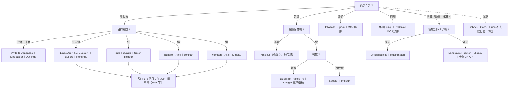

# 00 市售日語學習 APP 分析：總覽

> 本檔是整個系列的入口：說明目的、檔案清單、分類方法，並以一張總表、一張矩陣與一張決策樹彙整 01–04 的內容。
> 本檔所有資訊僅取自同資料夾 01–04 檔（05–07 完成後再回補），不另外新增事實。

---

## 1. README

### 1.1 本系列目的

為 `D:\Coding\日文講義` 的日語學習網站做**市售 APP 深度分析**：拆解市售 APP 的學習方法、介面型態、族群定位與價格，找出「市售 APP 覆蓋不足、本站可以補」的缺口，作為本站題型、介面與新功能設計的依據。

### 1.2 檔案清單

| 檔案 | 一句話說明 |
|---|---|
| [00-總覽.md](00-總覽.md) | 本檔：目的、分類方法、APP 總表、族群×方法×介面矩陣、選 APP 決策樹 |
| [01-APP檔案卡.md](01-APP檔案卡.md) | 46 節 APP 檔案卡，每款列定位、課程結構、複習演算法、題型、主畫面、遊戲化、AI、價格、優缺點、適合族群、來源 |
| [02-學習方法.md](02-學習方法.md) | 11 種學習方法的原理（認知科學／二語習得依據）、適用階段、優缺點、誤用、代表 APP 與旅遊／日檢／商用效益評分 |
| [03-介面種類與流程圖.md](03-介面種類與流程圖.md) | 11 種介面型態的畫面組成、互動步驟、設計陷阱與流程圖，加上 7 款代表 APP 的主流程圖 |
| [04-族群-日檢軸.md](04-族群-日檢軸.md) | 依程度（初學五十音／N5–N4／N3／N2／N1）分析學習者畫像、痛點、題型、APP 組合、每日課表與矩陣 |
| [05-族群-目的軸.md](05-族群-目的軸.md) | 依目的（遊學／商用／旅遊）分析族群需求與 APP 組合 |
| [06-旅遊專業場景.md](06-旅遊專業場景.md) | 14 個旅遊場景（機場、交通、住宿、餐廳、購物、觀光、醫療、緊急、美容美髮、運動戶外、親子長輩、聖地巡禮、自駕、季節活動）的單字、句型、對話腳本與市售 APP 涵蓋度 |
| [07-本站新功能設計.md](07-本站新功能設計.md) | 依 01–06 的缺口，設計本站可新增的功能 |

### 1.3 資料查證日

**2026-11-16**。價格以 App Store 美區 US$ 為主（另有標示者除外）；同一品項常出現多個價位，代表不同時期、促銷或地區方案並存。APP 改版頻繁，細節以實際版本為準。

### 1.4 「（待查證）」標記的意義

凡標「（待查證）」者，表示**未能從官方或可靠一手來源直接確認**的數字、功能或敘述（例如未公開的演算法、未實機確認的主畫面、只有單一第三方來源的價格）。引用時應視為暫定資訊，不可當作確定事實。

---

## 2. 分類方法

### 2.1 學習方法分類（對應 [02](02-學習方法.md) 的 11 種）

| # | 方法 | 一句話 | 旅遊 | 日檢 | 商用 |
|---|---|---|:-:|:-:|:-:|
| M1 | SRS 間隔重複 | 只複習「快忘的」，時間效率最高 | 3 | 5 | 4 |
| M2 | 遊戲化闖關 | 連勝、XP、聯賽維持每日習慣 | 3 | 2 | 1 |
| M3 | 情境對話 | 整句語塊，學了馬上用 | 5 | 2 | 3 |
| M4 | AI 口說 | 無壓力、無限次開口練習 | 4 | 2 | 4 |
| M5 | 沉浸閱讀／影片 | 可理解輸入＋點詞查詢＋句子挖礦 | 3 | 4 | 3 |
| M6 | 新聞精讀 | 書面語、漢語詞，對讀解直接 | 1 | 5 | 4 |
| M7 | 手寫筆順 | 寫得出來；假名階段必備 | 1 | 2 | 1 |
| M8 | 助記法 | 突破卡關字；對中文母語者部分多餘 | 2 | 3 | 2 |
| M9 | 社群語言交換 | 免費母語者回饋 | 4 | 2 | 3 |
| M10 | 題庫刷題 | 直接對應 JLPT 題型 | 1 | 5 | 2 |
| M11 | 歌曲跟唱 | 動機最高，練連音節奏 | 2 | 2 | 1 |

（評分 1–5 出自 02，為依方法特性的綜合判斷，非實驗數據。）

### 2.2 介面種類分類（對應 [03](03-介面種類與流程圖.md) 的 11 型）

| # | 介面型態 | 主練能力 | 辨識或產出 | 代表 APP |
|---|---|---|---|---|
| U1 | 卡片翻牌 | 詞彙、漢字記憶 | 回想（自評） | Anki、WaniKani |
| U2 | 選擇題 | 辨識、應試 | 辨識 | Duolingo、Migii |
| U3 | 拼字塊 | 語序、句型 | 半產出 | Duolingo、LingoDeer |
| U4 | 手寫描字 | 字形產出 | 產出 | Ringotan、Write It! Japanese |
| U5 | 聊天泡泡 | 書面溝通 | 產出 | HelloTalk、Tandem |
| U6 | 關卡樹／地圖 | 動機、順序 | 無 | Duolingo、Busuu |
| U7 | 儀表板／連勝 | 習慣、自我監控 | 無 | WaniKani、Duolingo |
| U8 | 雙字幕影片 | 聽力、真實語料 | 輸入 | Language Reactor、Migaku |
| U9 | 點詞查詢閱讀 | 閱讀、詞彙 | 輸入 | Satori Reader、LingQ |
| U10 | AI 角色扮演 | 口說、反應 | 產出 | Speak、Duolingo Video Call |
| U11 | 歌詞高亮 | 聽辨、片語 | 輸入＋聽寫 | LyricsTraining、Musixmatch |

### 2.3 族群分類

| 軸 | 族群 | 對應檔案 |
|---|---|---|
| 日檢軸（程度） | 初學五十音 → N5–N4 → N3 → N2 → N1 | [04-族群-日檢軸.md](04-族群-日檢軸.md) |
| 目的軸（用途） | 遊學／商用／旅遊 | [05-族群-目的軸.md](05-族群-目的軸.md) |

兩軸可交叉：例如「N5–N4＋旅遊」「N2＋商用」。01 檔案卡的「適合族群」欄即以這 8 個族群標記。

---

## 3. APP 總表

> 一列＝01 的一節檔案卡（合寫的類別算一列）。方法、介面以 2.1／2.2 的名稱填寫，只列主要者。價格為簡寫，完整方案見 01。
> ⚠ **不支援日語**：Babbel、Cake、Lirica（僅作設計參考）。

| # | APP | 類別 | 主要學習方法 | 主要介面 | 價格（簡寫） | 適用族群 |
|---|---|---|---|---|---|---|
| 1 | Duolingo | 綜合課程 | 遊戲化、SRS（半衰期回歸）、AI 口說 | 關卡樹、選擇題、拼字塊、AI 角色扮演（Video Call） | 免費；Super US$12.99/月 | 初學五十音、N5–N4（輔助）、旅遊 |
| 2 | Busuu | 綜合課程（CEFR） | 情境對話、社群交換、SRS | 關卡樹、選擇題、拼字塊、聊天泡泡（批改） | 免費層；年約 US$70–139.99 | 初學五十音、N5–N4、N3、遊學、旅遊 |
| 3 | Babbel ⚠ | 綜合課程 | —（**不支援日語**） | — | 約 US$13.95–17.95/月 | 不適用 |
| 4 | Rosetta Stone | 綜合課程（全沉浸） | 情境對話（圖像沉浸） | 選擇題（看圖）、Unit 卡片網格 | US$19.99/月、US$159/年 | 初學五十音（需另學假名）、N5、旅遊 |
| 5 | Mondly | 綜合課程（主題短課） | 遊戲化、情境對話、AI 口說 | 選擇題、拼字塊、聊天泡泡（Chatbot） | US$9.99/月、US$47.99/年 | 初學五十音（輔助）、N5、旅遊 |
| 6 | LingoDeer | 綜合課程（亞洲語言） | 遊戲化、情境對話、SRS（自評閃卡） | 關卡樹（單元格）、選擇題、拼字塊、卡片翻牌 | US$14.99/月、US$95.99/年 | 初學五十音、N5–N4、旅遊 |
| 7 | Memrise | 單字＋情境 | SRS、遊戲化、AI 口說 | 選擇題、儀表板、聊天泡泡（AI Buddies） | 免費層；US$61.99/年 | 初學五十音、N5–N4、旅遊 |
| 8 | Renshuu | 日語 SRS 全科平台 | SRS、遊戲化、題庫刷題 | 卡片翻牌、選擇題、儀表板 | 免費；pro US$49.99/年 | 初學五十音、N5–N4、N3、N2、N1 |
| 9 | Bunpo | JLPT 文法專攻 | SRS、題庫刷題、遊戲化、AI 口說 | 選擇題、拼字塊、儀表板、AI 角色扮演 | 免費層；Plus US$29.99/年、終身 US$39.99 | 初學五十音、N5–N4、N3、N2、N1 |
| 10 | Migaku | 沉浸工具組 | 沉浸閱讀／影片、SRS | 雙字幕影片、點詞查詢閱讀、卡片翻牌 | US$14/月、US$136.99/年 | N3、N2、N1、遊學 |
| 11 | Human Japanese | 電子教科書 | 教科書講解＋章末測驗（題庫刷題） | 章節目錄、選擇題、筆順動畫 | US$5/月、US$49/年（前 8 章免費） | 初學五十音、N5–N4 |
| 12 | JA Sensei | 全方位工具箱（Android） | SRS、手寫筆順、題庫刷題 | 模組網格、選擇題、手寫描字 | 免費含廣告＋IAP（待查證） | 初學五十音、N5–N4、N3、旅遊 |
| 13 | Nihongo | 辭典＋閃卡（Apple） | SRS、沉浸閱讀（Clippings） | 點詞查詢閱讀、卡片翻牌 | 免費；Pro US$49.99/年 | N5–N4、N3、N2、N1、遊學、旅遊 |
| 14 | Takoboto | 離線辭典 | 查詢工具（SRS 交給 AnkiDroid） | 搜尋列、卡片翻牌（閃卡） | 免費 | N5–N4、N3、N2、N1、旅遊 |
| 15 | Mazii | 辭典＋JLPT 模擬考 | 題庫刷題、新聞精讀、AI 口說 | 選擇題（模擬考）、點詞查詢閱讀 | 免費含廣告；US$49.99/年 | N5–N4、N3、N2、N1、遊學、商用 |
| 16 | MOJi辞書 | 華語圈日語辭典 | SRS（遺忘曲線背詞）、沉浸閱讀（注音） | 點詞查詢閱讀、選擇題、卡片翻牌 | 免費；永久 NT$990 | N5–N4、N3、N2、N1、遊學、商用、旅遊 |
| 17 | Obenkyo | 假名／漢字練習（Android） | 手寫筆順、題庫刷題 | 選擇題、手寫描字 | 免費含廣告 | 初學五十音、N5–N4 |
| 18 | Kana/Kanji Study | 假名＋漢字（Android） | 手寫筆順、SRS（付費加購） | 卡片翻牌、選擇題、手寫描字 | 免費；買斷約 US$12.99 | 初學五十音、N5–N4、N3、N2、N1 |
| 19 | Write It! Japanese | 假名手寫 | 手寫筆順 | 手寫描字 | 免費＋買斷 US$6.99–11.99 | 初學五十音 |
| 20 | Ringotan | 漢字手寫 SRS | 手寫筆順、SRS | 手寫描字 | 免費 | N5–N4、N3、N2（手寫需求） |
| 21 | WaniKani | 漢字助記 SRS（網站） | 助記法、SRS | 卡片翻牌（打字作答）、儀表板 | 終身 US$299；月 US$9（待查證） | N5–N4、N3、N2、N1（漢字閱讀） |
| 22 | Kanji Garden | 漢字 SRS（形近字） | SRS、遊戲化（輕度） | 選擇題、儀表板（進度花園） | 免費；付費金額待查證 | N5–N4、N3、N2、N1 |
| 23 | Anki | 通用閃卡 SRS | SRS（FSRS） | 卡片翻牌、儀表板（統計） | 免費；iOS 買斷 US$24.99 | 初學五十音、N5–N4、N3、N2、N1 |
| 24 | jpdb | 作品語料 SRS（網站） | SRS、沉浸閱讀／影片 | 卡片翻牌 | 免費；Patreon（待查證） | N5–N4、N3、N2、N1 |
| 25 | Bunpro | 文法 SRS | SRS、題庫刷題 | 卡片翻牌（填空輸入）、儀表板 | US$5/月、終身 US$150 | N5–N4、N3、N2、N1 |
| 26 | Speak | AI 口說 | AI 口說、情境對話 | AI 角色扮演 | US$17.99/月、US$83.99/年起 | N5–N4、N3、遊學、旅遊 |
| 27 | Praktika | AI 家教 | AI 口說 | AI 角色扮演、卡片翻牌 | US$9.99/月、US$59.99/年起 | N4、N3、旅遊、商用 |
| 28 | Pimsleur | 音檔課程 | 情境對話（分級間隔回想） | 純音訊（不屬 03 的 11 型） | US$19.95–20.95/月 | 初學五十音、N5–N4、旅遊 |
| 29 | HelloTalk | 語言交換 | 社群語言交換 | 聊天泡泡 | 免費；VIP US$45.99/年 | N4、N3、N2、遊學 |
| 30 | Tandem | 語言交換 | 社群語言交換 | 聊天泡泡 | 免費；Pro 約 US$79.99/年（第三方） | N4、N3、N2、遊學 |
| 31 | Cake ⚠ | 短影片學英韓 | —（**不支援日語**） | — | Plus US$13.99/月 | 不適用 |
| 32 | NHK NEWS WEB EASY | 簡易新聞（網頁） | 新聞精讀 | 點詞查詢閱讀 | 免費 | N4、N3 |
| 33 | Todaii | 新聞閱讀＋JLPT | 新聞精讀、題庫刷題、SRS（閃卡） | 點詞查詢閱讀、選擇題 | 免費含廣告；Premium US$39.99 | N5–N4、N3、N2 |
| 34 | Satori Reader | 中級分級讀物 | 沉浸閱讀、SRS | 點詞查詢閱讀、卡片翻牌 | US$8.99/月、US$89.99/年 | N4、N3、N2 |
| 35 | LingQ | 大量輸入閱讀 | 沉浸閱讀／影片 | 點詞查詢閱讀、儀表板（已知詞數） | US$14.99/月、US$119.99/年 | N4、N3、N2、N1 |
| 36 | Yomitan | 瀏覽器查詞擴充 | 沉浸閱讀（搭 Anki 做 SRS） | 點詞查詢閱讀（懸停彈窗） | 免費（開源） | N4、N3、N2、N1 |
| 37 | Language Reactor | 影片雙字幕擴充 | 沉浸影片 | 雙字幕影片 | 免費；Pro 約 US$5/月 | N3、N2、N1 |
| 38 | JLPT 題庫類（Migii、Kaopiz JLPT Test 等） | JLPT 模擬考 | 題庫刷題 | 選擇題 | Migii US$39.99/年、終身 US$119.99 | N5–N4、N3、N2、N1 |
| 39 | 商務日語類（檸檬樹商務會話篇、Business Japanese） | 商務會話 | 情境對話 | 音檔＋中日對照閱讀（不屬 03 主流型） | 免費／IAP US$0.99 | 商用、N3、N2 |
| 40 | VoiceTra | 語音翻譯工具 | 非學習工具（翻譯） | — | 免費 | 旅遊、遊學 |
| 41 | Google 翻譯相機 | 相機翻譯工具 | 非學習工具（翻譯） | — | 免費 | 旅遊、遊學 |
| 42 | LyricsTraining | 歌曲填空遊戲 | 歌曲跟唱、遊戲化 | 歌詞高亮 | 免費每日 3 局；US$29.99/年起 | 初學五十音（聽力啟蒙）、N5–N4 |
| 43 | Musixmatch | 同步歌詞 | 歌曲跟唱 | 歌詞高亮 | 免費；US$35.99/年 | N5–N4、N3（歌曲興趣） |
| 44 | Lirica ⚠ | 歌曲學文法 | —（**不支援日語**） | — | US$8.49/月起 | 不適用 |
| 45 | Smule | 社群卡拉OK | 歌曲跟唱、社群 | 歌詞高亮 | VIP US$9.99/月起 | N4、N3（歌曲興趣） |
| 46 | 卡拉OK APP（JOYSOUND／DAM） | 卡拉OK 採點 | 歌曲跟唱 | 歌詞高亮＋音程評分 | JOYSOUND ¥580/月；DAM 30 日 ¥1,100 | N3、N2、遊學（歌曲興趣） |

**合計 46 列**（其中 3 款不支援日語、2 款為翻譯工具、1 款網頁新聞、2 列為合寫類別）。

---

## 4. 族群 × 方法 × 介面矩陣

> 日檢軸 5 列依 [04](04-族群-日檢軸.md) 第 6 節矩陣；目的軸 3 列依 [02](02-學習方法.md)「依目標推薦組合」與 01 的「適合族群」欄綜合（05 完成後以 05 為準）。首推 APP 限 3 款以內。

| 族群 | 主要方法 | 主要介面 | 首推 APP 組合（≤3） |
|---|---|---|---|
| 初學五十音 | 手寫筆順＋助記法＋SRS＋遊戲化（維持習慣） | 手寫描字、卡片翻牌、選擇題（看字選音／聽音選字）、儀表板（46 格進度） | Write It! Japanese、LingoDeer、Duolingo |
| N5–N4 | SRS（單字＋文法）＋情境對話＋遊戲化＋考前題庫 | 選擇題、拼字塊（重組句）、卡片翻牌（變形輸入）、儀表板（每日任務） | LingoDeer（或 Busuu）、Bunpro、Renshuu |
| N3 | SRS（i+1 例句卡）＋沉浸閱讀／影片＋新聞精讀＋社群交換 | 點詞查詢閱讀、雙字幕影片、卡片翻牌 | jpdb、Bunpro、Satori Reader |
| N2 | SRS（新聞句子挖掘）＋新聞精讀＋題庫刷題（計時、模擬考倒推） | 點詞查詢閱讀（瀏覽器彈出字典）、選擇題（計時）、儀表板（弱項） | Bunpro、Anki＋Yomitan |
| N1 | 沉浸閱讀／影片（原生素材）＋SRS（句子卡）＋新聞精讀 | 點詞查詢閱讀（零干擾）、雙字幕影片、卡片翻牌 | Yomitan＋Anki、Migaku |
| 遊學 | 社群語言交換＋AI 口說＋情境對話＋SRS | 聊天泡泡、AI 角色扮演、點詞查詢閱讀 | HelloTalk、Speak、MOJi辞書 |
| 商用 | SRS（敬語、業界詞）＋新聞精讀＋AI 口說（會議／電話）＋真人交換 | 卡片翻牌、點詞查詢閱讀、AI 角色扮演 | 商務日語類（檸檬樹商務會話篇）、Praktika、MOJi辞書 |
| 旅遊 | 情境對話（主）＋AI 口說＋SRS（旅遊詞 300–500）＋遊戲化 | 關卡樹／地圖、AI 角色扮演、選擇題 | Pimsleur、Speak、Duolingo |

補充：旅遊、遊學在日本當地另可搭配翻譯工具 **VoiceTra**、**Google 翻譯相機**（非學習工具，不列入首推）。Praktika 有「日語發音辨識不準」的評論（見 01），商用口說亦可改用 Speak。

---

## 5. 選 APP 決策樹

