# 03 市售日語學習 APP：介面種類與流程圖

> 範圍：拆解 11 種常見學習介面型態（畫面組成、互動步驟、適合練的能力、設計重點與陷阱、代表 APP、流程圖），再以 7 款代表 APP 繪製「開啟 APP → 完成一次學習循環」的主流程圖。
> 流程圖依官方說明與公開評論整理，APP 改版頻繁，細節以實際版本為準；不確定處標「（待查證）」。
> 查證日期：2026-11。

---

## 目錄

**A. 介面型態**
1. 卡片翻牌
2. 選擇題
3. 拼字塊（Word Bank）
4. 手寫描字
5. 聊天泡泡
6. 關卡樹／地圖
7. 儀表板／連勝
8. 雙字幕影片
9. 點詞查詢閱讀
10. AI 角色扮演
11. 歌詞高亮

**B. 代表 APP 主流程圖**
12. Duolingo
13. WaniKani
14. Anki
15. Speak
16. Busuu
17. LyricsTraining
18. Migaku

**C. 介面型態總覽表**

---

# A. 介面型態

## 1. 卡片翻牌（Flashcard Flip）

### 畫面組成（由上到下）
1. 頂列：返回、牌組名稱、今日剩餘張數（新卡／學習中／到期，三色數字）。
2. 進度條：本輪完成比例。
3. 卡片正面：大字題目（漢字或單字），可選擇顯示假名注音、圖片。
4. 音檔按鈕（自動或手動播放）。
5. 「顯示答案」大按鈕（佔滿底部，拇指好按）。
6. 翻面後：背面（讀音、意義、例句、音檔）＋ 4 個評分鈕（重來／困難／良好／簡單），每顆鈕上方顯示「下次出現時間」。

### 互動步驟
1. 看正面 → 心中（或出聲）回想答案。
2. 點「顯示答案」或空白鍵。
3. 比對答案 → 自評。
4. 系統依評分排定下次時間 → 下一張。
5. 全部到期卡完成 → 顯示「今日完成」與統計。

### 適合練的能力
詞彙記憶（辨識與回想）、漢字讀音、意義連結；加入聽音卡可練聽辨。

### 設計重點與陷阱
- **重點**：評分鈕顯示下次間隔，讓使用者理解後果；支援鍵盤快捷鍵；一張卡只放一個知識點。
- **重點**：可切換卡片方向（日→中、中→日、音→義）。
- **陷阱**：自評太寬鬆（沒想出來也按「良好」）→ 可加「打字作答」選項。
- **陷阱**：4 個評分鈕造成選擇負擔；初學者可簡化為「記得／不記得」兩鈕。
- **陷阱**：背面資訊過多，翻面後閱讀時間過長，降低節奏。

### 代表 APP
Anki、WaniKani（打字作答版）、Bunpro、Renshuu、Quizlet。

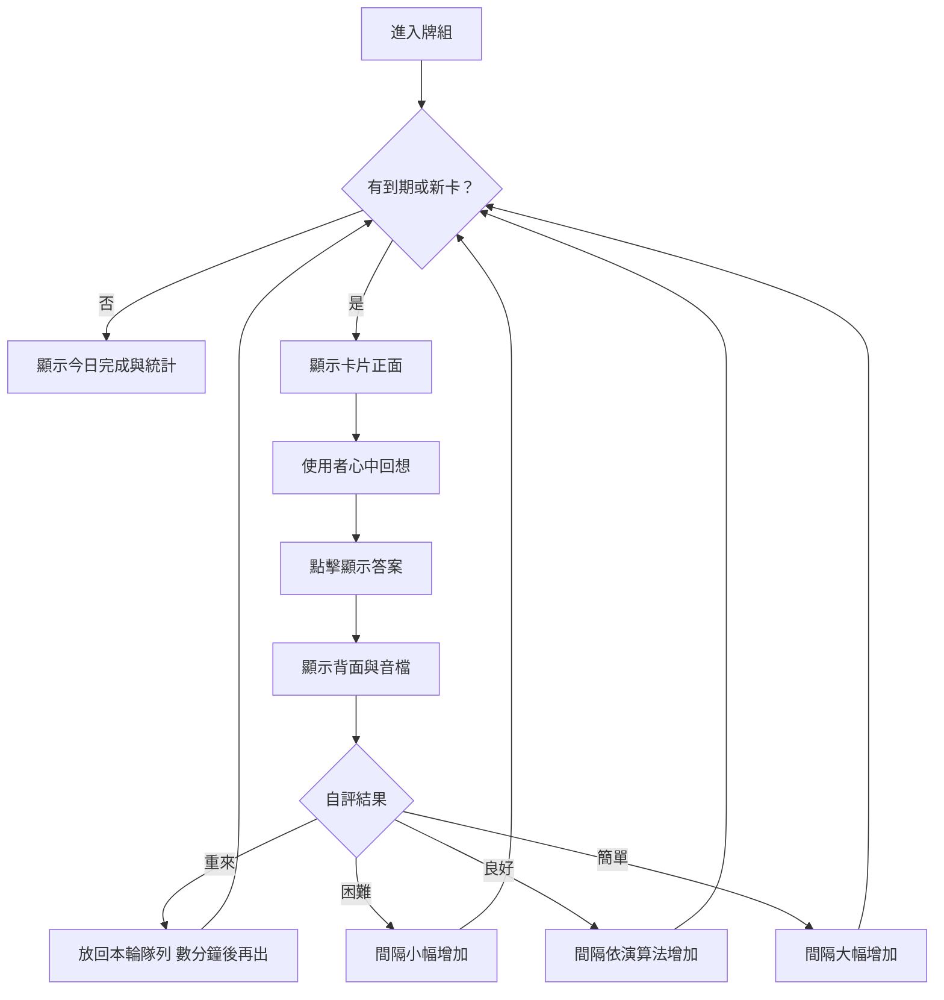

---

## 2. 選擇題（Multiple Choice）

### 畫面組成（由上到下）
1. 頂列：關閉、進度條、剩餘生命／能量（若有）。
2. 題型說明：「選出正確的意思」「聽音選字」。
3. 題幹：文字、圖片或播放鈕。
4. 選項區：2–4 個大按鈕（文字或圖卡），垂直或 2×2 排列。
5. 底部「確認」鈕。
6. 回饋列：答對綠色／答錯紅色＋正確答案＋「繼續」。

### 互動步驟
1. 閱讀或聆聽題幹。
2. 點選一個選項（可改選）。
3. 按「確認」。
4. 看回饋（對：音效＋綠；錯：顯示正解與說明）。
5. 按「繼續」進下一題；答錯題目會在本輪後段再出現。

### 適合練的能力
辨識型詞彙、聽音辨字、文法判斷、JLPT 題型熟悉度。

### 設計重點與陷阱
- **重點**：誘答選項要「似是而非」（同音異字、近形字、相近文法），否則變成刪去法遊戲。
- **重點**：答錯要顯示「為什麼錯」，不只顯示正解。
- **陷阱**：選項永遠固定在同一位置或同一組合，使用者靠位置記答案。
- **陷阱**：選擇題只練辨識，無法反映產出能力；應與打字、口說題穿插。
- **陷阱**：選項太少（2 個）時猜對率 50%，回饋失真。

### 代表 APP
Duolingo、Migii JLPT、LingoDeer、Mikan、Drops。

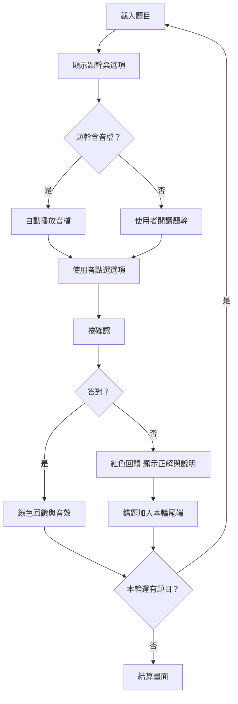

---

## 3. 拼字塊（Word Bank）

### 畫面組成（由上到下）
1. 頂列：關閉、進度條、生命／能量。
2. 題型說明：「翻譯這句話」。
3. 原句（母語或日語），可點播音檔；角色插圖。
4. 作答線：空白橫線，已選的字塊排在線上。
5. 字塊庫：打亂的單字／假名塊（含干擾塊），可點選上移。
6. 底部「確認」鈕；部分 APP 提供「改用鍵盤」切換。

### 互動步驟
1. 讀原句。
2. 依序點字塊，字塊移到作答線。
3. 點作答線上的字塊可退回。
4. 按「確認」→ 比對（常容許多種正確語序）。
5. 回饋＋顯示最佳答案。

### 適合練的能力
語序（日語 SOV、助詞位置）、句型組裝、初階翻譯；是「選擇題」與「自由輸入」之間的鷹架。

### 設計重點與陷阱
- **重點**：干擾塊應針對常見錯誤（は／が、に／で、時態）。
- **重點**：接受多種正確語序與省略（日語主語常省略）。
- **陷阱**：字塊切太大（整個片語一塊）就只剩排序，沒練到助詞。
- **陷阱**：使用者用「消去法」：剩下的塊一定要用，靠字塊數量推答案。
- **陷阱**：日語不以空白分詞，字塊切分方式本身會暗示文法結構，需一致。

### 代表 APP
Duolingo、LingoDeer、Busuu、Mondly、Memrise。

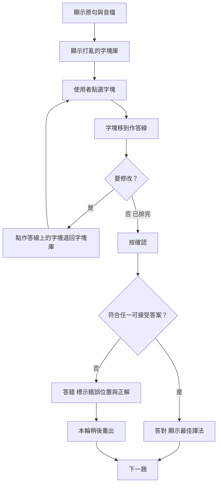

---

## 4. 手寫描字（Handwriting / Tracing）

### 畫面組成（由上到下）
1. 頂列：返回、字數進度。
2. 提示區：讀音、意義（默寫模式時只給這些）。
3. 書寫格：米字格或田字格；描寫模式顯示淡灰字型與筆順數字。
4. 筆順動畫鈕、清除鈕、提示鈕。
5. 回饋：每一筆寫完即判斷（筆畫方向、順序、位置），錯誤筆畫閃紅。
6. 底部：「下一字」或自評鈕。

### 互動步驟
1. 看筆順動畫（第一次學）。
2. 描寫：沿灰字寫。
3. 半提示：只顯示部分筆畫。
4. 默寫：只給讀音／意義，從空白格寫出。
5. 系統逐筆判定 → 錯 3 次自動顯示提示 → 進 SRS 排程。

### 適合練的能力
字形產出（寫得出來）、筆順、部件結構、假名區辨（シ／ツ、ソ／ン）。

### 設計重點與陷阱
- **重點**：從描→半描→默寫逐步撤除鷹架。
- **重點**：逐筆即時回饋比整字判定更有教學價值。
- **陷阱**：手指在小螢幕上寫難以控制比例，辨識誤判打擊信心；應支援觸控筆、放大格子。
- **陷阱**：判定過嚴（要求「止、跳、撇」）會讓初學者挫折；過鬆則學不到正確筆順。
- **陷阱**：只描不默寫，等於臨摹，回想效益低。

### 代表 APP
Skritter、Ringotan、Kanji Study、Japanese!（Obenkyo）、Write It! Japanese。

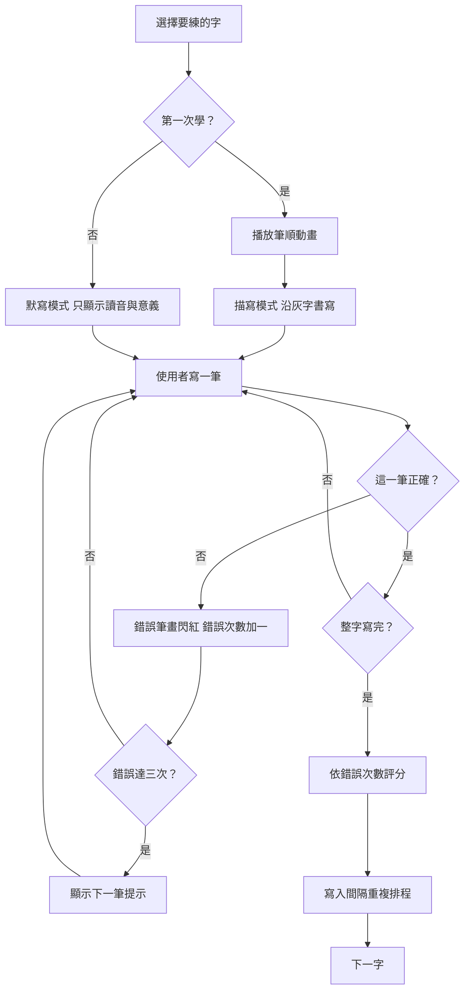

---

## 5. 聊天泡泡（Chat Bubble）

### 畫面組成（由上到下）
1. 頂列：對話對象（真人頭像或角色）、上線狀態、通話鈕。
2. 訊息流：左側對方泡泡、右側自己泡泡；泡泡下方小工具（翻譯、播放、修正、收藏）。
3. 修正訊息樣式：原句刪除線＋修正後文字（如 HelloTalk 的 Correct）。
4. 輸入列：文字框、語音鈕、貼圖、翻譯輔助鈕。
5. 建議回覆晶片（部分 APP 提供）。

### 互動步驟
1. 讀對方訊息；不懂則長按 → 翻譯／音譯／發音。
2. 撰寫回覆（可先寫中文再用翻譯輔助，但建議自寫）。
3. 送出；對方可長按你的訊息 → 修正 → 你收到修正版。
4. 收藏修正或生詞 → 匯入單字本。

### 適合練的能力
書面口語、即時寫作、閱讀真實訊息、社交用語；語音訊息可練口說。

### 設計重點與陷阱
- **重點**：修正功能要內建在訊息上，而不是另開頁面，降低修正成本。
- **重點**：翻譯鈕應「預設隱藏、點了才顯示」，避免依賴。
- **陷阱**：內建翻譯太方便 → 雙方都用翻譯溝通，練習失效。
- **陷阱**：真人聊天的安全問題（騷擾、詐騙），需有檢舉與過濾。
- **陷阱**：與 AI 的聊天泡泡若沒有修正層，等於只是聊天。

### 代表 APP
HelloTalk、Tandem、Busuu（社群批改呈現）、Duolingo（故事與部分練習以對話泡泡呈現）、LINE 類模擬對話教材。

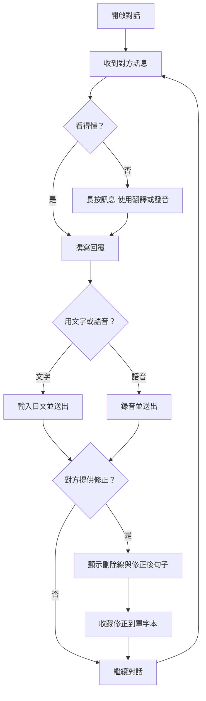

---

## 6. 關卡樹／地圖（Skill Tree / Path Map）

### 畫面組成（由上到下）
1. 頂列：語言旗幟、連勝火焰、寶石／貨幣、生命／能量。
2. 單元標題列：「單元 3：點餐」＋單元講義鈕。
3. 路徑：垂直蜿蜒的節點（圓形關卡），狀態分為已完成（金色）／目前（發光）／鎖定（灰）。
4. 特殊節點：寶箱、故事、單元測驗、複習。
5. 角色插圖穿插於路徑兩側。
6. 底部導覽列：學習、練習、排行榜、任務、個人。

### 互動步驟
1. 開啟即捲動到「目前節點」。
2. 點節點 → 彈出卡片（課名、XP、開始鈕）。
3. 完成課程 → 節點進度＋1 → 全部完成後解鎖下一節點。
4. 可選「跳級測驗」跳過已會的單元。

### 適合練的能力
不直接練能力；負責「學習順序」與「進度可視化」，維持動機。

### 設計重點與陷阱
- **重點**：單一路徑降低選擇負擔（Duolingo 2022 年由樹狀改為單一路徑）。
- **重點**：每個節點要對應明確的能力目標（例：能在餐廳點餐），而非只是課號。
- **陷阱**：路徑太長、看不到終點 → 長期疲乏。
- **陷阱**：完成節點不代表掌握；需要穿插複習節點與間隔重複。
- **陷阱**：鎖死順序讓已有基礎者無聊，必須提供跳級。

### 代表 APP
Duolingo、LingoDeer、Busuu、Mondly、Renshuu（任務地圖）。

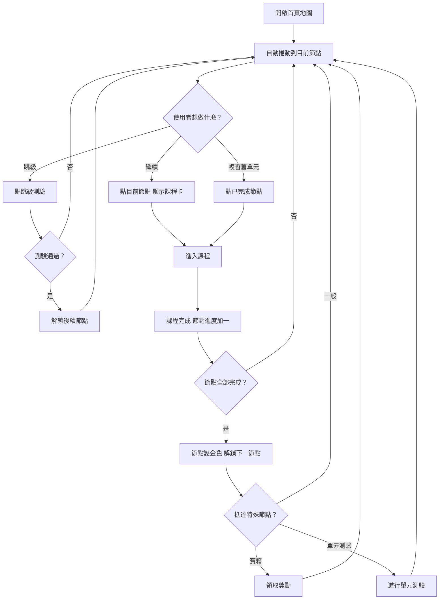

---

## 7. 儀表板／連勝（Dashboard / Streak）

### 畫面組成（由上到下）
1. 問候列：「早安，今天還有 45 張複習」。
2. 主要數字：連勝天數（火焰）、今日目標進度環。
3. 今日待辦卡：複習 N 張、新課 M 課，各附大按鈕。
4. 圖表：近 7／30 日學習量長條圖、熱力圖（GitHub 樣式）、保留率。
5. 等級／階段分布（例：WaniKani 的 Apprentice／Guru／Master／Enlightened／Burned 數量）。
6. 未來預測：「明天到期 120 張」。
7. 成就徽章、排行榜入口。

### 互動步驟
1. 開啟 → 一眼看到「今天要做什麼」。
2. 點待辦卡進入學習。
3. 完成後回到儀表板 → 進度環填滿、連勝＋1 動畫。
4. 中斷時：連勝凍結道具／補簽、提醒推播。

### 適合練的能力
不直接練語言；負責習慣養成、自我監控（metacognition）與工作量管理。

### 設計重點與陷阱
- **重點**：把「下一步」放最上面，統計放下面。
- **重點**：顯示「未來到期量」讓使用者控制新卡數，避免複習債。
- **陷阱**：連勝焦慮 → 只做最低量保火，或斷掉後直接放棄（「what-the-hell 效應」）。應提供凍結、補簽、以週為單位的目標。
- **陷阱**：堆滿圖表但沒有行動建議。
- **陷阱**：以「學習分鐘」為指標鼓勵拖時間，應以完成項目或保留率為主。

### 代表 APP
WaniKani、Duolingo、Anki（統計頁）、Bunpro、Renshuu。

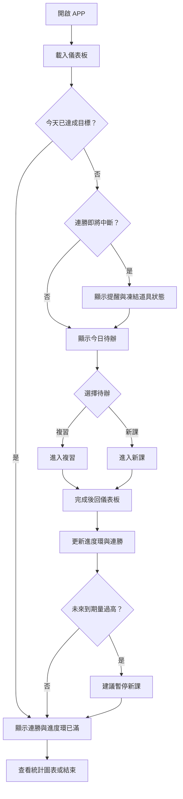

---

## 8. 雙字幕影片（Dual-Subtitle Video）

### 畫面組成（由上到下）
1. 影片播放區（Netflix／YouTube 原生播放器）。
2. 字幕區（疊在影片下方）：上排日文字幕（可加假名注音、詞彙依熟悉度著色），下排中文／英文字幕（可模糊、點擊才顯示）。
3. 控制列：上一句／重播本句／下一句、自動暫停（每句結束暫停）、播放速度。
4. 側邊欄：整集字幕清單（可點跳轉）、已存詞彙。
5. 查詞彈窗：點字幕詞 → 讀音、意義、加入卡片。

### 互動步驟
1. 選片 → 開啟日文＋母語字幕。
2. 播放；不懂時按「重播本句」。
3. 點日文字幕中的詞 → 查詞 → 加入卡片。
4. 熟悉後把母語字幕改為「模糊」，再進一步關閉。

### 適合練的能力
聽力、真實口語、詞彙偶發學習、句子挖礦。

### 設計重點與陷阱
- **重點**：母語字幕預設模糊、需主動點開，避免只讀母語字幕。
- **重點**：逐句重播與自動暫停是核心功能。
- **陷阱**：字幕時間軸與語音不同步，造成誤學。
- **陷阱**：平台改版導致擴充失效；需持續維護。
- **陷阱**：兩行字幕同時顯示，視線一直停在母語行。

### 代表 APP
Language Reactor、Migaku、Animelon（現況待查證）、FluentAI、Netflix 原生字幕。

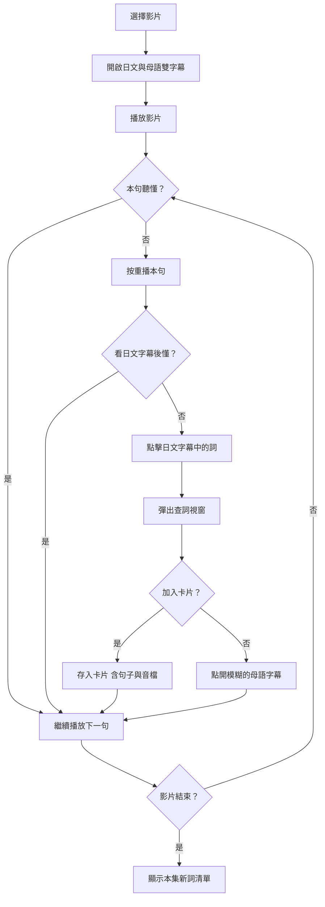

---

## 9. 點詞查詢閱讀（Tap-to-Lookup Reader）

### 畫面組成（由上到下）
1. 頂列：返回、標題、注音開關（全部／只生詞／無）、字級。
2. 音檔播放列（全文朗讀或逐句）。
3. 本文：詞彙依狀態著色（未知＝藍、學習中＝黃、已知＝無色，LingQ 類）。
4. 點詞後底部抽屜：讀音、詞性、意義、JLPT 級別、例句、「加入卡片」「標為已知」。
5. 段落末：逐句翻譯／解說展開鈕（Satori Reader 類）。
6. 文末：理解測驗、本篇生詞數、標記完成。

### 互動步驟
1. 選文章（依級別、主題）。
2. 閱讀；遇到生詞點擊 → 底部抽屜顯示解釋。
3. 標記狀態（已知／學習中）或加入 SRS。
4. 不懂整句時展開翻譯／文法解說。
5. 讀完 → 未點的藍字可「一鍵全部標為已知」→ 更新詞彙量統計。

### 適合練的能力
閱讀理解、詞彙擴充、文法在語境中的辨識、讀解速度。

### 設計重點與陷阱
- **重點**：日語無空白，斷詞（形態素解析）品質決定體驗；需能手動調整範圍（例：選取「〜てしまう」整段）。
- **重點**：注音可依熟悉度自動隱藏。
- **陷阱**：「一鍵全部標已知」誤標，使統計失真。
- **陷阱**：點詞太方便 → 每字都點，失去推測語意的練習。
- **陷阱**：活用形查詢需還原原形（食べさせられた → 食べる），否則查無結果。

### 代表 APP
Satori Reader、LingQ、Todaii、NHK NEWS WEB EASY（網頁辭書功能）、Yomitan（瀏覽器擴充）。

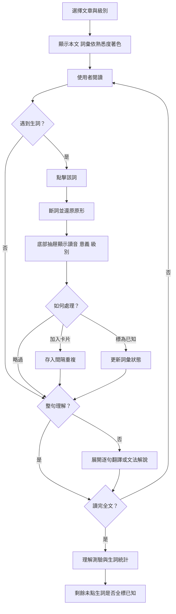

---

## 10. AI 角色扮演（AI Roleplay）

### 畫面組成（由上到下）
1. 情境卡：場景插圖、角色身分（如「你在拉麵店點餐，店員是 AI」）、任務清單（點一碗拉麵、加麵、結帳）。
2. 對話區：AI 角色泡泡（附音檔、可顯示假名／翻譯）、使用者語音轉文字泡泡。
3. 即時提示：卡住時「提示」鈕給 2–3 個建議句。
4. 麥克風大按鈕（按住說話或自動偵測）；文字輸入備援。
5. 任務進度勾選。
6. 結束後回饋頁：發音分數、文法錯誤列表、更自然的說法、生詞收藏。

### 互動步驟
1. 讀情境與任務。
2. AI 先開口 → 使用者回應（語音）。
3. ASR 轉文字 → LLM 判斷意圖、推進劇情；若不理解，AI 以角色身分追問（意義協商）。
4. 卡住 → 點提示。
5. 任務全部完成或達回合上限 → 回饋報告 → 可重來同情境。

### 適合練的能力
口說流利度、即時反應、情境用語、聽力；商務場景可練敬語。

### 設計重點與陷阱
- **重點**：明確任務清單讓對話有方向，比自由聊天更適合初中級。
- **重點**：回饋放在結束後（不中斷對話），但可選擇即時糾正模式。
- **陷阱**：ASR 把錯誤發音「猜對」，使用者以為自己說得好。
- **陷阱**：LLM 生成不自然或錯誤日語、敬語層級不一致。
- **陷阱**：AI 太遷就，任何回答都能過關，缺乏挑戰。

### 代表 APP
Speak、Duolingo（Video Call；Roleplay 日語尚未支援，詳見 02 文件）、Talkpal、Langua、Praktika（日語支援待查證）。

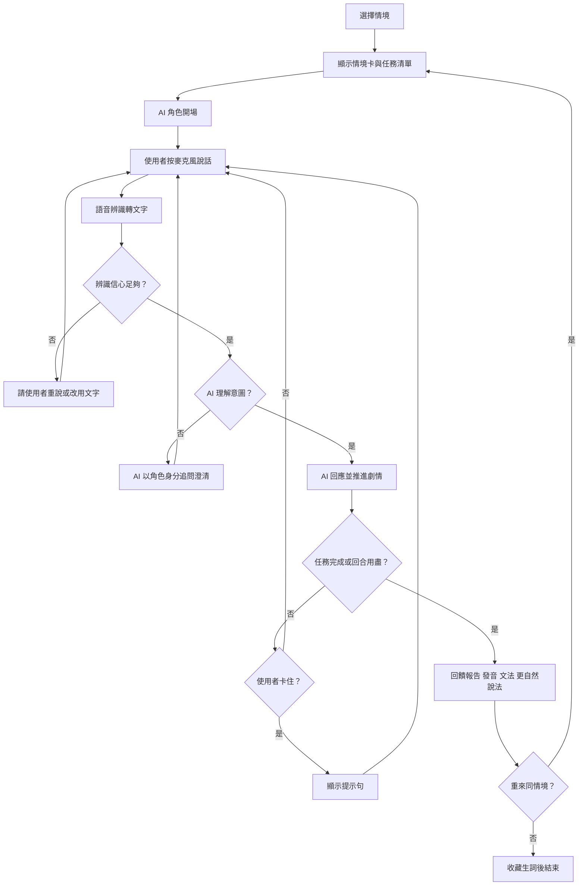

---

## 11. 歌詞高亮（Lyrics Highlight / Karaoke）

### 畫面組成（由上到下）
1. 影片／專輯封面區（MV 播放）。
2. 目前歌詞行：大字、逐字或逐句高亮（卡拉 OK 樣式），可附假名注音。
3. 前後歌詞行：較淡顯示。
4. 翻譯行（可隱藏）。
5. 遊戲模式時：挖空格（底線）＋選項或輸入框。
6. 控制列：重播本句、跳過、速度；分數與連擊。

### 互動步驟
1. 選歌 → 選模式（純跟唱／填空）與難度。
2. 播放，歌詞隨音樂高亮。
3. 填空模式：遇到空格時影片暫停 → 輸入或選擇 → 正確則繼續。
4. 跟唱模式：跟著高亮唱，部分 APP 有錄音評分（待查證）。
5. 結束 → 分數、正確率、排行。

### 適合練的能力
語音辨識（連音、促音）、假名讀速、片語記憶、聽寫。

### 設計重點與陷阱
- **重點**：歌詞時間軸要精準到詞或句，否則高亮失去意義。
- **重點**：挖空難度分級（如 LyricsTraining 的 10%／25%／50%／100%）。
- **陷阱**：日語輸入法（IME）在限時填空中操作慢，應提供假名鍵盤或選擇模式。
- **陷阱**：漢字／假名寫法不同（君／きみ）被判錯，需容許多種寫法。
- **陷阱**：版權限制造成曲庫冷門、地區無法播放。

### 代表 APP
LyricsTraining、Musixmatch、Spotify（歌詞同步，非學習用）、Language Reactor（YouTube MV）、LingoClip。

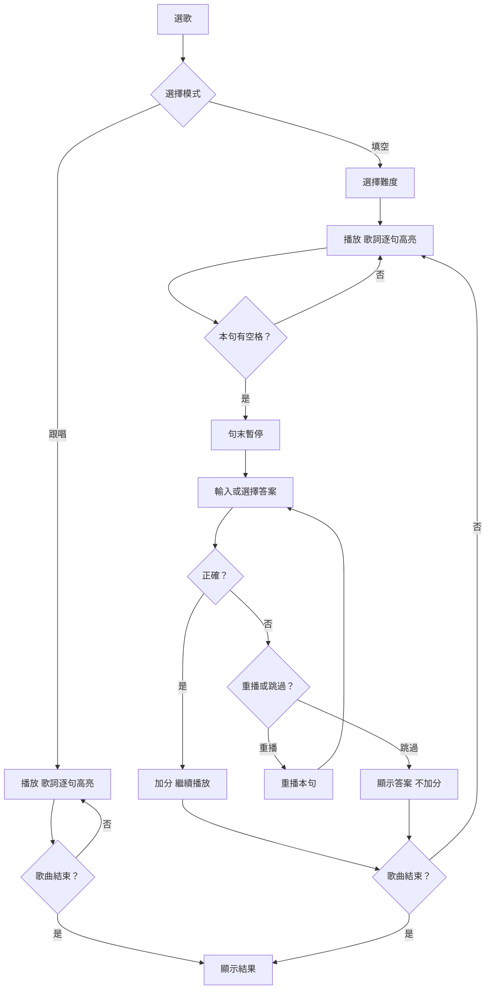

---

# B. 代表 APP 主流程圖

> 每張圖描述「開啟 APP → 完成一次學習循環」，含主要分支。

## 12. Duolingo

**循環要點**：單一路徑地圖 → 5 分鐘左右的課程（選擇題、拼字塊、聽寫、口說混合）→ XP、連勝、聯賽。答錯會消耗愛心或能量（依帳號版本與訂閱而異，**目前機制待查證**）；Super／Max 訂閱者不受限。
**來源**：Duolingo 官方部落格 <https://blog.duolingo.com/>；Video Call <https://blog.duolingo.com/video-call>

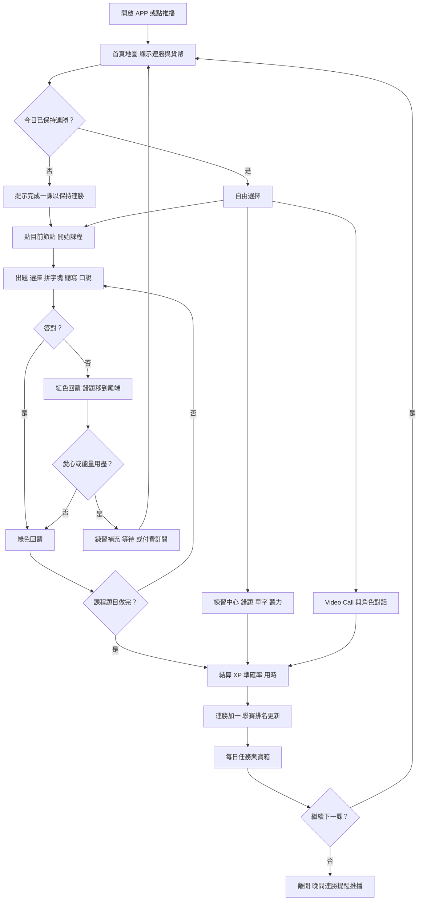

---

## 13. WaniKani

**循環要點**：先做「複習」再做「課程」。複習需分別輸入「意義」（英文）與「讀音」（假名，內建羅馬字轉假名）；答錯降階。當前等級 90% 漢字達 Guru 即升級、解鎖下一批部首與漢字。
**來源**：SRS 階段 <https://knowledge.wanikani.com/wanikani/srs-stages/>；升級條件細節以官方知識庫為準（待查證）。

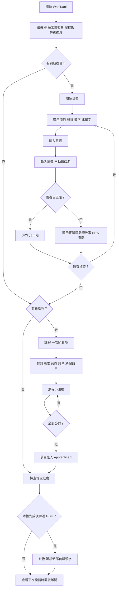

---

## 14. Anki

**循環要點**：牌組清單 → 學習到期卡 → 四鍵自評 → 演算法（SM-2 或 FSRS）排程 → 同步到 AnkiWeb。可另開「新增卡片」與「瀏覽」分支。
**來源**：Anki 手冊 <https://docs.ankiweb.net/>；FSRS <https://github.com/open-spaced-repetition/fsrs4anki>

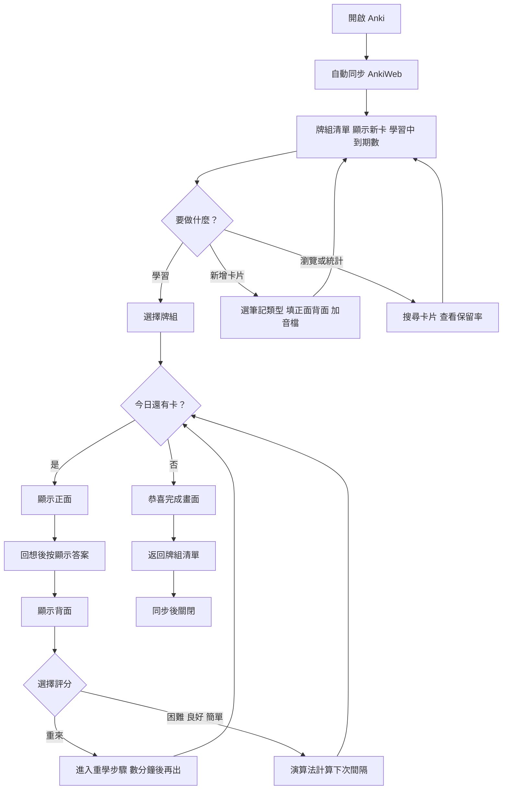

---

## 15. Speak

**循環要點**：每日課程以「聽 → 跟說 → 語音辨識回饋」為主，再進入 AI 家教自由對話或角色扮演；重點是開口量。官方列出支援日語。
**來源**：<https://www.speak.com/>；App Store 說明 <https://apps.apple.com/us/app/-/id1286609883>；課程細部結構（待查證）。

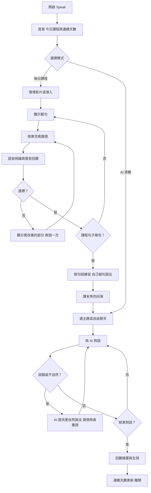

---

## 16. Busuu

**循環要點**：學習計畫 → 課程（單字、對話、文法、練習）→ 寫作／口說練習送社群母語者批改 → 收到批改 → 智慧複習；同時可批改別人的母語作業（互惠）。
**來源**：<https://www.busuu.com/en/how-to/corrections>、<https://www.busuu.com/en/how-to/help-others>

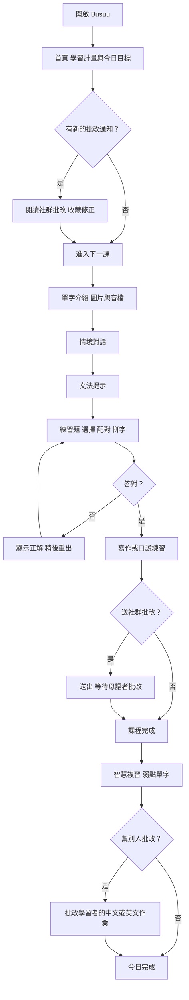

---

## 17. LyricsTraining

**循環要點**：選語言（日語）→ 選歌 → 選模式（Play 遊戲／Karaoke）→ 難度（約 10%／25%／50%／100% 挖空）→ 書寫或選擇模式 → 句末暫停作答 → 分數與排行。
**來源**：<https://lyricstraining.com/>；模式說明 <https://fltmag.com/lyricstraining/>、<https://teachersfirst.org/blog/2023/08/tech-tool-of-the-month-lyricstraining-part-2/>；快捷鍵細節（待查證）。

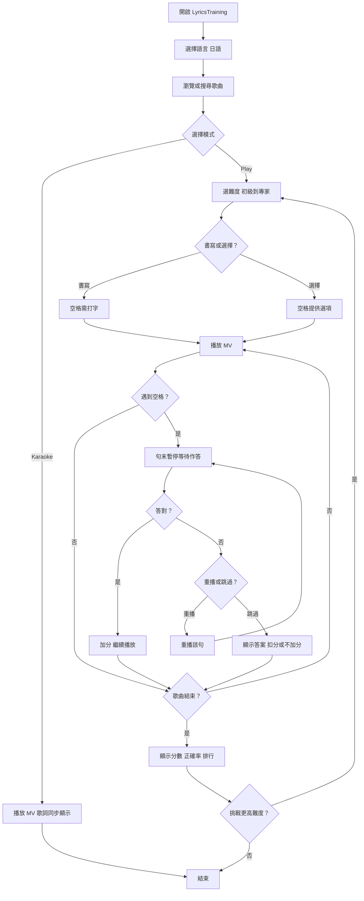

---

## 18. Migaku

**循環要點**：在 Netflix／YouTube 等串流平台開啟擴充 → 日文字幕斷詞並依熟悉度著色 → 點詞查詢 → 一鍵（或懸停按 Q）建卡，含句子、截圖、音檔 → 卡片進 Migaku Memory 或 Anki → SRS 複習 → 詞彙狀態回寫，下次看片時顏色更新。
**來源**：<https://migaku.com/blog/youtube/card-creation-from-video-content-migaku-browser-extension>；新版與舊版（Legacy）功能差異（待查證）。

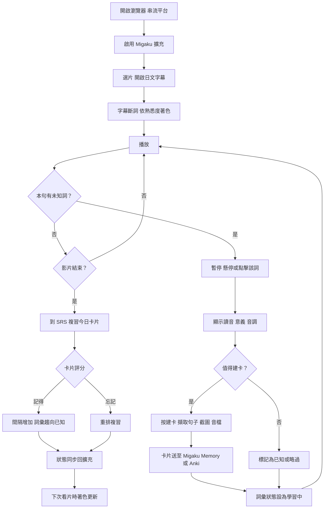

---

# C. 介面型態總覽表

| # | 介面型態 | 主練能力 | 互動成本 | 屬辨識或產出 | 適用階段 | 最大陷阱 | 代表 APP |
|---|---|---|:-:|---|---|---|---|
| 1 | 卡片翻牌 | 詞彙、漢字記憶 | 低 | 回想（自評） | 全階段 | 自評過寬 | Anki、WaniKani |
| 2 | 選擇題 | 辨識、應試 | 低 | 辨識 | 全階段 | 誘答太弱 | Duolingo、Migii |
| 3 | 拼字塊 | 語序、句型 | 低 | 半產出 | 入門–初級 | 消去法猜題 | Duolingo、LingoDeer |
| 4 | 手寫描字 | 字形產出 | 高 | 產出 | 入門（假名） | 只描不默寫 | Skritter、Ringotan |
| 5 | 聊天泡泡 | 書面溝通 | 中 | 產出 | 初級後段起 | 依賴翻譯 | HelloTalk、Tandem |
| 6 | 關卡樹／地圖 | 動機、順序 | 低 | 無 | 入門–中級 | 完成≠掌握 | Duolingo、Busuu |
| 7 | 儀表板／連勝 | 習慣、自我監控 | 低 | 無 | 全階段 | 連勝焦慮 | WaniKani、Duolingo |
| 8 | 雙字幕影片 | 聽力、真實語料 | 中 | 輸入 | N4 以上 | 只讀母語字幕 | Language Reactor、Migaku |
| 9 | 點詞查詢閱讀 | 閱讀、詞彙 | 中 | 輸入 | N4 以上 | 斷詞錯誤、過度查詢 | Satori Reader、LingQ |
| 10 | AI 角色扮演 | 口說、反應 | 高 | 產出 | 初級後段起 | ASR／LLM 錯誤 | Speak、Duolingo Video Call |
| 11 | 歌詞高亮 | 聽辨、片語 | 中 | 輸入＋聽寫 | 入門–中級 | IME 操作慢 | LyricsTraining、Musixmatch |

### 對本專案（日文講義）的介面建議
1. **核心循環**＝「儀表板（今日待辦）→ 卡片翻牌／選擇題混合 → 結算」，與 Anki＋Duolingo 的長處結合。
2. **旅遊場景**採「地圖（店家）＋ 聊天泡泡式情境對話」，每句附音檔與跟讀。
3. **選擇題誘答**用同音、近形、助詞混淆設計；答錯顯示原因。
4. **連勝**提供凍結／補簽，並顯示「明日到期量」以防複習債。
5. 中文母語者可省略漢字意義助記，改以讀音與和製漢語差異為主。

---

## 參考來源

- WaniKani SRS Stages <https://knowledge.wanikani.com/wanikani/srs-stages/>
- Anki Manual <https://docs.ankiweb.net/>；FSRS4Anki <https://github.com/open-spaced-repetition/fsrs4anki>
- Duolingo Blog <https://blog.duolingo.com/>；Video Call <https://blog.duolingo.com/video-call>
- Speak <https://www.speak.com/>；App Store <https://apps.apple.com/us/app/-/id1286609883>
- Busuu Community Corrections <https://www.busuu.com/en/how-to/corrections>；Help Others <https://www.busuu.com/en/how-to/help-others>
- LyricsTraining <https://lyricstraining.com/>；FLTMAG <https://fltmag.com/lyricstraining/>；TeachersFirst <https://teachersfirst.org/blog/2023/08/tech-tool-of-the-month-lyricstraining-part-2/>
- Migaku 建卡說明 <https://migaku.com/blog/youtube/card-creation-from-video-content-migaku-browser-extension>
- NHK NEWS WEB EASY <https://www3.nhk.or.jp/news/easy/>
- 學習方法理論依據見同資料夾 `02-學習方法.md`。
