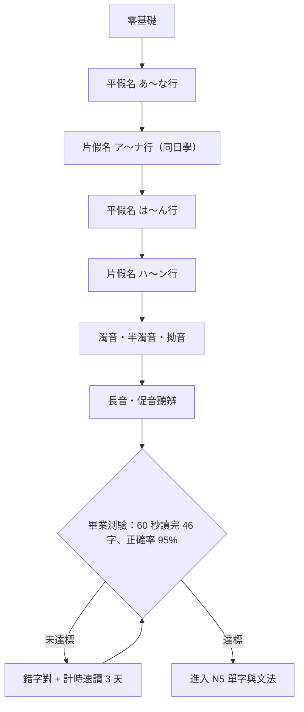
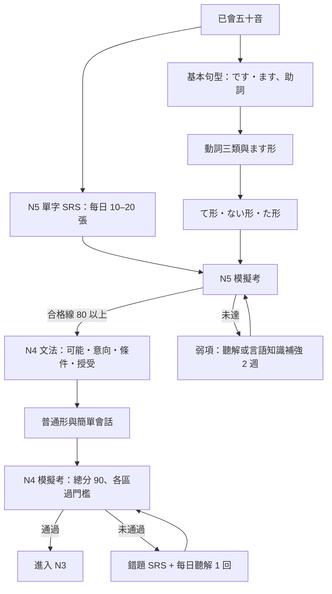
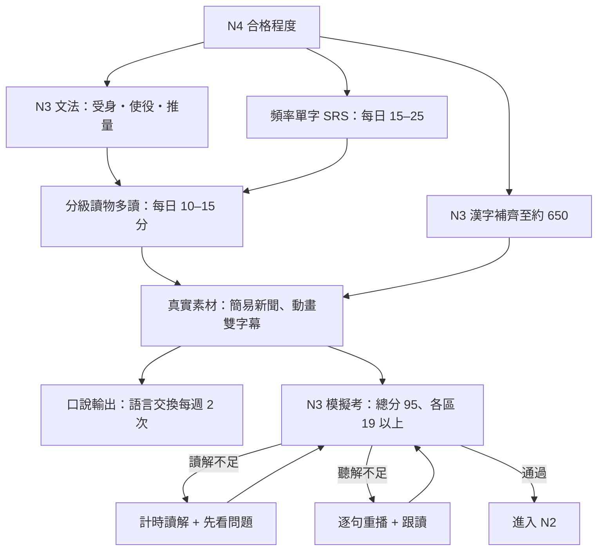
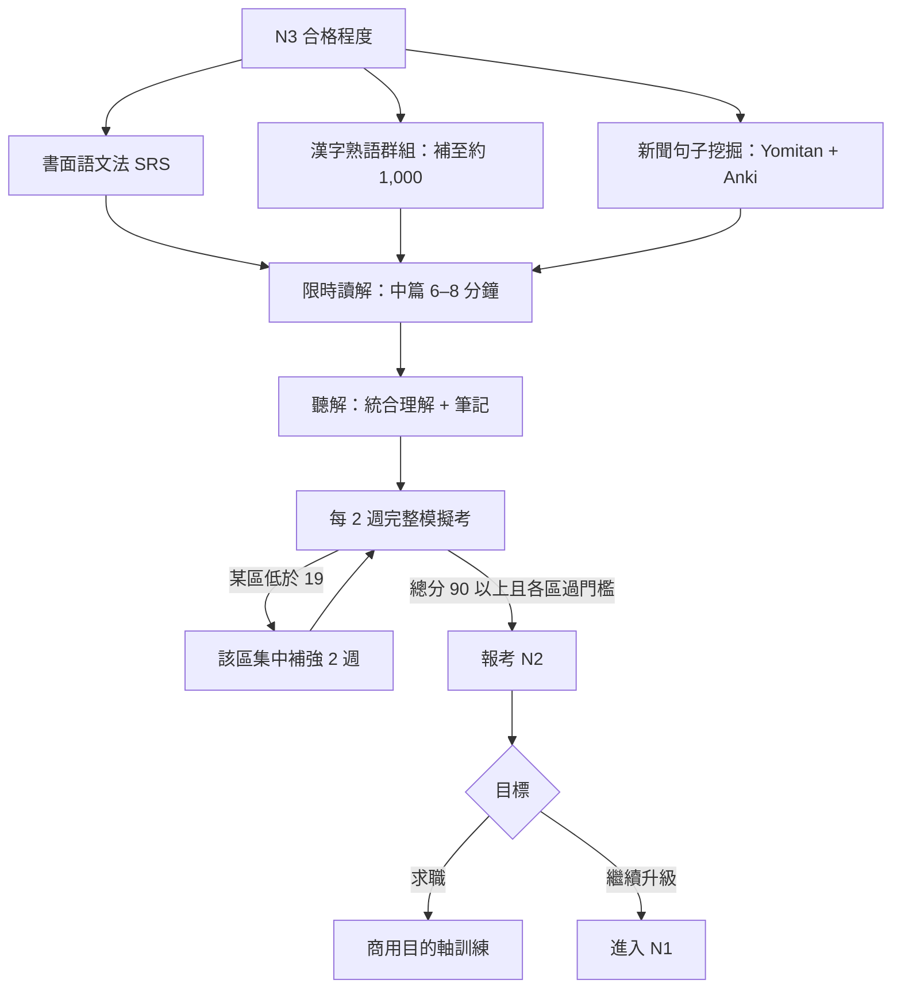
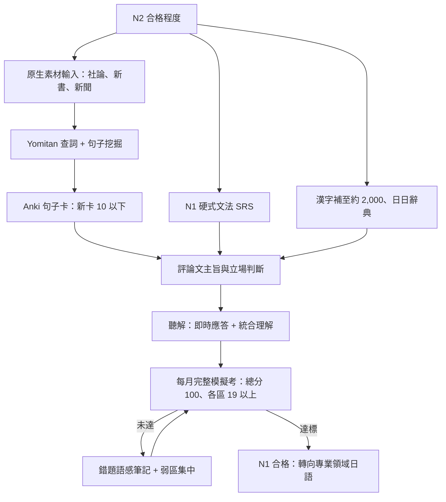

# 04｜族群分析：日檢軸（初學五十音 → N5–N4 → N3 → N2 → N1）

> 目的：依「程度」切分學習族群，逐級說明學習者畫像、官方能力標準、量級、痛點、最有效題型、方法、介面型態、市售 APP 組合與每日課表，最後彙整成「族群 × 方法 × 介面」矩陣，作為本專案設計題型與介面的依據。
>
> 查證日期：2026-11-16。凡標「（待查證）」者為未能從官方或產品官網直接確認的數字或敘述。

---

## 0. 共通前提與資料來源

### 0.1 JLPT 官方能力標準（摘要改寫）

官方「認定の目安」只以「讀」「聽」兩項描述能力，不公布單字、漢字、文法清單。

| 級別 | 讀（改寫） | 聽（改寫） | 官方合格分數（總分 180） | 科目與時間 |
|---|---|---|---|---|
| N5 | 能讀懂以平假名、片假名與日常基本漢字寫成的定型語句與短文 | 在教室或身邊生活場景，能從慢速短對話中聽出必要資訊 | 80；言語知識＋讀解 ≥38/120、聽解 ≥19/60 | 文字語彙 20 分／文法讀解 40 分／聽解 30 分 |
| N4 | 能讀懂以基本語彙與漢字寫成的身邊日常話題文章 | 日常場景中稍慢的對話大致能懂 | 90；同上兩區塊門檻 | 25／55／35 分 |
| N3 | 能讀懂日常話題的具體內容文章；能從報紙標題抓概要；換個說法的較難文章也能掌握要旨 | 日常場景中接近自然語速、有組織的對話，能連同人物關係大致理解具體內容 | 95；三區各 ≥19/60 | 30／70／40 分 |
| N2 | 能讀懂報紙、雜誌的報導與解說、淺易評論等論旨清楚的文章 | 日常以外較廣場景，接近自然語速的對話與新聞能掌握內容與要旨 | 90；三區各 ≥19/60 | 言語知識・讀解 105 分／聽解 50 分 |
| N1 | 能讀懂廣泛話題的社論、評論等邏輯稍複雜或抽象度高的文章，掌握結構與內容 | 自然語速的對話、新聞、講課能掌握脈絡、論理結構與要旨 | 100；三區各 ≥19/60 | 言語知識・讀解 110 分／聽解 55 分 |

來源：
- JLPT 官方「N1～N5：認定の目安」：https://www.jlpt.jp/about/levelsummary.html
- JLPT 官方「試験科目と試験（解答）時間」：https://www.jlpt.jp/guideline/testsections.html
- JLPT 官方「尺度得点と合否判定」（英文版 results）：https://www.jlpt.jp/guideline/results.html

### 0.2 單字／漢字／文法量級（重要說明）

- 2010 年新制起，JLPT **官方不再公布**語彙、漢字、文法清單（理由：測的是溝通能力，不宜公布清單）。來源：JLPT 官方指南（Guidebook）https://www.jlpt.jp/reference/pdf/guidebook_s_e.pdf
- 市面上流通的數字多源自舊制 1～4 級《日本語能力試験出題基準》（1994 起公開、2002 改訂版，凡人社）並加上 N3 的內插估計。下表數字為**業界常用估計，非官方**；舊制 4 級→N5、3 級→N4、2 級→N2、1 級→N1，N3 為新增級。來源：國際交流基金〈「新しい日本語能力試験」が始まりました〉https://www.jpf.go.jp/j/project/japanese/teach/tsushin/news/201011.html
- 文法項目數各教材差異很大，以下為常見教材區間（待查證）。

| 級別 | 累積單字（估計） | 累積漢字（估計） | 文法項目（估計，待查證） | 對應 CEFR／參照枠（參考） |
|---|---|---|---|---|
| 初學 | 0（只學 46 清音＋濁音、拗音、促音、長音，約 100+ 拼法） | 0 | 0 | — |
| N5 | 約 800 | 約 100 | 約 80–100 | A1 |
| N4 | 約 1,500 | 約 300 | 約 130–180（累積） | A2 |
| N3 | 約 3,750 | 約 650 | 約 250–300（累積） | B1 |
| N2 | 約 6,000 | 約 1,000 | 約 450（累積） | B2 |
| N1 | 約 10,000 | 約 2,000（常用漢字 2,136 字為上限參考） | 約 600+（累積） | C1 |

CEFR 對應僅為業界常用參考，JLPT 官方未正式宣稱一一對應（待查證）。文化庁「日本語教育の參照枠」以 A1–C2 六級描述能力：https://www.bunka.go.jp/seisaku/bunkashingikai/kokugo/hokoku/pdf/93736901_01.pdf

### 0.3 APP 事實查證（本檔引用到的功能）

| APP | 本檔使用的功能描述 | 來源 |
|---|---|---|
| WaniKani | 2,000+ 漢字、6,000+ 單字；部首→漢字→單字、助記法（mnemonic）＋SRS；可免費試用 | https://www.wanikani.com/ |
| Bunpro | 文法 SRS（文法庫、閱讀文章、假名練習；iOS/Android）；文法點數量與價格（待查證） | https://bunpro.jp/ |
| jpdb | 自研 SRS（非 SM-2）；依動畫／小說／VN 預建單字卡組；i+1 例句卡；無每日卡數上限 | https://jpdb.io/ |
| Satori Reader | Human Japanese 團隊製作；中級；1,650+ 集故事；漢字／假名／振假名切換；行內文法解說；內建 SRS | https://www.satorireader.com/ |
| Renshuu | 單字／漢字／文法字典皆可依 JLPT N5–N1 篩選；測驗、遊戲、聽力；免費起步 | https://www.renshuu.org/ |
| Yomitan | 免費瀏覽器擴充（Chrome/Firefox/Edge）；即時查詞、母語者音檔、一鍵送 Anki | https://yomitan.wiki/ |
| NHK News Web Easy | 日本語教師與記者合寫的「やさしい日本語」新聞；振假名、辭典彈窗、語音（機器合成） | https://www3.nhk.or.jp/news/easy/ ；介紹：https://tofugu.com/japanese-learning-resources-database/nhk-news-web-easy |
| Pimsleur | 日語共 5 Level；每課 30 分鐘口說聽力 | https://www.pimsleur.com/ ；Audible 課程描述：https://www.audible.com/pd/Pimsleur-Japanese-Level-1-Lessons-1-5-Audiobook/B09LRFR8RH |
| Speak | AI 對話模擬；2026 年評測列出日語為支援語言之一 | https://www.speak.com/ ；評測：https://lingrow.io/blog/best-apps-to-learn-japanese |
| 其他（Duolingo、LingoDeer、Anki、Migaku、Language Reactor、Todaii、MOJi辞書、HelloTalk 等） | 僅使用一般性功能描述；細節數字（待查證） | 各官網：duolingo.com、lingodeer.com、apps.ankiweb.net、migaku.com、languagereactor.com、todaiinews.com（待查證）、mojidict.com、hellotalk.com |

---

## 1. 初學（五十音）

### 1.1 學習者畫像
- 零基礎；多數為對動漫、旅遊、追星有興趣的學生或上班族，也有準備留學、打工度假的人。
- 華語母語者的特徵：看得懂漢字意思，但**完全不會唸**；容易以為「看得懂＝學會」，跳過假名直接看漢字。
- 投入意願高但持續力低，前兩週流失率最高（業界普遍觀察，具體數字待查證）。

### 1.2 官方能力標準
- JLPT 沒有「五十音級」；N5 的讀解標準已要求能讀平假名與片假名寫成的語句（見 0.1）。因此本級目標＝**N5 的前置門檻**。

### 1.3 量級
- 平假名 46＋片假名 46 個基本字；加濁音／半濁音（25×2）、拗音（33×2）、促音、長音、片假名外來語特殊拼法（ファ、ティ、ヴ 等）。
- 建議同時學 30–50 個「示範單字」作為字母錨點（例：あめ、いぬ、カメラ）。

### 1.4 需求與痛點
| 痛點 | 具體表現 |
|---|---|
| 形近字混淆 | さ／ち、ぬ／め、る／ろ、シ／ツ、ソ／ン、ク／ケ／タ |
| 片假名學了就忘 | 多數 APP 先教平假名、片假名練習量少 |
| 長音、促音、拗音聽不出 | おばさん／おばあさん、きて／きって、びょういん／びよういん |
| 手寫筆順錯 | 只用點選題、從未手寫，日後寫字歪斜、辨識變慢 |
| 不知道何時「畢業」 | 沒有明確的達標判定 |

### 1.5 最有效題型
1. **看字選音（4 選 1）** → 再升級為 **看字打字（romaji 或假名鍵盤）**：從再認到回想。
2. **聽音選字**：專攻長音、促音、拗音的最小對立組（minimal pair）。
3. **描字／手寫辨識**：先描後寫，強制筆順。
4. **形近字對照題**：同時出 シ・ツ・ソ・ン，要求選出指定字。
5. **計時速讀**：60 秒內讀完 20 個隨機假名（自動化程度指標）。

### 1.6 學習方法
- **分組 + 間隔重複**：每天一行（あ行、か行…），隔日複習前一行，第 3、7 天再複習。
- **助記圖像**（如 Tofugu 式圖像記憶）＋**手寫**：每字寫 5 次，並唸出聲。
- **片假名同步**：平假名每學完一行，立刻學對應片假名行，避免「片假名斷層」。
- **畢業標準**（建議）：平／片假名隨機 46 字各 60 秒內讀完、正確率 ≥95%；聽寫 20 個含長音促音單字錯 ≤2。

### 1.7 合適介面型態
- 大字卡、單字一頁；選項按鈕大；**筆順動畫 + 手寫畫布**；聲音自動播放；進度格（46 格填色）。
- 錯題即時重出（same-session retry），不要等隔天。

### 1.8 推薦 APP 組合
| 角色 | APP | 理由 |
|---|---|---|
| 主力 | **Write It! Japanese** | 手寫辨識＋筆順，逼使「回想」而非「再認」，修正形近字 |
| 主力（替代） | **LingoDeer** | 假名課程與後續 N5 文法課程連貫，有文法說明，不會在五十音後斷層 |
| 輔助 | **Duolingo** | 遊戲化、連續天數提醒，適合維持每日習慣；但文法說明少，不宜當唯一主力 |
| 輔助 | **Obenkyo**（Android）／**Kanji Study**（假名模組） | 快速隨機測驗、可自訂範圍，適合「計時速讀」 |
| 輔助 | **Anki**（現成假名卡組） | 免費、可自訂；適合畢業後保留假名複習 |

### 1.9 每日課表範例
**30 分鐘**
| 時間 | 活動 | 工具 |
|---|---|---|
| 0–5 | 複習昨日＋第 3／7 天前的行（SRS 到期卡） | Anki |
| 5–15 | 新學一行平假名：看助記圖、聽音、描寫 5 次 | Write It! |
| 15–22 | 對應的片假名一行 | Write It! |
| 22–27 | 聽音選字（長音／促音對立組） | LingoDeer / Duolingo |
| 27–30 | 60 秒計時速讀，記錄成績 | Obenkyo |

**60 分鐘**：上述 30 分鐘 + 15 分鐘「示範單字」聽寫（10 字）+ 10 分鐘跟讀（Duolingo 課程句）+ 5 分鐘手寫 20 個隨機假名對答。

### 1.10 常見卡關點與對策
| 卡關點 | 對策 |
|---|---|
| 背完平假名就停在片假名 | 規則：每學一行平假名必須同天學對應片假名 |
| 形近字錯 | 建立「錯字對」清單，每天做 1 輪對照題 |
| 長音促音聽不出 | 每日 5 組 minimal pair 聽辨，邊拍手數拍（モーラ） |
| 看羅馬拼音依賴 | 第 2 週起關閉 romaji 顯示 |
| 不知道何時進 N5 | 達畢業標準即進；不必追求 100% |

### 1.11 學習路線圖

---

## 2. 入門 N5–N4

### 2.1 學習者畫像
- 已會假名、正在建立第一批 800–1,500 單字與基本句型；許多人在用 Duolingo 等遊戲化 APP 累積連續天數。
- 目標：旅遊溝通、看懂簡單招牌與菜單、準備 N5/N4 或語言學校入學。
- 華語母語者：漢字意思易懂，但讀音（音讀／訓讀）與動詞變化是主要負擔。

### 2.2 官方能力標準
- N5：讀假名＋基本漢字的定型語句；聽慢速短對話取資訊。
- N4：讀身邊話題文章；聽稍慢的日常對話。
- 合格：N5 總分 80、N4 總分 90；兩級都需「言語知識＋讀解」≥38/120、「聽解」≥19/60。（https://www.jlpt.jp/guideline/results.html）

### 2.3 量級
- 單字約 800（N5）→ 1,500（N4）；漢字約 100 → 300（估計，見 0.2）。
- 文法核心：助詞（は・が・を・に・で・へ・と・も・から・まで）、です／ます、て形、ない形、た形、辭書形、可能形、意向形、授受（あげる・くれる・もらう）、條件（〜たら・〜ば・〜と）、比較、〜たい、〜ている、〜てもいい、〜なければならない、簡體（普通形）。

### 2.4 需求與痛點
| 痛點 | 具體表現 |
|---|---|
| 動詞分類與變化 | 一段／五段／不規則分不清；て形音便（書いて、読んで、行って）錯 |
| 助詞は／が、に／で | 會背規則但造句仍錯 |
| 漢字讀音 | 「生」「下」「上」一字多音 |
| 聽力跟不上 | APP 句子慢、真實考題語速快；數字、時間、日期聽錯 |
| 遊戲化陷阱 | 連續天數很高但不會造句；只會「選」不會「說」 |

### 2.5 最有效題型
1. **變形題（輸入）**：給「書く＋て形」→ 打出「書いて」。即時糾錯，比選擇題有效。
2. **助詞填空**：一句只挖一個助詞，選錯時顯示「為什麼」。
3. **重組句子（拖拉排序）**：訓練語序（主題→時間→地點→受詞→動詞）。
4. **聽力取資訊題**：模仿 JLPT 聽解「課題理解」：聽完選「接下來要做什麼」。
5. **數字／日期／時刻聽寫**：ついたち、はつか、よっか、〜時〜分。
6. **漢字讀音選擇＋例詞**：用單字記漢字，不單記字。

### 2.6 學習方法
- **單字 SRS**：每天新卡 10–20，複習全清；單字卡正面日文、背面中文＋例句音檔。
- **文法「規則 → 5 句 → 造句」**：每個文法點看說明後，練 5 句變形，再自己造 2 句。
- **跟讀（shadowing）入門版**：只跟讀已懂的句子，速度 0.75 倍起。
- **模擬考**：N5/N4 考前 6 週起每週一回官方題例（JLPT 官網有問題例）。

### 2.7 合適介面型態
- 文法卡片附「一句說明＋表格」；變形題用**即時打字輸入框**；拖拉排序；音檔播放鍵＋慢速鍵；每日任務清單（新卡數／複習數）。

### 2.8 推薦 APP 組合
| 角色 | APP | 理由 |
|---|---|---|
| 主力（課程） | **LingoDeer** 或 **Busuu** | 有結構化文法說明與課程順序；Busuu 另有母語者批改寫作／口說 |
| 主力（文法 SRS） | **Bunpro** | 以 JLPT 分級的文法點做 SRS 填空，專治「會看不會用」 |
| 主力（單字） | **Renshuu** 或 **Anki** | Renshuu 可依 JLPT 級別篩選單字／漢字／文法、免費起步；Anki 自由度高 |
| 輔助（字典） | **MOJi辞書** 或 **Takoboto** | 查詞、例句、動詞變化表 |
| 輔助（聽力口說） | **Pimsleur** | 每課 30 分鐘、純音訊，通勤可用，強迫開口回答 |
| 輔助（習慣） | **Duolingo** | 維持每日連續性；不作為主力 |

### 2.9 每日課表範例
**30 分鐘**
| 時間 | 活動 | 工具 |
|---|---|---|
| 0–10 | 單字 SRS（複習＋新卡 10） | Renshuu / Anki |
| 10–20 | 1 個新文法點：說明＋5 句變形 | LingoDeer / Bunpro |
| 20–25 | 文法 SRS 到期複習 | Bunpro |
| 25–30 | 聽力：數字／時間聽寫 10 題 | 自製或 Renshuu 聽力 |

**60 分鐘**
| 時間 | 活動 | 工具 |
|---|---|---|
| 0–15 | 單字 SRS（新卡 20） | Anki / Renshuu |
| 15–30 | 課程 1 課（文法＋對話） | LingoDeer / Busuu |
| 30–40 | 文法 SRS | Bunpro |
| 40–55 | Pimsleur 半課或跟讀課文 | Pimsleur |
| 55–60 | 寫 3 句今日日記（用今天文法），送 Busuu 或 HelloTalk 批改 | Busuu / HelloTalk |

### 2.10 常見卡關點與對策
| 卡關點 | 對策 |
|---|---|
| て形音便 | 用「うつる→って、むぶぬ→んで、く→いて、ぐ→いで、す→して」口訣，每天 10 題輸入題 |
| は／が | 先只記 3 條：新資訊用が、對比用は、疑問詞＋が |
| 單字背了就忘 | 新卡上限 20、補複習比新卡重要；每張卡加音檔 |
| 敢看不敢說 | 每天至少 5 分鐘出聲跟讀；Pimsleur 強迫回答 |
| N4 聽解不及格（<19/60） | 考前 4 週每天 1 回聽解，聽完看逐字稿再跟讀 |

### 2.11 學習路線圖

---

## 3. N3

### 3.1 學習者畫像
- 「中級高原期」：學了 6–18 個月，單字 1,500+，課本對話都懂，但看不懂真實文章、聽不懂日劇。
- 目的多元：準備留學（語言學校中級班）、工作簽證門檻、從動漫字幕畢業。
- 常見狀態：APP 課程已經「學完」，不知道下一步。

### 3.2 官方能力標準
- 讀：日常話題的具體內容文章；從報紙標題掌握概要；日常範圍內較難的文章換個說法能掌握要旨。
- 聽：接近自然語速、有組織的會話，能連同人物關係大致理解具體內容。
- 合格：總分 95、三區各 ≥19/60（N3 是唯一總分 95 的級別，比 N2 的 90 高，需注意）。（https://www.jlpt.jp/guideline/results.html）

### 3.3 量級
- 單字約 3,750、漢字約 650（估計）；文法新增約 100–150 項（待查證），含：〜ようにする／〜ことにする、〜ばかり、〜わけ、〜はず、受身、使役、使役受身、敬語入門、〜っぽい、〜らしい、〜ように見える。

### 3.4 需求與痛點
| 痛點 | 具體表現 |
|---|---|
| 從「教材日文」跳到「真實日文」 | 語速、省略、口語縮約（〜ちゃう、〜てる、〜じゃん）聽不懂 |
| 讀解速度慢 | 一句一句翻，讀不完考題 |
| 單字量爆增 | 每天需 15–25 新字才能在 6–9 個月內達 3,750 |
| 相似文法 | 〜ように／〜ために、〜はず／〜べき、〜そう（樣態）／〜そう（傳聞） |
| 漢字讀音 | 熟語音讀規則（〜性・〜的・〜化）大量出現 |

### 3.5 最有效題型
1. **i+1 例句卡**：只含一個生字的句子卡（jpdb 的設計）。
2. **相似文法辨析題**：兩個文法並排，給情境選正確者並說明差異。
3. **分級讀物＋點擊查詞**：讀完回答 3 題要旨題（JLPT「內容理解」型）。
4. **聽解「ポイント理解」**：先看問題再聽，練預測。
5. **漢字熟語拆解**：已知漢字組新詞（例：「安」＋「心」→安心），練習推讀音。

### 3.6 學習方法
- **單字：頻率優先**：從實際要看的內容（動畫、新聞）建單字卡組。
- **多讀（extensive reading）**：每天 10–15 分鐘分級讀物，理解 80% 以上即可，不查每個字。
- **精讀 1 篇**：每週 1 篇新聞全文精讀＋跟讀。
- **口說輸出**：每週 2 次語言交換或 AI 對話，用當週文法。

### 3.7 合適介面型態
- **閱讀器 + 彈出字典 + 一鍵加卡**；雙語字幕播放器（可暫停、逐句重播）；文法辨析對照表；每日讀量統計。

### 3.8 推薦 APP 組合
| 角色 | APP | 理由 |
|---|---|---|
| 主力（單字） | **jpdb** | 依動畫／小說預建卡組＋i+1 例句卡，直接連到「想看的內容」 |
| 主力（文法） | **Bunpro**（N3 路徑） | 相似文法逐點 SRS，附例句 |
| 主力（閱讀） | **Satori Reader** | 為中級設計的故事，振假名可切換、行內文法解說、內建 SRS |
| 輔助（新聞） | **NHK News Web Easy** 或 **Todaii** | やさしい日本語新聞，振假名＋辭典＋語音；Todaii 為新聞學習 APP（細節待查證） |
| 輔助（影音） | **Language Reactor** | Netflix／YouTube 雙字幕、逐句重播，練口語縮約 |
| 輔助（漢字） | **WaniKani** 或 **Kanji Study** | 系統補齊 650 字；WaniKani 用部首助記＋SRS |
| 輔助（口說） | **HelloTalk** / **Tandem** | 免費語言交換，母語者即時糾錯 |

### 3.9 每日課表範例
**30 分鐘**
| 時間 | 活動 | 工具 |
|---|---|---|
| 0–12 | 單字 SRS（新卡 15） | jpdb |
| 12–20 | 文法 SRS + 1 個新文法 | Bunpro |
| 20–30 | 讀 1 篇故事（點擊查詞、加卡） | Satori Reader |

**60 分鐘**
| 時間 | 活動 | 工具 |
|---|---|---|
| 0–15 | 單字 SRS（新卡 20–25） | jpdb |
| 15–25 | 文法 SRS + 相似文法辨析 2 組 | Bunpro |
| 25–40 | 多讀 1 篇 + 新聞 1 則 | Satori Reader / NHK Easy |
| 40–55 | 影音 1 段：雙字幕看 → 關字幕再看 → 跟讀 5 句 | Language Reactor |
| 55–60 | 寫 3–5 句感想，發到 HelloTalk 求批改 | HelloTalk |

### 3.10 常見卡關點與對策
| 卡關點 | 對策 |
|---|---|
| 課程學完沒下一步 | 換成「內容驅動」：從想看的作品建 jpdb 卡組 |
| 讀解讀不完 | 先看問題再讀；每天計時讀 1 篇，記錄字數/分鐘 |
| 聽不懂口語縮約 | 整理縮約對照表（〜ている→〜てる、〜てしまう→〜ちゃう），影音逐句重播 |
| 文法混淆 | 每次只比較一組，寫出「什麼時候用 A、什麼時候用 B」各 2 句 |
| 總分 95 門檻被忽略 | 模擬考以 95 為目標，而非 90 |

### 3.11 學習路線圖

---

## 4. N2

### 4.1 學習者畫像
- 求職或升學導向最強的一級：日本企業求職、大學／專門學校入學門檻常見 N2（各校要求不同，待各校查證）。
- 已能看懂日常內容，但新聞、評論、商務文書吃力；漢字與抽象詞彙是主要瓶頸。
- 時間壓力大：多為在職或在學，要在固定考期（每年 7 月、12 月）前達標。

### 4.2 官方能力標準
- 讀：報紙、雜誌的報導與解說、淺易評論等論旨清楚的文章。
- 聽：日常以外較廣場景，接近自然語速的會話與新聞，掌握內容與要旨。
- 合格：總分 90、三區各 ≥19/60；考試為「言語知識・讀解」105 分＋「聽解」50 分兩節。

### 4.3 量級
- 單字約 6,000、漢字約 1,000（估計）；文法累積約 450 項（待查證）。
- 重點：抽象漢語詞（〜性、〜化、〜的）、書面語文法（〜に際して、〜をめぐって、〜に基づいて、〜ざるを得ない、〜わけにはいかない）、敬語中級。

### 4.4 需求與痛點
| 痛點 | 具體表現 |
|---|---|
| 讀解時間不夠 | 105 分鐘內包含語彙、文法、讀解；長文與「統合理解」（比較兩篇文章）耗時 |
| 書面語文法量大 | 意思相近的文法極多（〜にかけて／〜にわたって） |
| 漢語詞同音異義 | 機関／期間／器官、保証／保障／補償 |
| 聽解「統合理解」 | 多人討論＋選項比較，需邊聽邊記 |
| 只會應試不會用 | 考過 N2 但商務場合說不出口（見 05 目的軸） |

### 4.5 最有效題型
1. **同音異義辨析（漢字選擇）**：給句子選正確漢字。
2. **文法「語感」題**：四選一＋要求說出替換後語感差異。
3. **限時讀解**：中篇讀解（JLPT「中文」，約 500 字）每篇 6–8 分鐘，訓練略讀與找關鍵句。
4. **統合理解**：兩篇短評比較「A 與 B 的共通點」。
5. **聽解筆記題**：先聽完再看選項，練筆記符號。

### 4.6 學習方法
- **單字：例句卡＋音檔**；以新聞、商務文章為來源（Yomitan 一鍵加卡）。
- **漢字：熟語群組**：以一個漢字串 5–10 個熟語（例：「保」→保証、保障、保存、保険、確保）。
- **讀解：計時＋結構標記**：每段找「主張句」「轉折詞（しかし・つまり・一方）」。
- **模擬考倒推**：考前 3 個月每 2 週一回完整模擬，依弱區分配時間。

### 4.7 合適介面型態
- **瀏覽器彈出字典**（真實網頁）；**計時讀解模式**（倒數＋每題耗時統計）；漢字熟語樹狀圖；弱項儀表板（各區分數走勢）。

### 4.8 推薦 APP 組合
| 角色 | APP | 理由 |
|---|---|---|
| 主力（文法） | **Bunpro**（N2 路徑） | 書面語文法逐點 SRS |
| 主力（單字） | **Anki ＋ Yomitan** | 在真實新聞網頁上查詞一鍵製卡，量大時效率最高 |
| 主力（漢字） | **WaniKani**（中後段等級）或 **Kanji Study** | 系統補到約 1,000 字；Kanji Study 可依 JLPT 範圍篩選（待查證） |
| 輔助（閱讀） | **Satori Reader** 進階篇 ／ **NHK News Web Easy → 一般 NHK 新聞** | 從簡易新聞過渡到原文新聞 |
| 輔助（沉浸） | **Migaku** | 瀏覽器／影音沉浸工具，查詞＋製卡＋句子挖掘（功能細節待查證） |
| 輔助（字典） | **MOJi辞書** | 日日辭典與例句，練「用日文理解日文」 |
| 輔助（口說） | **Speak** 或 **HelloTalk** | AI 對話或真人交換，補足應試以外的輸出 |

### 4.9 每日課表範例
**30 分鐘**
| 時間 | 活動 | 工具 |
|---|---|---|
| 0–12 | Anki 單字（新卡 15、複習清空） | Anki |
| 12–20 | 文法 SRS + 新文法 1 | Bunpro |
| 20–30 | 計時讀解 1 篇（中篇，約 500 字） | 模擬題 / NHK 新聞 |

**60 分鐘**
| 時間 | 活動 | 工具 |
|---|---|---|
| 0–15 | Anki 單字（新卡 20） | Anki |
| 15–25 | 漢字 SRS | WaniKani / Kanji Study |
| 25–35 | 文法 SRS + 相似文法辨析 | Bunpro |
| 35–50 | 新聞原文 1 則：Yomitan 查詞、標主張句、加卡 5 張 | 瀏覽器 + Yomitan |
| 50–60 | 聽解 1 題型（統合理解）＋筆記練習 | 模擬題音檔 |

### 4.10 常見卡關點與對策
| 卡關點 | 對策 |
|---|---|
| 言語知識・讀解時間不夠 | 語彙文法區限時 25–30 分內完成，剩下全給讀解（建議分配，待驗證） |
| 同音異義 | 每週整理 10 組，製成「漢字選擇」卡 |
| 聽解統合理解 | 練習符號筆記（○×→），聽完再看選項 |
| 單字卡積壓 | 每日複習上限優先，新卡暫停直到積壓清空 |
| 通過但不會用 | 搭配 05 目的軸的敬語與商務場景訓練 |

### 4.11 學習路線圖

---

## 5. N1

### 5.1 學習者畫像
- 高階：翻譯、口譯、在日專業職、研究所、日語教師、日系企業管理職。
- 已能日常生活無礙，瓶頸在**抽象評論文、低頻語彙、細微語感**；應試技巧與真實能力落差可能很大。
- 學習資源轉為「原生日文素材」，市售學習 APP 的直接覆蓋明顯變少。

### 5.2 官方能力標準
- 讀：廣泛話題的社論、評論等邏輯稍複雜或抽象度高的文章，理解結構與內容；也能讀各種話題的深入讀物，理解脈絡與表達意圖。
- 聽：自然語速的會話、新聞、講課，能理解脈絡、人物關係、論理結構並掌握要旨。
- 合格：總分 100、三區各 ≥19/60；「言語知識・讀解」110 分＋「聽解」55 分。

### 5.3 量級
- 單字約 10,000、漢字約 2,000（估計；常用漢字表 2,136 字為上限參考）；文法累積 600+（待查證）。
- 特徵：古典殘留表現（〜んがため、〜べからず）、硬式書面語（〜をもって、〜に即して、〜を余儀なくされる）、慣用句、四字熟語、擬聲擬態語。

### 5.4 需求與痛點
| 痛點 | 具體表現 |
|---|---|
| 低頻詞海量 | 單字 SRS 新卡邊際效益下降，記了很少遇到 |
| 抽象評論文 | 論點層層轉折，作者立場難判斷 |
| 語感題 | 「言い換え」「用法」題：選項都「好像可以」 |
| 聽解「即時應答」 | 短句語氣（皮肉、遠回し）判斷 |
| 市售 APP 斷層 | 多數 APP 停在 N2 前後，N1 需自建素材 |

### 5.5 最有效題型
1. **用法題（4 句選 1 句正確用法）**：檢驗語感而非意思。
2. **評論文主旨＋作者立場題**。
3. **即時應答聽解**：一句話＋三選一回應，訓練語氣判讀。
4. **句子挖掘卡（sentence mining）**：從真實素材摘整句，正面整句、背面只標生詞。
5. **摘要寫作**：讀 800 字社論，寫 150 字摘要（輸出驗證理解）。

### 5.6 學習方法
- **大量原生輸入**：社論、新書、Podcast、紀錄片；用工具降低查詞成本。
- **只挖「看過兩次以上」的詞**：控制 SRS 負荷。
- **日日辭典**：查詞改用日文釋義，順便讀解。
- **模擬考精析**：每題寫出「錯選項為何錯」。

### 5.7 合適介面型態
- **零干擾閱讀器＋彈出日日辭典**；**句子挖掘一鍵製卡**；聽力**逐句 A-B 重播**；錯題「語感筆記」欄。

### 5.8 推薦 APP 組合
| 角色 | APP | 理由 |
|---|---|---|
| 主力（工具） | **Yomitan ＋ Anki** | 原生網頁查詞、母語者音檔、一鍵送 Anki；N1 素材以真實網頁為主 |
| 主力（沉浸） | **Migaku** 或 **Language Reactor** | 影音沉浸＋句子挖掘 |
| 主力（單字頻率） | **jpdb** | 用作品頻率挑「真的會遇到」的低頻詞 |
| 輔助（閱讀平台） | **LingQ** | 匯入任意文章、標示已知／未知詞，量化閱讀量 |
| 輔助（文法） | **Bunpro**（N1 路徑） | 補齊 N1 硬式文法 |
| 輔助（字典） | **MOJi辞書** | 日日辭典、例句 |
| 輔助（口說） | **HelloTalk** / **Tandem** | 討論時事，練抽象議題表達 |

### 5.9 每日課表範例
**30 分鐘**
| 時間 | 活動 | 工具 |
|---|---|---|
| 0–10 | Anki 句子卡複習（新卡 ≤10） | Anki |
| 10–25 | 讀社論 1 篇，Yomitan 查詞、挖 3–5 句 | 瀏覽器 + Yomitan |
| 25–30 | 用 3 句日文寫主旨 | 筆記 |

**60 分鐘**
| 時間 | 活動 | 工具 |
|---|---|---|
| 0–15 | Anki 句子卡 + jpdb 頻率卡 | Anki / jpdb |
| 15–35 | 社論或長篇讀物 1 篇，計時＋立場判斷 | LingQ / 瀏覽器 |
| 35–50 | 新聞或紀錄片 10 分鐘，逐句重播、挖 3 句 | Language Reactor / Migaku |
| 50–60 | N1 文法 SRS ＋ 即時應答聽解 5 題 | Bunpro / 模擬題 |

### 5.10 常見卡關點與對策
| 卡關點 | 對策 |
|---|---|
| SRS 爆量 | 改「句子卡」、新卡 ≤10、只挖重複出現的詞 |
| 用法題全錯 | 每個錯詞查 5 個真實例句（語料庫或新聞），寫出搭配詞 |
| 評論文立場判斷錯 | 讀後先寫「作者贊成什麼、反對什麼」一句話 |
| 聽解即時應答 | 收集「遠回し」說法（〜かねる、〜ないこともない），做語氣標記 |
| 缺乏系統 APP | 接受「工具＋原生素材」模式，以每月讀量／聽量為 KPI |

### 5.11 學習路線圖

---

## 6. 「族群 × 方法 × 介面」矩陣

| 族群 | 核心目標 | 最有效方法 | 最有效題型 | 合適介面 | 主力 APP | 輔助 APP | 市售 APP 覆蓋度 | 本專案可補的缺口 |
|---|---|---|---|---|---|---|---|---|
| 初學（五十音） | 假名自動化讀寫 | 分組＋助記＋手寫＋間隔重複 | 看字選音→打字、聽音選字、描寫、形近字對照、計時速讀 | 大字卡、筆順動畫、手寫畫布、46 格進度 | Write It! Japanese、LingoDeer | Duolingo、Obenkyo、Kanji Study、Anki | 高（大量 APP 覆蓋） | 形近字對照、長音促音 minimal pair、「畢業測驗」 |
| N5–N4 | 基本句型與 1,500 字 | 單字 SRS＋文法「規則→5 句→造句」＋入門跟讀 | 變形輸入、助詞填空、重組句、課題理解聽解、數字日期聽寫 | 即時輸入框、拖拉排序、慢速音檔、每日任務 | LingoDeer / Busuu、Bunpro、Renshuu / Anki | MOJi辞書、Takoboto、Pimsleur、Duolingo | 高 | 華語母語者的漢字讀音陷阱、て形音便專項 |
| N3 | 從教材跨到真實日文 | 頻率單字＋多讀＋影音逐句＋語言交換 | i+1 例句卡、相似文法辨析、分級讀物要旨題、ポイント理解 | 閱讀器＋彈出字典＋一鍵加卡、雙字幕播放器 | jpdb、Bunpro、Satori Reader | NHK Easy、Todaii、Language Reactor、WaniKani、HelloTalk | 中 | 口語縮約對照、相似文法辨析題庫 |
| N2 | 書面語與限時讀解 | 新聞句子挖掘＋熟語群組＋計時讀解＋模擬考倒推 | 同音異義、語感題、限時讀解、統合理解、聽解筆記 | 瀏覽器彈出字典、計時模式、弱項儀表板 | Bunpro、Anki＋Yomitan、WaniKani | Satori Reader、Migaku、MOJi辞書、Speak | 中低 | 同音異義題庫、讀解計時統計、商用銜接 |
| N1 | 抽象評論與語感 | 原生大量輸入＋句子挖掘＋日日辭典＋錯題語感筆記 | 用法題、評論立場題、即時應答、摘要寫作 | 零干擾閱讀器、句子挖掘、A-B 重播、語感筆記 | Yomitan＋Anki、Migaku / Language Reactor、jpdb | LingQ、Bunpro、MOJi辞書、HelloTalk | 低 | 用法題訓練、遠回し表現庫 |

### 矩陣使用方式
1. 判定使用者程度 → 找到所在列。
2. 「本專案可補的缺口」欄 = 市售 APP 覆蓋不足之處，優先做成本專案的練習題型。
3. 介面欄位決定該級畫面元件（例：N3 以上必備「點詞查詢＋加入不會清單」）。

---

## 7. 來源彙整
- JLPT 認定の目安：https://www.jlpt.jp/about/levelsummary.html
- JLPT 試験科目と時間：https://www.jlpt.jp/guideline/testsections.html
- JLPT 合否判定與基準點：https://www.jlpt.jp/guideline/results.html
- JLPT Guidebook（不公布清單的說明）：https://www.jlpt.jp/reference/pdf/guidebook_s_e.pdf
- 國際交流基金：新制 JLPT 開始（舊 4 級→新 5 級）：https://www.jpf.go.jp/j/project/japanese/teach/tsushin/news/201011.html
- 文化庁「日本語教育の参照枠」報告（2021）：https://www.bunka.go.jp/seisaku/bunkashingikai/kokugo/hokoku/pdf/93736901_01.pdf
- WaniKani：https://www.wanikani.com/
- Bunpro：https://bunpro.jp/
- jpdb：https://jpdb.io/
- Satori Reader：https://www.satorireader.com/
- Renshuu：https://www.renshuu.org/
- Yomitan：https://yomitan.wiki/
- NHK News Web Easy：https://www3.nhk.or.jp/news/easy/
- Pimsleur 日語課程描述（Audible）：https://www.audible.com/pd/Pimsleur-Japanese-Level-1-Lessons-1-5-Audiobook/B09LRFR8RH
- 2026 日語 APP 評測（Speak 支援日語）：https://lingrow.io/blog/best-apps-to-learn-japanese
- 單字／漢字量級估計：非官方，原始數字出自舊制《日本語能力試験出題基準》（凡人社 2002 改訂版）—具體數字（待查證）
