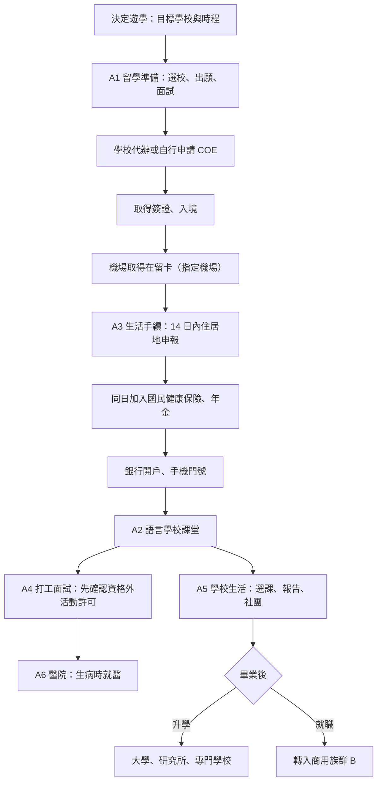
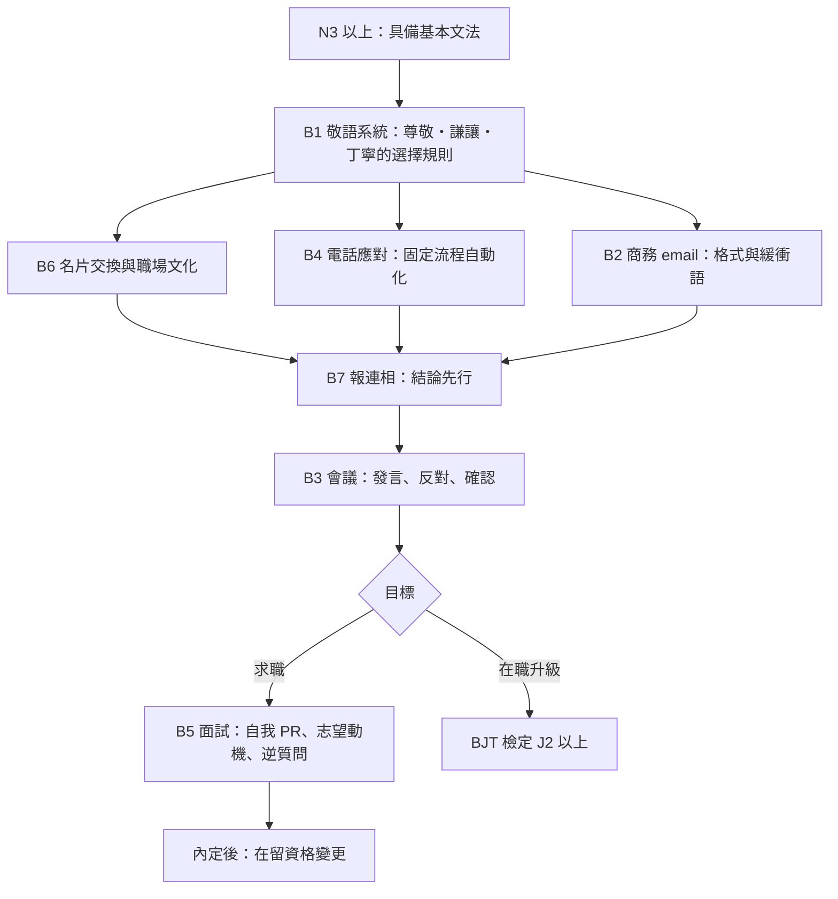

# 05｜族群分析：目的軸（遊學 × 商用）

> 與 04 日檢軸分開：本檔不以 JLPT 級別分群，而以「使用日語要完成的任務」分群。每個子場景提供：情境說明、必備單字（≥30）、句型（≥20）、對話腳本（6–10 輪）、陷阱與禮儀、推薦 APP 與市售 APP 涵蓋度、來源。
>
> 查證日期：2026-11-16。制度類資訊（在留、保險、勞動時數）會改，使用前請以官方頁面為準；未能確認者標「（待查證）」。
>
> 涵蓋度評估說明：依各 APP 官網公開的課程／功能介紹判斷，未逐課實測。◎＝有專門單元或核心功能；○＝部分涵蓋；△＝只能靠工具自行補（查詞、交換、AI 自由對話）；×＝基本未涵蓋。

## 子場景總表

| 族群 | 編號 | 子場景 | 單字數 | 句型數 | 對話輪數 |
|---|---|---|---|---|---|
| 遊學 | A1 | 留學準備（申請、COE、面試） | 33 | 22 | 8 |
| 遊學 | A2 | 語言學校課堂 | 34 | 22 | 8 |
| 遊學 | A3 | 生活手續（在留卡／住民登錄／國保／銀行／手機／租屋） | 45 | 26 | 10 |
| 遊學 | A4 | 打工面試 | 34 | 23 | 10 |
| 遊學 | A5 | 學校生活（大學／專門學校） | 36 | 21 | 8 |
| 遊學 | A6 | 醫院 | 40 | 23 | 10 |
| 商用 | B1 | 敬語系統（尊敬／謙讓／丁寧） | 33 | 22 | 8 |
| 商用 | B2 | 商務書信與 email | 33 | 22 | 6 |
| 商用 | B3 | 會議 | 33 | 22 | 10 |
| 商用 | B4 | 電話應對 | 31 | 22 | 10 |
| 商用 | B5 | 面試（就職） | 35 | 22 | 10 |
| 商用 | B6 | 名片交換與職場文化 | 34 | 21 | 8 |
| 商用 | B7 | 報連相 | 32 | 21 | 8 |

---

# A. 遊學族群

## A0. 族群畫像與路線

- **誰**：準備赴日讀語言學校、專門學校、大學／研究所，或短期遊學、交換的學生；多數出發時約 N4–N3，部分 N2。
- **核心需求**：在「抵達後 2 週內」完成一連串行政手續；在課堂聽懂老師、敢發問；找到合法打工；生病時能就醫。
- **與日檢軸的差異**：日檢軸練「讀懂考題」，遊學族群要「在窗口、教室、店裡、診間即時聽懂並回應」，大量是**固定流程中的固定句型**，非常適合做成「情境腳本＋角色扮演」題型。
- **官方能力框架參考**：文化庁「日本語教育の參照枠」設留學分野，教育模型以 B2 為主要目標；生活 Can do 涵蓋 A1–B2。來源：https://www.bunka.go.jp/seisaku/bunkashingikai/kokugo/hokoku/pdf/93736901_01.pdf ；留學分野教育模型報告（2025 改訂版）：https://www.mext.go.jp/content/20250501-mxt_nihongo02-000036709_25.pdf



---

## A1. 留學準備（選校、出願、COE、入學面試）

### 情境說明
出發前 6–12 個月：比較日本語學校／大學、準備出願文件（成績單、畢業證書、經費證明）、寫志望理由書或研究計畫書、與學校或指導教授 email 往來、參加線上面試；學校代理申請「在留資格認定證明書（COE）」後，在本國申請簽證並入境。
- 只以學日語為目的入學者，須就讀「認定日本語教育機関（留學課程）」或「告示日本語教育機関」（告示機関的過渡期限至 2029 年 3 月 31 日）。來源：法務省／文科省文件 https://www.moj.go.jp/isa/content/001417402.pdf （摘要依搜尋結果，細節待查證原文）
- COE 可由本人或代理人（親屬、受入機關職員）向地方出入國在留管理局申請，實務多由學校代辦；申請時常需經費支付能力證明。來源：Study in Japan https://www.studyinjapan.go.jp/ja/planning/immigration-procedures/
- 大學入學常用日本留學試驗（EJU）：日語科目讀解・聽解・聽讀解 0–400 分、記述 0–50 分，每年 6 月、11 月。來源：JASSO https://www.jasso.go.jp/ryugaku/eju/examinee/syllabus/japanese.html ；Study in Japan https://www.studyinjapan.go.jp/ja/planning/examination/

### 必備單字（33）
| 日文 | 讀音 | 中文 |
|---|---|---|
| 留学 | りゅうがく | 留學 |
| 留学生 | りゅうがくせい | 留學生 |
| 日本語学校 | にほんごがっこう | 日語學校 |
| 専門学校 | せんもんがっこう | 專門學校 |
| 大学院 | だいがくいん | 研究所 |
| 研究生 | けんきゅうせい | 研究生（非正規、準備考研究所的身分） |
| 願書 | がんしょ | 入學申請書 |
| 出願 | しゅつがん | 提出申請、報名 |
| 締め切り | しめきり | 截止日 |
| 入学試験 | にゅうがくしけん | 入學考試 |
| 面接 | めんせつ | 面試 |
| 書類選考 | しょるいせんこう | 書面審查 |
| 合格通知 | ごうかくつうち | 錄取通知 |
| 入学許可書 | にゅうがくきょかしょ | 入學許可書 |
| 在留資格認定証明書 | ざいりゅうしかくにんていしょうめいしょ | 在留資格認定證明書（COE） |
| 査証 | さしょう | 簽證 |
| 在留資格 | ざいりゅうしかく | 在留資格 |
| 経費支弁者 | けいひしべんしゃ | 經費支付者 |
| 預金残高証明書 | よきんざんだかしょうめいしょ | 存款餘額證明書 |
| 卒業証明書 | そつぎょうしょうめいしょ | 畢業證明書 |
| 成績証明書 | せいせきしょうめいしょ | 成績證明書 |
| 推薦状 | すいせんじょう | 推薦信 |
| 志望理由書 | しぼうりゆうしょ | 志願理由書 |
| 研究計画書 | けんきゅうけいかくしょ | 研究計畫書 |
| 指導教員 | しどうきょういん | 指導教授 |
| 奨学金 | しょうがくきん | 獎學金 |
| 学費 | がくひ | 學費 |
| 入学金 | にゅうがくきん | 入學金 |
| 寮 | りょう | 宿舍 |
| 入国 | にゅうこく | 入境 |
| 在留カード | ざいりゅうカード | 在留卡 |
| 日本留学試験 | にほんりゅうがくしけん | 日本留學試驗（EJU） |
| 日本語能力試験 | にほんごのうりょくしけん | 日本語能力試驗（JLPT） |

### 句型（22）
| 日文 | 中文 | 使用時機 |
|---|---|---|
| 突然のご連絡失礼いたします。 | 冒昧聯絡，敬請見諒。 | 第一次寫信給教授／學校 |
| 現在、〇〇大学〇〇学部の4年生です。 | 我目前是〇〇大學〇〇系四年級。 | 信件或面試自我介紹 |
| 〇〇大学大学院への進学を希望しております。 | 我希望進入〇〇大學研究所就讀。 | 說明來意 |
| 先生の研究室で〜について研究したいと考えております。 | 我希望在老師的研究室研究〜。 | 寫給指導教授 |
| 研究生として受け入れていただくことは可能でしょうか。 | 請問是否能收我為研究生？ | 詢問教授受入意願 |
| 研究計画書を添付いたしましたので、ご確認いただけますと幸いです。 | 附上研究計畫書，若能過目將不勝感激。 | 附件說明 |
| ご検討のほど、よろしくお願いいたします。 | 懇請考慮。 | 信件結尾 |
| 出願に必要な書類を教えていただけますか。 | 能告訴我申請需要哪些文件嗎？ | 詢問學校窗口 |
| 締め切りはいつまでですか。 | 截止日是什麼時候？ | 確認期限 |
| 書類はすべて日本語訳が必要ですか。 | 所有文件都需要日文翻譯嗎？ | 準備文件 |
| 在留資格認定証明書の代理申請をお願いできますか。 | 可以請貴校代為申請 COE 嗎？ | 錄取後 |
| 経費支弁者は父です。 | 經費支付者是我父親。 | 填表、面試 |
| 日本語は〇年間勉強しました。 | 我學了〇年日文。 | 面試 |
| 日本語能力試験のN2に合格しています。 | 我已通過 JLPT N2。 | 面試、履歷 |
| 日本を選んだ理由は〜からです。 | 選擇日本的理由是因為〜。 | 面試必問 |
| 卒業後は〜したいと考えております。 | 畢業後我打算〜。 | 面試必問 |
| 奨学金の申請条件を教えてください。 | 請告訴我獎學金的申請條件。 | 詢問學校 |
| 寮の申し込みはいつから始まりますか。 | 宿舍申請什麼時候開始？ | 詢問住宿 |
| オンラインで面接を受けることはできますか。 | 可以線上面試嗎？ | 人在海外 |
| 入学金の振込期限はいつですか。 | 入學金匯款期限是什麼時候？ | 錄取後 |
| 合格通知はメールで届きますか。 | 錄取通知會用 email 寄來嗎？ | 確認流程 |
| 入国の際に必要なものはありますか。 | 入境時有需要準備的東西嗎？ | 行前 |

### 對話腳本：日本語學校線上面試（8 輪）
| 輪 | 說話者 | 日文 | 中文 |
|---|---|---|---|
| 1 | 面接官 | はじめまして。では、自己紹介をお願いします。 | 你好，請自我介紹。 |
| 2 | 学生 | はじめまして。台湾から参りました林と申します。現在、大学の3年生です。よろしくお願いいたします。 | 你好，我是來自台灣的林，目前大三。請多指教。 |
| 3 | 面接官 | 日本語はどのくらい勉強しましたか。 | 你學了多久日文？ |
| 4 | 学生 | 2年間勉強しました。去年、日本語能力試験のN3に合格しました。 | 學了兩年，去年通過 N3。 |
| 5 | 面接官 | どうして日本で勉強したいのですか。 | 為什麼想在日本讀書？ |
| 6 | 学生 | 日本のアニメ制作に興味があり、将来は専門学校でアニメーションを学びたいと考えております。そのために、まず日本語学校で上級の日本語を身につけたいです。 | 我對日本動畫製作有興趣，將來想在專門學校學動畫；為此想先在日本語學校學到高級日語。 |
| 7 | 面接官 | 学費や生活費はどなたが払いますか。 | 學費和生活費由誰支付？ |
| 8 | 学生 | 父が経費支弁者です。預金残高証明書も提出いたします。 | 經費支付者是父親，我也會提交存款證明。 |

### 陷阱／禮儀
- **信件主旨要具體**：例「研究生受入れのご相談（台湾・林〇〇）」；不寫主旨或只寫「こんにちは」容易被忽略。
- **面試回答「志望動機」要和「畢業後規劃」一致**：入管與學校都會看整體合理性（學習目的與經費能力），前後矛盾是常見扣分點（入管審查細節待查證）。
- **確認學校類型**：只學日語者要讀「認定／告示日本語教育機関」，選校前先查。
- **在留卡何時拿到**：成田、羽田、中部、關西、新千歲、神戶、廣島、福岡 8 機場在上陸許可時交付；那霸、仙台自 2026-03-01 起加入；其他口岸改為住居地申報後郵寄。來源：出入國在留管理庁 https://www.moj.go.jp/isa/content/001456547.pdf
- **常見錯誤敬語**：「先生にお伺いさせていただきます」為二重敬語，用「先生に伺います」即可。

### 推薦 APP 與涵蓋度
| APP | 用法 | 涵蓋度 |
|---|---|---|
| Busuu | 寫作題送母語者批改，可練志望理由書段落 | △（批改依靠社群，非留學專門單元） |
| HelloTalk / Tandem | 請日本人看信件、模擬面試 | △ |
| Speak | AI 角色扮演可自訂面試情境（自訂功能細節待查證） | △ |
| MOJi辞書 | 查正式書面詞、例句 | △ |
| Bunpro | 「〜と考えております」「〜いただけますと幸いです」等文法點 SRS | ○（文法有，情境無） |
| Duolingo / LingoDeer / Babbel | 以旅遊與日常為主 | ×（未見留學申請、面試專門單元，待查證） |
- **評估**：市售 APP 幾乎不涵蓋「出願文件、教授信件、入學面試」，此為明顯缺口。本專案可提供：信件範本填空、面試必問 10 題的錄音作答與範例比對。

### 來源
- Study in Japan（入國手續）：https://www.studyinjapan.go.jp/ja/planning/immigration-procedures/
- Study in Japan（考試）：https://www.studyinjapan.go.jp/ja/planning/examination/
- JASSO EJU 日本語シラバス：https://www.jasso.go.jp/ryugaku/eju/examinee/syllabus/japanese.html
- 出入國在留管理庁 機場交付在留卡（2026 年 2 月資料）：https://www.moj.go.jp/isa/content/001456547.pdf
- 法務省・文科省 日本語教育機関相關文件：https://www.moj.go.jp/isa/content/001417402.pdf

---

## A2. 語言學校課堂

### 情境說明
語言學校以「分班測驗 → 初／中／上級 → 進學指導」運作，課堂全日語（直接教學法），每天約 4 堂；有小考、期末考、作文、發表。**出席率**是學校與入管都重視的指標，長期缺席可能影響在留期間更新（具體門檻依學校規定，待查證）。學生需要的不是「更多文法」，而是**在課堂上能發問、請求重複、確認用法、請假聯絡**。

### 必備單字（34）
| 日文 | 讀音 | 中文 |
|---|---|---|
| 授業 | じゅぎょう | 課、上課 |
| クラス | クラス | 班級 |
| クラス分けテスト | クラスわけテスト | 分班測驗 |
| 初級 | しょきゅう | 初級 |
| 中級 | ちゅうきゅう | 中級 |
| 上級 | じょうきゅう | 高級 |
| 教科書 | きょうかしょ | 課本 |
| 宿題 | しゅくだい | 作業 |
| 提出 | ていしゅつ | 繳交 |
| 小テスト | しょうテスト | 小考 |
| 期末試験 | きまつしけん | 期末考 |
| 出席 | しゅっせき | 出席 |
| 欠席 | けっせき | 缺席 |
| 遅刻 | ちこく | 遲到 |
| 早退 | そうたい | 早退 |
| 出席率 | しゅっせきりつ | 出席率 |
| 作文 | さくぶん | 作文 |
| 発表 | はっぴょう | 發表 |
| 聴解 | ちょうかい | 聽解 |
| 読解 | どっかい | 讀解 |
| 文法 | ぶんぽう | 文法 |
| 語彙 | ごい | 詞彙 |
| 漢字 | かんじ | 漢字 |
| 例文 | れいぶん | 例句 |
| 質問 | しつもん | 問題、提問 |
| 意味 | いみ | 意思 |
| 使い方 | つかいかた | 用法 |
| 発音 | はつおん | 發音 |
| 練習 | れんしゅう | 練習 |
| 担任 | たんにん | 班導師 |
| 進路指導 | しんろしどう | 升學／出路指導 |
| 面談 | めんだん | 面談 |
| 修了証書 | しゅうりょうしょうしょ | 結業證書 |
| 遅延証明書 | ちえんしょうめいしょ | （電車）延誤證明 |

### 句型（22）
| 日文 | 中文 | 使用時機 |
|---|---|---|
| すみません、もう一度お願いします。 | 不好意思，請再說一次。 | 沒聽清楚 |
| もう少しゆっくり話していただけますか。 | 可以說慢一點嗎？ | 語速太快 |
| 今、何とおっしゃいましたか。 | 您剛剛說什麼？ | 漏聽關鍵字 |
| 「〜」はどういう意味ですか。 | 「〜」是什麼意思？ | 生字 |
| 「A」と「B」の違いは何ですか。 | A 和 B 有什麼不同？ | 相似文法、相似詞 |
| この言葉はどうやって使いますか。 | 這個詞怎麼用？ | 用法 |
| 例文を作ってみてもいいですか。 | 我可以試著造句嗎？ | 練習 |
| これは自然な日本語ですか。 | 這是自然的日文嗎？ | 確認語感 |
| 「〜」と言っても大丈夫ですか。 | 可以說「〜」嗎？ | 確認可否 |
| 漢字の読み方を教えてください。 | 請告訴我漢字怎麼唸。 | 讀音 |
| 何ページですか。 | 第幾頁？ | 跟上進度 |
| 黒板の字が見えません。 | 看不到黑板上的字。 | 座位 |
| 宿題はいつまでに出せばいいですか。 | 作業什麼時候前要交？ | 期限 |
| 今日は体調が悪いので、休ませていただきます。 | 今天身體不舒服，想請假。 | 打電話／傳訊請假 |
| 電車が遅れて、遅刻しました。申し訳ありません。 | 電車誤點，我遲到了，很抱歉。 | 遲到 |
| こちらが遅延証明書です。 | 這是延誤證明。 | 遲到補件 |
| 作文を見ていただけませんか。 | 可以幫我看作文嗎？ | 請老師修改 |
| 進路について相談したいのですが。 | 我想討論升學方向。 | 找班導 |
| 先生、ちょっとよろしいですか。 | 老師，可以打擾一下嗎？ | 下課找老師 |
| 〜についてどう思いますか。 | 你覺得〜怎麼樣？ | 小組討論 |
| 私は〜と思います。なぜなら〜からです。 | 我認為〜，因為〜。 | 發表意見 |
| わかりました。／まだよくわかりません。 | 我懂了。／我還不太懂。 | 回應老師確認 |

### 對話腳本：下課問老師相似文法（8 輪）
| 輪 | 說話者 | 日文 | 中文 |
|---|---|---|---|
| 1 | 学生 | 先生、ちょっとよろしいですか。 | 老師，可以打擾一下嗎？ |
| 2 | 先生 | はい、どうぞ。 | 好，請說。 |
| 3 | 学生 | 「ために」と「ように」の違いがよくわからないんですが……。 | 我不太懂「ために」和「ように」的差別……。 |
| 4 | 先生 | 「ために」の前は自分でコントロールできることです。「ように」の前は「できる」「わかる」のような、コントロールできないことが多いですね。 | 「ために」前面是自己能控制的事；「ように」前面多是「能夠」「懂」這類無法控制的事。 |
| 5 | 学生 | じゃあ、「日本語が上手になるように、毎日練習します」は自然ですか。 | 那「為了日文變好，每天練習」這句自然嗎？ |
| 6 | 先生 | はい、とても自然です。「上手になる」は自分で決められないからです。 | 很自然，因為「變好」不是自己能直接決定的。 |
| 7 | 学生 | なるほど。例文をもう一つ作ってみてもいいですか。 | 原來如此。我可以再造一句嗎？ |
| 8 | 先生 | もちろん。宿題のノートに書いて、明日見せてください。 | 當然。寫在作業本上，明天給我看。 |

### 陷阱／禮儀
- **「わかりましたか？」不要只回「はい」**：老師確認時，不懂要說「まだよくわかりません」，否則進度就過去了。
- **請假要在上課前聯絡**：事後才說會被當無故缺席；電車誤點要拿車站或網站的「遅延証明書」。
- **出席率**：學校會追蹤並可能通報；把它當作「在留」問題，不只是成績問題。
- **對老師用丁寧語**，對同學可用普通形；日本語學校同學多為外國人，用「やさしい日本語」溝通更順。

### 推薦 APP 與涵蓋度
| APP | 用法 | 涵蓋度 |
|---|---|---|
| Bunpro | 課堂文法預習／複習，按 JLPT 分級 SRS | ○ |
| Renshuu | 課本單字自建清單、JLPT 篩選 | ○ |
| Anki | 把課本單字、老師例句做成卡 | ○（需自建） |
| MOJi辞書 / Takoboto | 課堂即時查詞、例句 | ○ |
| LingoDeer / Human Japanese | 文法說明清楚，可當課前預習 | ○ |
| Duolingo | 補課外時間，但與課本進度不同步 | △ |
- **評估**：「課堂用語」（請求重複、確認語感、請假）多數 APP 未專門教學（待查證）；本專案可做「課堂求生 20 句」角色扮演，並與課本單元同步出 SRS。

### 來源
- 文化庁「日本語教育の參照枠」：https://www.bunka.go.jp/seisaku/bunkashingikai/kokugo/hokoku/pdf/93736901_01.pdf
- 留學分野教育模型（文化庁委託，2025 改訂版）：https://www.mext.go.jp/content/20250501-mxt_nihongo02-000036709_25.pdf
- 出席率與在留更新的具體門檻：（待查證，依各校及入管指引）

---

## A3. 生活手續（在留卡／區役所住民登錄／國民健康保險／銀行開戶／手機門號／租屋）

### 情境說明
抵達後最密集、最怕出錯的一週。建議順序：**租屋（或先住學校宿舍）→ 區役所住居地申報（含國保、年金）→ 銀行開戶 → 手機門號**（手機與銀行常互相要求對方資料，實務上依業者而異）。
- **住居地申報**：新成為中長期在留者，定居後 **14 日內**持在留卡到住居地市區町村窗口申報；辦理住民基本台帳的轉入即視為已申報。來源：出入國在留管理庁 https://www.moj.go.jp/isa/applications/procedures/nyuukokukanri10_00021.html
- **國民健康保險**：在日 3 個月以上的外國人須加入；醫療費自付原則 3 成；保費以前一年所得計算，無收入也要申報所得。來源：Study in Japan https://www.studyinjapan.go.jp/ja/life/insurance/ ；JPSS https://www.jpss.jp/ja/life/1/2/
- **保險證改制**：2024-12-02 起不再新發傳統健康保險證，改以マイナ保険証（個人編號卡）或「資格確認書」就醫。來源：濱田市資料 https://www.city.hamada.shimane.jp/www/contents/1727326227106/simple/mainanbakado.pdf ；千葉市 https://www.city.chiba.jp/hokenfukushi/iryoeisei/hoken/01onlineshikakukakunin.html
- **銀行**：入境未滿 6 個月的外國籍人士原則上以「非居住者」身分開戶，匯款等可能受限，滿 6 個月也不會自動轉換，需到窗口變更；ゆうちょ銀行規定在留期間 3 個月以下、未發在留卡者不能開戶。來源：東京大學 https://www.ms.u-tokyo.ac.jp/kyoumu/af0e09fda625f72d752576c7d8df81efc92655e2.pdf ；ゆうちょ銀行 https://www.jp-bank.japanpost.jp/kaisetu/pdf/kaisetu_jp.pdf
- **手機**：依《攜帶電話不正利用防止法》，簽約須本人確認；2027-04-01 起對面簽約原則改為讀取證件 IC 晶片（依律師事務所解說，以總務省公告為準）。來源：總務省 https://www.soumu.go.jp/main_sosiki/joho_tsusin/d_syohi/050526_1.html ；解說 https://www.miyake.gr.jp/wp-content/uploads/2026/07/AMLCFTセミナー_2027年4月から変わる携帯電話契約の本人確認.pdf
- **租屋**：國土交通省有多語「部屋探しのガイドブック」；全日本不動產協會等有外國人租屋指南。來源：https://www.fudousan.or.jp/for_non_japanese/index.html ；國交省 FAQ https://www.mlit.go.jp/jutakukentiku/house/content/001394553.pdf

### 必備單字（45）
| 日文 | 讀音 | 中文 |
|---|---|---|
| 在留カード | ざいりゅうカード | 在留卡 |
| 住居地 | じゅうきょち | 居住地 |
| 転入届 | てんにゅうとどけ | 遷入登記 |
| 住民票 | じゅうみんひょう | 住民票（居住證明） |
| 区役所 | くやくしょ | 區公所 |
| 市役所 | しやくしょ | 市公所 |
| 窓口 | まどぐち | 窗口 |
| 番号札 | ばんごうふだ | 號碼牌 |
| 届出 | とどけで | 申報 |
| マイナンバー | マイナンバー | 個人編號 |
| 国民健康保険 | こくみんけんこうほけん | 國民健康保險 |
| 保険料 | ほけんりょう | 保費 |
| 資格確認書 | しかくかくにんしょ | 資格確認書（取代舊保險證） |
| 国民年金 | こくみんねんきん | 國民年金 |
| 学生納付特例 | がくせいのうふとくれい | 學生繳費特例（延後繳） |
| 印鑑 | いんかん | 印章 |
| 口座開設 | こうざかいせつ | 開戶 |
| 通帳 | つうちょう | 存摺 |
| キャッシュカード | キャッシュカード | 提款卡 |
| 暗証番号 | あんしょうばんごう | 密碼 |
| 振込 | ふりこみ | 匯款 |
| 引き落とし | ひきおとし | 自動扣款 |
| 携帯電話 | けいたいでんわ | 手機 |
| 契約 | けいやく | 契約、簽約 |
| 本人確認書類 | ほんにんかくにんしょるい | 身分證明文件 |
| 料金プラン | りょうきんプラン | 資費方案 |
| 格安SIM | かくやすシム | 平價 SIM |
| 解約 | かいやく | 解約 |
| 賃貸 | ちんたい | 租賃 |
| 不動産屋 | ふどうさんや | 房仲業者 |
| 物件 | ぶっけん | 房源 |
| 間取り | まどり | 格局（如 1K、1LDK） |
| 家賃 | やちん | 房租 |
| 管理費 | かんりひ | 管理費 |
| 敷金 | しききん | 押金 |
| 礼金 | れいきん | 禮金（不退還） |
| 仲介手数料 | ちゅうかいてすうりょう | 仲介費 |
| 保証人 | ほしょうにん | 保證人 |
| 保証会社 | ほしょうがいしゃ | 租屋保證公司 |
| 内見 | ないけん | 看房 |
| 初期費用 | しょきひよう | 入住初期費用 |
| 退去 | たいきょ | 退租搬出 |
| 原状回復 | げんじょうかいふく | 恢復原狀 |
| ゴミ出し | ごみだし | 倒垃圾 |
| 粗大ゴミ | そだいごみ | 大型垃圾 |

### 句型（26）
| 日文 | 中文 | 使用時機 |
|---|---|---|
| 転入届を出したいのですが、どの窓口ですか。 | 我想辦遷入登記，請問在哪個窗口？ | 區公所入口 |
| 在留カードとパスポートを持ってきました。 | 我帶了在留卡和護照。 | 遞交文件 |
| この書類の書き方を教えていただけますか。 | 可以教我這份表格怎麼填嗎？ | 填表 |
| 国民健康保険に加入したいです。 | 我想加入國民健康保險。 | 轉入後同窗口或保險課 |
| 学生なので、国民年金の学生納付特例を申請したいです。 | 我是學生，想申請國民年金學生繳費特例。 | 年金課 |
| 住民票の写しを1通お願いします。 | 請給我一份住民票影本。 | 開戶、簽約常需 |
| マイナンバーカードを申請したいのですが。 | 我想申請個人編號卡。 | 區公所 |
| この内容で間違いありません。 | 內容沒有錯誤。 | 確認申請書 |
| 住所が変わったので、手続きをしたいです。 | 地址變更了，我想辦手續。 | 搬家 |
| 口座を開きたいのですが、留学生でも開けますか。 | 我想開戶，留學生也可以開嗎？ | 銀行 |
| 印鑑がなくてもサインで大丈夫ですか。 | 沒有印章用簽名可以嗎？ | 銀行 |
| キャッシュカードはいつ届きますか。 | 提款卡什麼時候寄到？ | 銀行 |
| 海外からの送金を受け取ることはできますか。 | 可以收海外匯款嗎？ | 銀行（非居住者限制） |
| 本人確認書類は何が必要ですか。 | 需要哪些身分證明文件？ | 銀行、手機 |
| 在留カードで契約できますか。 | 可以用在留卡簽約嗎？ | 手機門市 |
| 一番安い料金プランはどれですか。 | 最便宜的方案是哪個？ | 手機門市 |
| 支払いはクレジットカードでないとだめですか。 | 一定要用信用卡付款嗎？ | 手機門市 |
| 解約金はかかりますか。 | 解約要違約金嗎？ | 手機門市 |
| 駅から徒歩10分以内で、家賃6万円以下の部屋を探しています。 | 我在找離車站走路 10 分鐘內、房租 6 萬以下的房間。 | 房仲 |
| 外国人でも入居できる物件はありますか。 | 有外國人也能入住的房源嗎？ | 房仲 |
| 内見できますか。 | 可以看房嗎？ | 房仲 |
| 初期費用は全部でいくらですか。 | 初期費用總共多少？ | 簽約前 |
| 保証人がいないのですが、保証会社を使えますか。 | 我沒有保證人，可以用保證公司嗎？ | 簽約 |
| ゴミの出し方を教えてください。 | 請告訴我垃圾怎麼丟。 | 入住 |
| 退去するときは、何日前に連絡すればいいですか。 | 退租要提前幾天通知？ | 簽約時確認 |
| 番号札を取って、お待ちください。 | 請抽號碼牌等候。 | 聽懂窗口指示 |

### 對話腳本：區役所遷入登記＋國保（10 輪）
| 輪 | 說話者 | 日文 | 中文 |
|---|---|---|---|
| 1 | 学生 | すみません、引っ越してきたので、転入届を出したいのですが。 | 不好意思，我剛搬來，想辦遷入登記。 |
| 2 | 職員 | 海外からですか。在留カードとパスポートをお願いします。 | 從國外來的嗎？請給我在留卡和護照。 |
| 3 | 学生 | はい、こちらです。 | 好的，在這裡。 |
| 4 | 職員 | こちらの用紙に、新しい住所とお名前を書いてください。 | 請在這張表填上新地址和姓名。 |
| 5 | 学生 | 住所の書き方を教えていただけますか。建物の名前も書きますか。 | 可以教我地址怎麼寫嗎？建築名稱也要寫嗎？ |
| 6 | 職員 | はい、建物名と部屋番号まで書いてください。国民健康保険の手続きもしますか。 | 要，寫到建築名和房號。國保也要一起辦嗎？ |
| 7 | 学生 | はい、お願いします。年金の学生納付特例も申請したいです。 | 好，麻煩了。我也想申請年金學生繳費特例。 |
| 8 | 職員 | わかりました。学生証はお持ちですか。 | 了解。有帶學生證嗎？ |
| 9 | 学生 | はい、あります。住民票の写しも1通いただけますか。銀行で使います。 | 有。可以也給我一份住民票影本嗎？開戶要用。 |
| 10 | 職員 | はい。では番号札を取って、3番の窓口の前でお待ちください。 | 好。請抽號碼牌，在 3 號窗口前等候。 |

### 陷阱／禮儀
- **14 日期限**：超過可能受罰則（入管法規定，罰則細節待查證）；搬家後同樣 14 日內申報。
- **國保要從入境日起算**：晚加入可能被追繳過去的保費；收入為零也要做所得申報，才能適用減免。
- **保險證已改制**：辦完國保後問清楚會拿到「資格確認書」還是用マイナ保険証；看病時帶在身上。
- **銀行**：入境未滿 6 個月可能被限制為非居住者帳戶；滿 6 個月記得到窗口變更。
- **手機**：多數簽約需本人名下支付方式；學生常先辦預付或平價 SIM，細節依業者（待查證）。
- **租屋**：初期費用常見為「敷金＋禮金＋仲介費＋首月房租＋保證公司費用＋火災保險」，合計可能數倍月租（倍數依物件，待查證）；退租「原狀回復」範圍要在入住時拍照存證。
- **垃圾分類**：各區規則不同、收運日固定；違規丟棄是外國住戶最常見的鄰里糾紛來源（待查證統計）。

### 推薦 APP 與涵蓋度
| APP | 用法 | 涵蓋度 |
|---|---|---|
| VoiceTra | 窗口即時語音翻譯（NICT 開發，多語） | △（翻譯工具，非教學） |
| Google 翻譯 | 鏡頭翻譯表格、通知單 | △ |
| MOJi辞書 / Mazii | 查「転入届」「資格確認書」等行政詞 | △ |
| Anki | 把本節 45 字做成「行前必背」卡組 | ○（需自建） |
| Duolingo / Busuu / Babbel / Mondly | 有「旅行、住宿、購物」類主題，但無行政手續專門單元（待查證） | × |
- **評估**：生活手續是**市售 APP 涵蓋度最低、但錯誤成本最高**的場景（期限、保費、契約）。本專案應優先做：手續流程圖＋窗口對話角色扮演＋「填表單」練習（姓名片假名、地址寫法）。

### 來源
- 住居地申報 14 日：https://www.moj.go.jp/isa/applications/procedures/nyuukokukanri10_00021.html
- Study in Japan 保險：https://www.studyinjapan.go.jp/ja/life/insurance/
- JPSS 留學生國保：https://www.jpss.jp/ja/life/1/2/
- 保險證廢止與資格確認書：https://www.city.chiba.jp/hokenfukushi/iryoeisei/hoken/01onlineshikakukakunin.html
- 東大：非居住者帳戶說明：https://www.ms.u-tokyo.ac.jp/kyoumu/af0e09fda625f72d752576c7d8df81efc92655e2.pdf
- ゆうちょ銀行開戶說明：https://www.jp-bank.japanpost.jp/kaisetu/pdf/kaisetu_jp.pdf
- 總務省 攜帶電話不正利用防止法：https://www.soumu.go.jp/main_sosiki/joho_tsusin/d_syohi/050526_1.html
- 外國人租屋指南（全日本不動產協會）：https://www.fudousan.or.jp/for_non_japanese/index.html

---

## A4. 打工面試

### 情境說明
留學生打工前必須取得「資格外活動許可」；上限為**每週 28 小時**，學校規定的長期休假期間**每日 8 小時**，風俗營業類店家禁止。超時可能導致退去強制或不准更新在留期間。來源：出入國在留管理庁 https://www.moj.go.jp/isa/applications/resources/nyuukokukanri07_00159.html
典型流程：看求人 → 打電話／網路應徵 → 面試（便利商店、餐廳、補貨、倉儲）→ 簽雇用契約 → 研修 → 排班。面試重點是「能來幾天幾小時」「日語能力」「在留資格」。

### 必備單字（34）
| 日文 | 讀音 | 中文 |
|---|---|---|
| アルバイト | アルバイト | 打工 |
| バイト | バイト | 打工（口語） |
| 求人 | きゅうじん | 徵人 |
| 応募 | おうぼ | 應徵 |
| 面接 | めんせつ | 面試 |
| 履歴書 | りれきしょ | 履歷表 |
| 証明写真 | しょうめいしゃしん | 證件照 |
| 志望動機 | しぼうどうき | 應徵動機 |
| 長所 | ちょうしょ | 優點 |
| 短所 | たんしょ | 缺點 |
| 採用 | さいよう | 錄用 |
| 不採用 | ふさいよう | 不錄用 |
| 時給 | じきゅう | 時薪 |
| 交通費 | こうつうひ | 交通費 |
| シフト | シフト | 班表 |
| 勤務日数 | きんむにっすう | 上班天數 |
| 勤務時間 | きんむじかん | 上班時間 |
| 研修 | けんしゅう | 新人訓練 |
| 制服 | せいふく | 制服 |
| まかない | まかない | 員工餐 |
| 店長 | てんちょう | 店長 |
| 接客 | せっきゃく | 接待客人 |
| レジ | レジ | 收銀 |
| 品出し | しなだし | 上架補貨 |
| キッチン | キッチン | 內場、廚房 |
| ホール | ホール | 外場 |
| 深夜 | しんや | 深夜 |
| 資格外活動許可 | しかくがいかつどうきょか | 資格外活動許可 |
| 週28時間 | しゅうにじゅうはちじかん | 每週 28 小時 |
| 長期休業 | ちょうききゅうぎょう | 長期休假（寒暑假） |
| 雇用契約書 | こようけいやくしょ | 雇用契約書 |
| 給料日 | きゅうりょうび | 發薪日 |
| 振込口座 | ふりこみこうざ | 薪資帳戶 |
| 源泉徴収 | げんせんちょうしゅう | 預扣所得稅 |

### 句型（23）
| 日文 | 中文 | 使用時機 |
|---|---|---|
| 求人を見てお電話しました。〇〇と申します。 | 我看到徵人訊息打來的，我叫〇〇。 | 電話應徵開頭 |
| アルバイトの面接をお願いしたいのですが。 | 我想應徵打工面試。 | 電話應徵 |
| 面接はいつがよろしいでしょうか。 | 請問面試哪天方便？ | 約時間 |
| 本日はよろしくお願いいたします。 | 今天請多指教。 | 面試開場 |
| 台湾から来た留学生の〇〇です。 | 我是來自台灣的留學生〇〇。 | 自我介紹 |
| 資格外活動許可を持っています。 | 我有資格外活動許可。 | 面試必說 |
| 週28時間以内でお願いします。 | 請排在每週 28 小時以內。 | 談排班 |
| 週3日、1日5時間くらい働きたいです。 | 我想每週 3 天、每天約 5 小時。 | 談排班 |
| 平日は授業があるので、夕方6時以降なら入れます。 | 平日有課，傍晚 6 點後可以上班。 | 說明可上班時間 |
| 土日は一日中大丈夫です。 | 週末整天都可以。 | 說明可上班時間 |
| 接客の経験があります。 | 我有接待客人的經驗。 | 強調經驗 |
| 日本語はまだ勉強中ですが、一生懸命頑張ります。 | 日文還在學，但我會努力。 | 回應日語能力疑慮 |
| 交通費は出ますか。 | 有交通補助嗎？ | 確認條件 |
| 研修期間はありますか。時給は変わりますか。 | 有訓練期嗎？時薪會不同嗎？ | 確認條件 |
| 来週から働けます。 | 下週就可以上班。 | 回答「何時能開始」 |
| 試験期間はシフトを減らしていただけますか。 | 考試期間可以少排一點班嗎？ | 談排班 |
| 夏休みは多めに入れます。 | 暑假可以多排。 | 談排班（注意每日 8 小時） |
| 一日の仕事の流れを教えていただけますか。 | 可以告訴我一天的工作流程嗎？ | 回答「有什麼問題嗎」 |
| 本日はありがとうございました。 | 今天謝謝您。 | 面試結束 |
| いらっしゃいませ。何名様ですか。 | 歡迎光臨，請問幾位？ | 上班後（外場） |
| 少々お待ちください。 | 請稍等。 | 上班後 |
| かしこまりました。 | 好的，了解。 | 接受點單 |
| 申し訳ございません。 | 非常抱歉。 | 客訴、失誤 |

### 對話腳本：便利商店面試（10 輪）
| 輪 | 說話者 | 日文 | 中文 |
|---|---|---|---|
| 1 | 学生 | 失礼します。本日面接をお願いしております、陳と申します。よろしくお願いいたします。 | 打擾了，我是今天來面試的陳，請多指教。 |
| 2 | 店長 | どうぞ、座ってください。履歴書はありますか。 | 請坐。有帶履歷嗎？ |
| 3 | 学生 | はい、こちらです。 | 有，在這裡。 |
| 4 | 店長 | 留学生ですね。在留カードを見せてもらえますか。 | 你是留學生吧，可以看一下在留卡嗎？ |
| 5 | 学生 | はい。裏に資格外活動許可のスタンプがあります。 | 好的，背面有資格外活動許可的章。 |
| 6 | 店長 | 週に何日くらい入れますか。 | 一週可以上幾天？ |
| 7 | 学生 | 週3日、1日5時間くらいです。平日は夕方6時以降、土日は一日中大丈夫です。 | 一週 3 天，每天約 5 小時；平日傍晚 6 點後，週末整天都可以。 |
| 8 | 店長 | レジの経験はありますか。 | 有收銀經驗嗎？ |
| 9 | 学生 | 日本ではありませんが、台湾のカフェで1年間接客をしていました。日本語はまだ勉強中ですが、一生懸命頑張ります。 | 在日本沒有，但在台灣咖啡店做過一年接客。日文還在學，但會努力。 |
| 10 | 店長 | わかりました。結果は3日以内に電話で連絡しますね。 | 了解，3 天內會打電話通知結果。 |

### 陷阱／禮儀
- **28 小時是所有打工合計**，不是每家各 28 小時；排班時自己記錄。
- **長期休假每日 8 小時**的「長期休假」以學校學則定義為準。
- **風俗營業類**（含部分酒店、柏青哥等，依法令類別）一律禁止，即使只是清潔工作。
- **履歷**：證件照、住址寫法、日期（和曆或西曆擇一統一）；部分店家仍偏好手寫（待查證比例）。
- **遲到、請假要提前打電話**，不要只傳 LINE（依店家文化）。
- **面試敲門入室**：敲門 →「失礼します」→ 等對方說請坐再坐。

### 推薦 APP 與涵蓋度
| APP | 用法 | 涵蓋度 |
|---|---|---|
| Speak / Praktika | AI 對話，可要求扮演店長練面試（Praktika 日語支援待查證） | △ |
| HelloTalk / Tandem | 請日本朋友模擬面試 | △ |
| Pimsleur | 練「聽問題→立刻口頭回答」的反射 | ○（日常會話有，打工面試無專門課，待查證） |
| Busuu / Babbel | 有「工作」類主題單元（日語是否有，待查證） | △ |
| Anki | 接客用語卡組（いらっしゃいませ、かしこまりました…） | ○（需自建） |
- **評估**：接客敬語（マニュアル敬語）與打工面試流程在市售 APP 覆蓋低；本專案可做「面試 10 問」錄音作答＋「接客 20 句」聽辨題。

### 來源
- 出入國在留管理庁 資格外活動（留學生打工）：https://www.moj.go.jp/isa/applications/resources/nyuukokukanri07_00159.html
- 大阪大學 資格外活動說明：https://www.ist.osaka-u.ac.jp/files/students/international/Conditional-Work-Permit-Information.pdf

---

## A5. 學校生活（大學／專門學校）

### 情境說明
從「語言學校」進入「日本學生為主」的大學或專門學校：要自己選課、看シラバス、算學分、寫報告與引用文獻、在研討課（ゼミ）發表、參加社團與聚會，並與學長姐（先輩）、學弟妹（後輩）相處。語言上要同時掌握**對老師的丁寧語／敬語**與**同學間的普通形（タメ口）**。

### 必備單字（36）
| 日文 | 讀音 | 中文 |
|---|---|---|
| 履修登録 | りしゅうとうろく | 選課登記 |
| 単位 | たんい | 學分 |
| 必修 | ひっしゅう | 必修 |
| 選択科目 | せんたくかもく | 選修科目 |
| シラバス | シラバス | 課程大綱 |
| 講義 | こうぎ | 講課 |
| ゼミ | ゼミ | 研討課、專題研究室 |
| レポート | レポート | 報告 |
| 課題 | かだい | 作業 |
| 休講 | きゅうこう | 停課 |
| 補講 | ほこう | 補課 |
| 出席カード | しゅっせきカード | 出席卡 |
| 留年 | りゅうねん | 留級 |
| 卒業論文 | そつぎょうろんぶん | 畢業論文 |
| 教授 | きょうじゅ | 教授 |
| 准教授 | じゅんきょうじゅ | 副教授 |
| 研究室 | けんきゅうしつ | 研究室 |
| 先輩 | せんぱい | 學長姐 |
| 後輩 | こうはい | 學弟妹 |
| 同級生 | どうきゅうせい | 同屆同學 |
| サークル | サークル | 社團（較休閒） |
| 部活 | ぶかつ | 社團（較正式、多為運動） |
| 学生証 | がくせいしょう | 學生證 |
| 学生課 | がくせいか | 學生事務課 |
| 留学生センター | りゅうがくせいセンター | 留學生中心 |
| 図書館 | としょかん | 圖書館 |
| 学食 | がくしょく | 學生餐廳 |
| 生協 | せいきょう | 大學生活合作社 |
| 授業料免除 | じゅぎょうりょうめんじょ | 學費減免 |
| 在籍証明書 | ざいせきしょうめいしょ | 在學證明 |
| 成績 | せいせき | 成績 |
| 飲み会 | のみかい | 聚餐、喝酒聚會 |
| 新歓 | しんかん | 迎新活動 |
| 引用 | いんよう | 引用 |
| 参考文献 | さんこうぶんけん | 參考文獻 |
| 剽窃 | ひょうせつ | 抄襲 |

### 句型（21）
| 日文 | 中文 | 使用時機 |
|---|---|---|
| 履修登録の締め切りはいつですか。 | 選課截止是什麼時候？ | 學務窗口 |
| この授業は何単位ですか。 | 這門課幾學分？ | 選課 |
| この授業を取りたいのですが、まだ間に合いますか。 | 我想選這門課，還來得及嗎？ | 加選 |
| レポートの提出期限を延ばしていただくことは可能でしょうか。 | 請問報告期限能否延後？ | 寫信給教授 |
| オフィスアワーに伺ってもよろしいでしょうか。 | 我可以在 office hour 去拜訪嗎？ | 約教授 |
| 前回の授業を欠席してしまったので、資料をいただけますか。 | 我上次缺課，能給我講義嗎？ | 找教授／TA |
| ノート、見せてもらえる？ | 筆記可以借我看嗎？ | 同學間（普通形） |
| 先輩、ちょっと聞いてもいいですか。 | 學長，可以問一下嗎？ | 對學長姐（丁寧語） |
| サークルに入りたいんですが、見学できますか。 | 我想加入社團，可以參觀嗎？ | 新歡 |
| 本日は〜について発表いたします。 | 今天我要報告〜。 | ゼミ發表開場 |
| ご質問があれば、お願いいたします。 | 若有問題請提出。 | 發表結尾 |
| ご指摘ありがとうございます。確認いたします。 | 謝謝指正，我會確認。 | 回應質疑 |
| 参考文献はどのように書けばよいでしょうか。 | 參考文獻要怎麼寫？ | 問教授 |
| 在籍証明書を発行していただけますか。 | 可以開在學證明嗎？ | 學生課 |
| 授業料免除の申請書類はどこでもらえますか。 | 學費減免申請文件在哪裡拿？ | 學生課 |
| 飲み会、行ける？ ― ごめん、今日バイトなんだ。 | 聚會能去嗎？―抱歉，今天要打工。 | 同學間 |
| お先に失礼します。 | 我先走了。 | 離開研究室 |
| 〇〇さんはどう思う？ | 〇〇你覺得呢？ | 小組討論（同學間） |
| グループワークの役割分担を決めましょう。 | 來決定小組分工吧。 | 小組作業 |
| 私はスライドを担当します。 | 我負責投影片。 | 小組作業 |
| 休講のお知らせ、見た？ | 你看到停課通知了嗎？ | 同學間 |

### 對話腳本：寫信改成當面請教授延期報告（8 輪）
| 輪 | 說話者 | 日文 | 中文 |
|---|---|---|---|
| 1 | 学生 | 失礼します。〇〇先生、今少しお時間よろしいでしょうか。 | 打擾了，〇〇老師，現在方便嗎？ |
| 2 | 教授 | はい、どうぞ。 | 好，請說。 |
| 3 | 学生 | 経済学概論を履修している、留学生の王です。期末レポートのことでご相談があって伺いました。 | 我是修經濟學概論的留學生王，想就期末報告請教。 |
| 4 | 教授 | どうしましたか。 | 怎麼了？ |
| 5 | 学生 | 先週体調を崩して入院しておりまして、締め切りに間に合いそうにありません。提出期限を3日ほど延ばしていただくことは可能でしょうか。 | 我上週生病住院，可能趕不上截止，請問能否延後三天左右？ |
| 6 | 教授 | そうでしたか。診断書はありますか。 | 原來如此。有診斷書嗎？ |
| 7 | 学生 | はい、こちらにございます。 | 有，在這裡。 |
| 8 | 教授 | わかりました。では金曜日までにメールで提出してください。 | 了解，那請在週五前用 email 交。 |

### 陷阱／禮儀
- **先輩・後輩**：即使只大一屆也用丁寧語，直到對方說「タメ口でいいよ」。
- **引用與抄襲**：日本大學對 コピペ（複製貼上）嚴格，可能導致學分取消（處分依校規，待查證）。
- **飲み会**：不喝酒可說「お酒が飲めないので、ウーロン茶でお願いします」；未滿 20 歲不能飲酒（日本法定飲酒年齡 20 歲）。
- **請教授時先報「課名＋學號／姓名」**：教授課多，直接開口講事情會被反問。
- **成績與在留**：學分不足留級可能影響在留更新（審查實務待查證）。

### 推薦 APP 與涵蓋度
| APP | 用法 | 涵蓋度 |
|---|---|---|
| Satori Reader | 有大學生活、日常故事，練普通形與敬語切換（具體集數主題待查證） | ○ |
| Language Reactor | 看日劇／YouTube 的大學生活內容，學タメ口 | △ |
| LingQ | 匯入課程講義或論文閱讀 | △ |
| Yomitan + Anki | 讀論文、シラバス時即查即存 | △ |
| HelloTalk | 練同學間口語 | △ |
- **評估**：學術日語（報告寫作、ゼミ發表、引用格式）市售 APP 幾乎沒有；口語（タメ口）可用影音沉浸補。本專案可做「丁寧語 ↔ タメ口」轉換題與「發表開場／結尾」模板。

### 來源
- JASSO 留學生活資訊：https://www.studyinjapan.go.jp/ja/life/insurance/ （生活篇入口）
- 日本法定飲酒年齡（20 歲飲酒禁止法）：（待查證官方連結）
- 各校學則（選課、抄襲處分）：（待查證，依各校）

---

## A6. 醫院

### 情境說明
日本小病多去社區診所（クリニック），先在櫃台交保險資格證明＋填問診票，等候叫號後看診，再拿處方箋到藥局領藥。夜間或判斷是否需叫救護車時，可打 **#7119**（救急安心センター，部分地區實施，時間依地區）；緊急時直接 **119**（「火事ですか、救急ですか」）。外國人可在 JNTO 依地區、語言、科別搜尋醫療機構。
- #7119：https://www.city.nagoya.jp/bousai/shoubou/1012724/1013205/1034493/1013206.html ；總務省消防庁資料 https://www.soumu.go.jp/main_content/000747720.pdf
- JNTO 醫療機構搜尋（觀光廳介紹）：https://www.mlit.go.jp/kankocho/page08_000168.html
- 國保自付 3 成：https://www.studyinjapan.go.jp/ja/life/insurance/

### 必備單字（40）
| 日文 | 讀音 | 中文 |
|---|---|---|
| 病院 | びょういん | 醫院 |
| クリニック | クリニック | 診所 |
| 内科 | ないか | 內科 |
| 外科 | げか | 外科 |
| 整形外科 | せいけいげか | 骨科 |
| 歯科 | しか | 牙科 |
| 皮膚科 | ひふか | 皮膚科 |
| 耳鼻科 | じびか | 耳鼻喉科 |
| 眼科 | がんか | 眼科 |
| 婦人科 | ふじんか | 婦科 |
| 受付 | うけつけ | 掛號櫃台 |
| 初診 | しょしん | 初診 |
| 問診票 | もんしんひょう | 問診表 |
| 保険証 | ほけんしょう | 保險證（舊制；現多為マイナ保険証或資格確認書） |
| 診察券 | しんさつけん | 掛號卡 |
| 診察 | しんさつ | 看診 |
| 症状 | しょうじょう | 症狀 |
| 熱 | ねつ | 發燒 |
| 咳 | せき | 咳嗽 |
| 鼻水 | はなみず | 鼻水 |
| 喉 | のど | 喉嚨 |
| 頭痛 | ずつう | 頭痛 |
| 腹痛 | ふくつう | 腹痛 |
| 吐き気 | はきけ | 想吐 |
| 下痢 | げり | 腹瀉 |
| めまい | めまい | 頭暈 |
| 寒気 | さむけ | 發冷 |
| アレルギー | アレルギー | 過敏 |
| 持病 | じびょう | 慢性病 |
| 骨折 | こっせつ | 骨折 |
| 捻挫 | ねんざ | 扭傷 |
| 処方箋 | しょほうせん | 處方箋 |
| 薬局 | やっきょく | 藥局 |
| 副作用 | ふくさよう | 副作用 |
| 食後 | しょくご | 飯後 |
| 注射 | ちゅうしゃ | 打針 |
| 点滴 | てんてき | 點滴 |
| 救急車 | きゅうきゅうしゃ | 救護車 |
| 診断書 | しんだんしょ | 診斷書 |
| 紹介状 | しょうかいじょう | 轉診單 |

### 句型（23）
| 日文 | 中文 | 使用時機 |
|---|---|---|
| 初めてなんですが、診ていただけますか。 | 我第一次來，可以看診嗎？ | 櫃台 |
| 予約はしていません。 | 我沒有預約。 | 櫃台 |
| マイナ保険証（資格確認書）を持っています。 | 我有帶保險資格證明。 | 櫃台 |
| 昨日の夜から熱があります。38度5分です。 | 從昨晚開始發燒，38.5 度。 | 問診 |
| 喉が痛くて、咳が止まりません。 | 喉嚨痛、咳不停。 | 問診 |
| お腹がずきずき痛みます。 | 肚子抽痛。 | 描述痛法 |
| 吐き気がします。 | 想吐。 | 問診 |
| 頭がふらふらします。 | 頭暈暈的。 | 問診 |
| 足をひねりました。 | 扭到腳了。 | 外傷 |
| 〜にアレルギーがあります。 | 我對〜過敏。 | 問診、拿藥 |
| 今、ほかの薬を飲んでいます。 | 我現在有在吃其他藥。 | 問診、拿藥 |
| 持病はありません。 | 沒有慢性病。 | 問診表 |
| 妊娠の可能性はありません。 | 沒有懷孕可能。 | 照 X 光、開藥前 |
| どのくらいで治りますか。 | 多久會好？ | 看診 |
| 学校を休んだほうがいいですか。 | 我應該向學校請假嗎？ | 看診 |
| 診断書を書いていただけますか。 | 可以開診斷書嗎？ | 請假、延期報告用 |
| 英語か中国語が話せる先生はいますか。 | 有會說英文或中文的醫生嗎？ | 櫃台 |
| 薬は一日何回飲みますか。 | 藥一天吃幾次？ | 藥局 |
| ジェネリックでお願いします。 | 請給我學名藥。 | 藥局（較便宜） |
| どこが痛いですか。 ― ここです。 | 哪裡痛？―這裡。 | 聽懂醫生問題 |
| いつからですか。 ― 3日前からです。 | 從什麼時候開始？―三天前。 | 聽懂醫生問題 |
| 火事ですか、救急ですか。 ― 救急です。 | 是火災還是急救？―急救。 | 撥 119 |
| 救急車をお願いします。住所は〜です。 | 請派救護車，地址是〜。 | 撥 119 |

### 對話腳本：診所初診（10 輪）
| 輪 | 說話者 | 日文 | 中文 |
|---|---|---|---|
| 1 | 学生 | すみません、初めてなんですが、診ていただけますか。予約はしていません。 | 不好意思，第一次來，沒預約，可以看診嗎？ |
| 2 | 受付 | はい。保険証かマイナンバーカードはお持ちですか。 | 可以。有保險證或個人編號卡嗎？ |
| 3 | 学生 | 資格確認書を持っています。こちらです。 | 我有資格確認書，在這裡。 |
| 4 | 受付 | では、こちらの問診票にご記入ください。 | 請填這張問診表。 |
| 5 | 医師 | 今日はどうされましたか。 | 今天怎麼了？ |
| 6 | 学生 | 昨日の夜から38度5分の熱があって、喉がとても痛いです。 | 從昨晚開始發燒 38.5 度，喉嚨很痛。 |
| 7 | 医師 | 咳や鼻水はありますか。薬のアレルギーは？ | 有咳嗽或流鼻水嗎？對藥物過敏嗎？ |
| 8 | 学生 | 咳は少しあります。アレルギーはありません。 | 有一點咳，沒有過敏。 |
| 9 | 医師 | 風邪ですね。3日分の薬を出します。熱が下がらなかったら、また来てください。 | 是感冒，開 3 天藥。燒沒退再來。 |
| 10 | 学生 | わかりました。学校に出すので、診断書をお願いできますか。 | 了解。要交給學校，可以開診斷書嗎？ |

### 陷阱／禮儀
- **119 vs #7119**：意識不清、大量出血、劇烈頭痛直接 119；不確定時打 #7119（並非全國都有、時段不同）。
- **大醫院沒有轉診單**：特定大型醫院初診需另付「選定療養費」（金額與適用醫院待查證最新規定），小病先去診所。
- **診斷書多為自費**（金額依院所，待查證）。
- **痛的形容詞**：ずきずき（抽痛）、しくしく（悶痛）、ひりひり（刺痛灼熱）、がんがん（頭劇痛）；選錯會影響診斷描述。
- **保險資格證明要帶**：沒帶可能先全額自付，事後再辦退費（依保險者規定，待查證）。

### 推薦 APP 與涵蓋度
| APP | 用法 | 涵蓋度 |
|---|---|---|
| VoiceTra | 診間即時語音翻譯，可作為溝通後備 | △（工具） |
| Google 翻譯 | 鏡頭翻譯藥袋、問診表 | △（工具） |
| Mondly / Babbel / Busuu | 常見「身體與健康」主題單元（日語課程是否含，待查證） | ○／△ |
| Duolingo | 有身體部位、生病等基礎詞彙（具體單元待查證） | △ |
| Anki | 症狀與擬態語卡組 | ○（需自建） |
- **評估**：基本身體詞彙多數 APP 有，但「問診表填寫」「描述痛法（擬態語）」「119 通報流程」覆蓋低。本專案可做：問診表填空題、擬態語聽辨題、119 通報角色扮演。

### 來源
- 總務省消防庁 #7119 資料：https://www.soumu.go.jp/main_content/000747720.pdf
- 名古屋市 #7119 說明：https://www.city.nagoya.jp/bousai/shoubou/1012724/1013205/1034493/1013206.html
- 觀光廳：外國人患者受入醫療機關清單（JNTO 搜尋）：https://www.mlit.go.jp/kankocho/page08_000168.html
- Study in Japan 保險：https://www.studyinjapan.go.jp/ja/life/insurance/

---

# B. 商用族群

## B0. 族群畫像與路線

- **誰**：在日求職的留學生、在台日商／日系企業員工、對日業務窗口（業務、採購、客服、工程師）、準備轉職赴日者。程度多為 N3–N1，但**應試能力與職場表現落差大**：通過 N2 仍常在電話、email、會議卡關。
- **核心需求**：敬語的「選擇」（對誰、在誰面前、說誰的事）而非背形式；固定格式（email、電話、名片）的自動化；職場溝通規範（報連相）。
- **能力證明**：BJT 商務日語能力測試（日本漢字能力檢定協會）以 0–800 分、J5～J1+ 六級評定；高度人才積分制中 BJT 480 分以上＝15 分（與 JLPT N1 同等）、400 分以上＝10 分（與 N2 同等）。來源：https://kanken.or.jp/bjt/english/about/levelguide.html ；https://www.kanken.or.jp/bjt/data/bjt_jikohyouka_2025.pdf
- **敬語官方依據**：文化審議會答申《敬語の指針》（2007-02-02）把敬語分為尊敬語、謙讓語Ⅰ、謙讓語Ⅱ（丁重語）、丁寧語、美化語五類（傳統三分法為尊敬／謙讓／丁寧）。來源：文化庁 報告・答申一覽 https://www.bunka.go.jp/seisaku/bunkashingikai/kokugo/hokoku/



---

## B1. 敬語系統（尊敬／謙讓／丁寧）

### 情境說明
敬語的難點不是形式而是**選擇**：①抬高對方的動作（尊敬語）；②壓低自己這方對對方的動作（謙讓語Ⅰ）；③對聽者鄭重地說自己的動作（謙讓語Ⅱ／丁重語）；④整體客氣（丁寧語）。關鍵規則是「**ウチ／ソト**」：對公司外的人提到自己公司的上司，也要用謙讓語並直呼姓氏（不加さん、不加職稱敬稱）。

### 敬語轉換速查表
| 普通形 | 尊敬語 | 謙讓語 | 丁寧語 |
|---|---|---|---|
| 行く | いらっしゃる／お越しになる | 伺う（謙Ⅰ）／参る（謙Ⅱ） | 行きます |
| 来る | いらっしゃる／お見えになる／お越しになる | 伺う／参る | 来ます |
| いる | いらっしゃる | おる | います |
| 言う | おっしゃる | 申し上げる（謙Ⅰ）／申す（謙Ⅱ） | 言います |
| 食べる・飲む | 召し上がる | いただく | 食べます |
| 見る | ご覧になる | 拝見する | 見ます |
| する | なさる | いたす | します |
| 知っている | ご存じだ | 存じ上げる（人）／存じている（事） | 知っています |
| 会う | お会いになる | お目にかかる | 会います |
| もらう | お受け取りになる | いただく／頂戴する | もらいます |
| あげる | — | 差し上げる | あげます |
| くれる | くださる | — | くれます |
| 聞く | お聞きになる | 伺う／拝聴する | 聞きます |
| 一般動詞 | お／ご〜になる、〜れる・られる | お／ご〜する、お／ご〜いたす | 〜ます |

### 必備單字（33）
| 日文 | 讀音 | 中文 |
|---|---|---|
| 尊敬語 | そんけいご | 尊敬語 |
| 謙譲語 | けんじょうご | 謙讓語 |
| 丁寧語 | ていねいご | 丁寧語 |
| 丁重語 | ていちょうご | 丁重語（謙讓語Ⅱ） |
| 美化語 | びかご | 美化語 |
| いらっしゃる | いらっしゃる | 在／來／去（尊） |
| おっしゃる | おっしゃる | 說（尊） |
| 召し上がる | めしあがる | 吃、喝（尊） |
| ご覧になる | ごらんになる | 看（尊） |
| なさる | なさる | 做（尊） |
| くださる | くださる | 給我（尊） |
| お越しになる | おこしになる | 來、去（尊） |
| ご存じ | ごぞんじ | 知道（尊） |
| 伺う | うかがう | 拜訪、請教、聽（謙） |
| 参る | まいる | 去、來（謙Ⅱ） |
| 申す | もうす | 說、叫做（謙Ⅱ） |
| 申し上げる | もうしあげる | 說、稟告（謙Ⅰ） |
| いただく | いただく | 吃喝、收到（謙） |
| 拝見する | はいけんする | 看（謙） |
| 存じる | ぞんじる | 知道、認為（謙Ⅱ） |
| 存じ上げる | ぞんじあげる | 認識（某人）（謙Ⅰ） |
| おる | おる | 在（謙Ⅱ） |
| いたす | いたす | 做（謙Ⅱ） |
| 差し上げる | さしあげる | 給（謙） |
| お目にかかる | おめにかかる | 見面（謙） |
| 承る | うけたまわる | 承接、聽取（謙） |
| かしこまりました | かしこまりました | 遵命、了解（謙） |
| ございます | ございます | 有、是（丁寧） |
| 弊社 | へいしゃ | 敝公司 |
| 御社 | おんしゃ | 貴公司（口語） |
| 貴社 | きしゃ | 貴公司（書面） |
| 私 | わたくし | 我（正式） |
| 先方 | せんぽう | 對方 |

### 句型（22）
| 日文 | 中文 | 使用時機 |
|---|---|---|
| お世話になっております。 | 承蒙關照。 | 對公司外的人開場（電話、email、見面） |
| 〇〇社の田中と申します。 | 我是〇〇公司的田中。 | 自報姓名（謙Ⅱ） |
| 部長は何時にいらっしゃいますか。 | 部長幾點會來？ | 對同事問上司行程 |
| 社長がそうおっしゃっていました。 | 社長是這麼說的。 | 公司內提到社長 |
| どうぞ召し上がってください。 | 請用。 | 招待客人 |
| 資料をご覧になりましたか。 | 您看過資料了嗎？ | 問客戶／上司 |
| 明日、御社に伺います。 | 明天到貴公司拜訪。 | 約拜訪 |
| 資料を拝見しました。 | 資料我拜讀了。 | 回覆對方 |
| その件は存じております。 | 那件事我知道。 | 回應上司／客戶 |
| 担当の者がおりますので、お呼びいたします。 | 負責人在，我去請他來。 | 櫃台接待 |
| 少々お待ちいただけますでしょうか。 | 可以請您稍候嗎？ | 讓對方等 |
| お手数をおかけしますが、ご確認いただけますか。 | 麻煩您，可以確認一下嗎？ | 請託 |
| 恐れ入りますが、お名前を伺ってもよろしいでしょうか。 | 不好意思，可以請教您的大名嗎？ | 問名字 |
| 申し訳ございませんが、鈴木は本日休んでおります。 | 很抱歉，鈴木今天休假。 | 對外提到自家人（直呼姓、謙讓） |
| 社長の山田に申し伝えます。 | 我會轉達給社長山田。 | 對外人說會轉達自家上司 |
| ご都合はいかがでしょうか。 | 您方便嗎？ | 約時間 |
| ご案内いたします。 | 我來為您帶路。 | 接待 |
| お荷物、お持ちします。 | 我來幫您拿行李。 | 接待 |
| よろしければ、お使いください。 | 如果不介意，請使用。 | 提供東西 |
| 承知いたしました。 | 了解了。 | 對上司、客戶 |
| 本日はご足労いただき、ありがとうございます。 | 感謝您今天專程前來。 | 客戶來訪 |
| 〇〇様でいらっしゃいますね。お待ちしておりました。 | 是〇〇先生吧，恭候已久。 | 接待來客 |

### 對話腳本：客戶到公司櫃台（8 輪）
| 輪 | 說話者 | 日文 | 中文 |
|---|---|---|---|
| 1 | 来客 | お世話になっております。ABC商事の佐藤と申します。営業部の山田部長と2時にお約束をいただいております。 | 承蒙關照，我是 ABC 商事的佐藤，和營業部山田部長約了 2 點。 |
| 2 | 受付 | 佐藤様でいらっしゃいますね。お待ちしておりました。 | 是佐藤先生吧，恭候已久。 |
| 3 | 受付 | ただいま山田に連絡いたしますので、少々お待ちいただけますでしょうか。 | 我現在聯絡山田，請您稍候。 |
| 4 | 来客 | はい、ありがとうございます。 | 好的，謝謝。 |
| 5 | 受付 | お待たせいたしました。山田はただいま参りますので、会議室にご案内いたします。こちらへどうぞ。 | 久等了，山田馬上過來，我帶您到會議室，這邊請。 |
| 6 | 来客 | 恐れ入ります。 | 不好意思麻煩了。 |
| 7 | 受付 | どうぞおかけください。お飲み物はコーヒーとお茶、どちらになさいますか。 | 請坐。飲料要咖啡還是茶？ |
| 8 | 来客 | では、お茶をいただけますか。 | 那請給我茶。 |

### 陷阱／禮儀
- **ウチ／ソト**：對外人說「山田部長が申しておりました」是錯的，應為「部長の山田が申しておりました」。
- **二重敬語**：「おっしゃられる」「お伺いさせていただく」「ご覧になられる」屬二重敬語，雖常見但正式場合避免。
- **「させていただく」濫用**：只在「需要對方許可」或「受到對方恩惠」時使用（敬語の指針的說明，待查證原文段落）。
- **「ご苦労様」對上司失禮**，改用「お疲れ様です」。
- **「了解しました」對上司／客戶有爭議**，保守用「承知しました／かしこまりました」。
- **「とんでもございません」**：慣用上已普遍，《敬語の指針》對此有討論（認可範圍待查證原文）。

### 推薦 APP 與涵蓋度
| APP | 用法 | 涵蓋度 |
|---|---|---|
| Bunpro | N4–N2 敬語文法點（お〜になる、お〜する、尊敬・謙讓動詞）SRS | ○ |
| Renshuu | 依級別篩選敬語詞彙、測驗 | ○ |
| LingoDeer | 中後段課程有敬語說明（範圍待查證） | ○ |
| Satori Reader | 故事中自然出現敬語，可看敬語在情境中的選擇 | ○ |
| Duolingo / Babbel / Mondly | 以丁寧語為主，尊敬／謙讓系統化少（待查證） | △ |
- **評估**：多數 APP 教「形式」，少練「選擇（對誰說誰）」。本專案可做「情境選擇題」：給說話者、聽者、被提到的人三個角色，選正確敬語。

### 來源
- 文化庁 報告・答申（敬語の指針，2007-02-02）：https://www.bunka.go.jp/seisaku/bunkashingikai/kokugo/hokoku/
- 敬語五分類解說（小學館 HugKum）：https://hugkum.sho.jp/727639
- BJT 等級說明：https://kanken.or.jp/bjt/english/about/levelguide.html

---

## B2. 商務書信與 email

### 情境說明
日本商務 email 有固定骨架：**收件者（公司名→部門→姓名＋様）→ 開場問候（お世話になっております）→ 自報公司姓名 → 主旨一句 → 本文（條列）→ 結語（よろしくお願いいたします）→ 署名檔**。紙本書信另有「頭語・時候の挨拶・結語」（拝啓…敬具）。email 不寫季節問候，但要用「緩衝語」（クッション言葉：恐れ入りますが、お手数ですが）讓請託柔和。

### Email 範本（請對方報價）
```
件名：【ご依頼】部品Aのお見積りについて（台湾〇〇股份有限公司）

株式会社ABC
購買部　佐藤様

いつもお世話になっております。
台湾〇〇股份有限公司の林でございます。

先日はお打ち合わせのお時間をいただき、誠にありがとうございました。
標記の件につきまして、下記のとおりお見積りをお願いしたく、ご連絡いたしました。

・品名：部品A
・数量：1,000個
・希望納期：12月20日

お忙しいところ恐れ入りますが、12月5日（金）までにご返信いただけますと幸いです。
ご不明な点がございましたら、お気軽にお問い合わせください。

何卒よろしくお願いいたします。

――――――――――――
台湾〇〇股份有限公司　営業部
林 〇〇（Lin 〇〇）
TEL：+886-2-xxxx-xxxx
Mail：xxx@example.com
――――――――――――
```

### 必備單字（33）
| 日文 | 讀音 | 中文 |
|---|---|---|
| 件名 | けんめい | 主旨 |
| 宛先 | あてさき | 收件人 |
| CC | シーシー | 副本 |
| BCC | ビーシーシー | 密件副本 |
| 添付ファイル | てんぷファイル | 附件 |
| 署名 | しょめい | 簽名檔 |
| 本文 | ほんぶん | 內文 |
| 拝啓 | はいけい | 敬啟者（頭語） |
| 敬具 | けいぐ | 敬上（結語） |
| 前略 | ぜんりゃく | 省略問候（頭語） |
| 草々 | そうそう | 草草（對應前略的結語） |
| 時候の挨拶 | じこうのあいさつ | 季節問候語 |
| 頭語 | とうご | 開頭語 |
| 結語 | けつご | 結尾語 |
| 御中 | おんちゅう | 公啟（寄給組織） |
| 様 | さま | 先生／小姐（寄給個人） |
| 各位 | かくい | 各位 |
| 返信 | へんしん | 回信 |
| 転送 | てんそう | 轉寄 |
| ご査収 | ごさしゅう | 查收 |
| ご確認 | ごかくにん | 確認 |
| ご教示 | ごきょうじ | 指教 |
| ご送付 | ごそうふ | 寄送 |
| ご快諾 | ごかいだく | 慨允 |
| 取り急ぎ | とりいそぎ | 先行（簡要聯絡） |
| 見積書 | みつもりしょ | 報價單 |
| 請求書 | せいきゅうしょ | 請款單 |
| 納品書 | のうひんしょ | 交貨單 |
| 発注 | はっちゅう | 下單 |
| 納期 | のうき | 交期 |
| 議事録 | ぎじろく | 會議紀錄 |
| お詫び | おわび | 道歉 |
| 催促 | さいそく | 催促 |

### 句型（22）
| 日文 | 中文 | 使用時機 |
|---|---|---|
| いつもお世話になっております。 | 一直承蒙關照。 | 開場（往來中的對象） |
| 初めてご連絡いたします。 | 初次聯絡。 | 第一次寫信 |
| 〇〇様よりご紹介いただきました、〇〇と申します。 | 經〇〇先生介紹，我是〇〇。 | 介紹而來 |
| 先日はお忙しいところ、ありがとうございました。 | 前幾天百忙之中，謝謝您。 | 會面後 |
| 〜の件でご連絡いたしました。 | 為〜一事與您聯絡。 | 說明主旨 |
| 標記の件につきまして、下記のとおりご案内いたします。 | 關於主旨所述事項，說明如下。 | 正式通知 |
| 資料を添付いたしましたので、ご査収ください。 | 附上資料，敬請查收。 | 附件 |
| ご確認のほど、よろしくお願いいたします。 | 敬請確認。 | 請對方確認 |
| 恐れ入りますが、〇日までにご返信いただけますと幸いです。 | 不好意思，若能在〇日前回覆將不勝感激。 | 設期限 |
| ご多忙のところ恐縮ですが、〜 | 百忙之中不好意思，〜 | 請託緩衝 |
| 本件について、ご教示いただけますでしょうか。 | 此事能否請您指教？ | 詢問 |
| 下記の候補日の中から、ご都合のよい日時をお知らせいただけますでしょうか。 | 能否從以下候選日中告知方便的時間？ | 約會議 |
| ご提案いただいた日程で問題ございません。 | 您提議的時間沒問題。 | 回覆約時間 |
| 念のため、再送いたします。 | 保險起見再寄一次。 | 對方未回 |
| 行き違いでご連絡をいただいておりましたら、ご容赦ください。 | 若已與您的來信錯過，敬請見諒。 | 催促的緩衝 |
| 返信が遅くなり、申し訳ございません。 | 回覆晚了，非常抱歉。 | 遲回 |
| この度はご迷惑をおかけし、誠に申し訳ございません。 | 這次造成困擾，深感抱歉。 | 道歉信 |
| 今後このようなことがないよう、再発防止に努めます。 | 今後會努力避免再發生。 | 道歉信 |
| ご不明な点がございましたら、お気軽にお問い合わせください。 | 若有不明之處，歡迎詢問。 | 結尾 |
| 取り急ぎ、ご連絡まで。 | 先行簡要聯絡。 | 簡短通知（對上位者慎用） |
| 引き続きよろしくお願いいたします。 | 今後也請多關照。 | 結尾 |
| 以上、よろしくお願いいたします。 | 以上，麻煩您了。 | 結尾 |

### 對話腳本：email 往返約會議（6 輪）
| 輪 | 寄件人 | 日文（本文重點） | 中文 |
|---|---|---|---|
| 1 | 林 → 佐藤 | いつもお世話になっております。〇〇の林でございます。来週のお打ち合わせの日程につきまして、下記の候補日の中からご都合のよい日時をお知らせいただけますでしょうか。①12/3（水）14時 ②12/4（木）10時 | 承蒙關照，我是林。關於下週會議，能否從以下候選時間告知方便時段？①12/3 14 點 ②12/4 10 點 |
| 2 | 佐藤 → 林 | お世話になっております。ABCの佐藤です。12/4（木）10時でお願いできますでしょうか。 | 承蒙關照，我是佐藤。12/4 10 點可以嗎？ |
| 3 | 林 → 佐藤 | ご返信ありがとうございます。それでは12/4（木）10時に御社へ伺います。当日は弊社の陳と2名で参ります。 | 謝謝回覆。那 12/4 10 點到貴公司拜訪，當天我和敝公司陳兩人前往。 |
| 4 | 佐藤 → 林 | 承知いたしました。受付で私の名前をお伝えください。 | 了解。請在櫃台報我的名字。 |
| 5 | 林 → 佐藤 | 承知いたしました。当日使用する資料を添付いたしましたので、事前にご査収いただけますと幸いです。 | 了解。附上當天資料，若能事先查收將不勝感激。 |
| 6 | 佐藤 → 林 | 資料を拝見しました。当日はどうぞよろしくお願いいたします。 | 資料已拜讀，當天請多指教。 |

（註：email 中寫給對方公司的「御社へ伺います」，書面也常見「貴社」；兩者在 email 中皆有人用，正式文件以「貴社」為穩妥。）

### 陷阱／禮儀
- **様と御中不可並用**：「ABC株式会社御中 佐藤様」錯誤；寄個人用「様」，寄組織用「御中」。
- **「各位様」重複**，「各位」即可。
- **CC 的人要在開頭寫出**：例「（CC：弊社 陳）」。
- **主旨具體**：「【ご確認】12/4打ち合わせ資料」比「よろしくお願いします」好。
- **「取り急ぎ」對上位者可能失禮**，改「まずはご報告まで」較穩妥（依公司文化）。
- **台灣公司名**：保留「股份有限公司」或用英文登記名，避免自行改成「株式会社」造成名稱不一致。
- **不要直接貼機器翻譯**：敬語層級與緩衝語無法控制，容易過度直接。

### 推薦 APP 與涵蓋度
| APP | 用法 | 涵蓋度 |
|---|---|---|
| Busuu | 寫作題送母語者批改 | △ |
| HelloTalk | 請日本人修正 email 語氣 | △ |
| Bunpro | 書面敬語文法（〜いただけますと幸いです、〜につきまして） | ○ |
| MOJi辞書 | 查書面語（ご査収、ご教示）例句 | △ |
| Google 翻譯 | 只適合理解來信；不建議直接用於回信 | × |
- **評估**：市售 APP 幾乎沒有「商務 email 骨架」訓練。本專案可做：email 段落排序題（收件者→開場→…→署名）、緩衝語填空、錯誤敬語挑錯題。

### 來源
- 文化庁 敬語の指針：https://www.bunka.go.jp/seisaku/bunkashingikai/kokugo/hokoku/
- BJT 商務日語測驗（含文書場景）：https://kanken.or.jp/bjt/english/about/levelguide.html
- 商務 email 慣例細節：（待查證，各企業規範不同）

---

## B3. 會議

### 情境說明
日本會議的特徵：**事前疏通（根回し）**多、會上少正面衝突；決策常以「持ち帰り（帶回研議）」「稟議（簽呈）」延後確定。外國員工常見問題：太直接反對、沒聽懂委婉拒絕、不知何時插話。線上會議另有連線、靜音、畫面分享等固定用語。

### 必備單字（33）
| 日文 | 讀音 | 中文 |
|---|---|---|
| 会議 | かいぎ | 會議 |
| 打ち合わせ | うちあわせ | 討論、碰面會議 |
| 議題 | ぎだい | 議題 |
| アジェンダ | アジェンダ | 議程 |
| 資料 | しりょう | 資料 |
| 書記 | しょき | 記錄者 |
| 司会 | しかい | 主持人 |
| 進行 | しんこう | 進行、主持 |
| 出席者 | しゅっせきしゃ | 出席者 |
| 決定事項 | けっていじこう | 決議事項 |
| 検討 | けんとう | 研議 |
| 提案 | ていあん | 提案 |
| 賛成 | さんせい | 贊成 |
| 反対 | はんたい | 反對 |
| 懸念 | けねん | 疑慮 |
| 課題 | かだい | 待解問題 |
| 対応策 | たいおうさく | 對策 |
| 期限 | きげん | 期限 |
| 担当者 | たんとうしゃ | 負責人 |
| 予算 | よさん | 預算 |
| 承認 | しょうにん | 核准 |
| 保留 | ほりゅう | 保留 |
| 持ち帰り | もちかえり | 帶回研議 |
| 根回し | ねまわし | 事前疏通 |
| 稟議 | りんぎ | 簽呈 |
| 合意 | ごうい | 共識 |
| スケジュール | スケジュール | 時程 |
| 進捗 | しんちょく | 進度 |
| 共有 | きょうゆう | 分享、共享 |
| 質疑応答 | しつぎおうとう | 問答 |
| 結論 | けつろん | 結論 |
| 次回 | じかい | 下次 |
| 画面共有 | がめんきょうゆう | 畫面分享 |

### 句型（22）
| 日文 | 中文 | 使用時機 |
|---|---|---|
| それでは、定刻になりましたので始めさせていただきます。 | 時間到了，我們開始。 | 主持開場 |
| 本日の議題は3点です。 | 今天有 3 個議題。 | 主持 |
| まず、〜についてご報告いたします。 | 首先報告〜。 | 報告 |
| お手元の資料の3ページをご覧ください。 | 請看手邊資料第 3 頁。 | 說明資料 |
| 〜について、ご意見をいただけますか。 | 關於〜，能聽聽您的意見嗎？ | 徵詢 |
| 私は〜に賛成です。理由は2つあります。 | 我贊成〜，理由有兩個。 | 表態 |
| おっしゃることはよくわかりますが、〜という懸念もございます。 | 您說的我很理解，但也有〜的疑慮。 | 委婉反對 |
| 反対というわけではないのですが、〜 | 不是反對，只是〜 | 委婉提出異議 |
| 一点、確認させていただいてもよろしいでしょうか。 | 可以確認一點嗎？ | 插話提問 |
| 少し補足させていただきます。 | 我稍微補充一下。 | 補充 |
| 申し訳ありません、もう一度ご説明いただけますか。 | 抱歉，能再說明一次嗎？ | 沒聽懂 |
| 〜という理解でよろしいでしょうか。 | 我理解為〜，這樣對嗎？ | 確認理解 |
| その件は一度持ち帰って検討させてください。 | 這件事請讓我帶回研議。 | 不當場決定 |
| 時間の関係で、次の議題に移ります。 | 因為時間關係，進入下一議題。 | 主持控時 |
| 本日の決定事項を確認します。 | 確認今天的決議事項。 | 收尾 |
| 担当は〇〇さん、期限は来週金曜日でお願いします。 | 由〇〇負責，期限下週五。 | 分派 |
| 何かほかにございますか。 | 還有其他事項嗎？ | 收尾 |
| それでは、本日はこれで終わります。ありがとうございました。 | 那今天就到這裡，謝謝。 | 結束 |
| 画面を共有します。見えていますでしょうか。 | 我分享畫面，看得到嗎？ | 線上會議 |
| 音声が途切れているようです。 | 聲音好像斷斷續續。 | 線上會議 |
| 〇〇さん、ミュートになっているようです。 | 〇〇，你好像開了靜音。 | 線上會議 |
| 議事録は後ほど共有いたします。 | 會議紀錄稍後分享。 | 收尾 |

### 對話腳本：專案進度會議（10 輪）
| 輪 | 說話者 | 日文 | 中文 |
|---|---|---|---|
| 1 | 課長 | それでは、定刻になりましたので始めます。本日の議題は新システム導入のスケジュールです。林さん、進捗をお願いします。 | 時間到了，開始吧。今天議題是新系統導入時程。林，請報告進度。 |
| 2 | 林 | はい。お手元の資料の2ページをご覧ください。現在、テストが7割ほど完了しております。 | 好。請看資料第 2 頁。目前測試完成約七成。 |
| 3 | 林 | ただ、台湾工場とのデータ連携で不具合が見つかり、1週間ほど遅れる見込みです。 | 不過和台灣工廠的資料串接發現問題，預計會延遲一週左右。 |
| 4 | 課長 | 1週間ですか。来月の稼働に影響はありますか。 | 一週嗎？會影響下個月上線嗎？ |
| 5 | 林 | 現時点では、稼働日には間に合う見込みです。対応策として、台湾側の担当者と毎日打ち合わせを行います。 | 目前預計還能趕上上線日。對策是每天和台灣窗口開會。 |
| 6 | 鈴木 | 一点、確認させていただいてもよろしいでしょうか。追加の費用は発生しますか。 | 可以確認一點嗎？會有追加費用嗎？ |
| 7 | 林 | 現時点では発生しない見込みですが、念のため来週までに確認いたします。 | 目前預計不會，但保險起見下週前確認。 |
| 8 | 鈴木 | おっしゃることはわかりますが、予算の締めが近いので、できれば今週中にお願いできますか。 | 我理解，但預算快結算了，能否這週內確認？ |
| 9 | 林 | 承知いたしました。金曜日までにご報告いたします。 | 了解，週五前回報。 |
| 10 | 課長 | では決定事項を確認します。費用確認は林さん、期限は今週金曜日。議事録は鈴木さんお願いします。以上です。 | 確認決議：費用確認由林負責，期限本週五；紀錄請鈴木。以上。 |

### 陷阱／禮儀
- **「検討します」「前向きに検討します」常是未決或婉拒**，不等於同意；會後要追問具體期限。
- **不要當場直接說「それは違います」**，先肯定（おっしゃることはわかりますが）再提出。
- **重要提案先根回し**：會前個別向關鍵人物說明，會上才容易通過（文化慣例）。
- **座位**：離門最遠為上座（主席或客戶），新人坐靠門處。
- **會議紀錄寫「決定事項・担当・期限」三要素**。

### 推薦 APP 與涵蓋度
| APP | 用法 | 涵蓋度 |
|---|---|---|
| Speak | AI 對話可練開會發言、反對表述（情境自訂細節待查證） | △ |
| Language Reactor | 看日劇職場會議片段、逐句跟讀 | △ |
| Pimsleur | 後段 Level 有較正式會話（商務會議專門課待查證） | △ |
| HelloTalk / Tandem | 找上班族語伴模擬會議 | △ |
| Bunpro | 委婉表達文法（〜というわけではない、〜かねる） | ○ |
- **評估**：會議日語幾乎無市售專門課程。本專案可做：「委婉度」排序題（直接→婉轉）、會議逐字稿聽解＋決議三要素填空。

### 來源
- BJT 測驗等級與場景：https://kanken.or.jp/bjt/english/about/levelguide.html
- 根回し、稟議：（待查證，屬日本企業慣例，無單一官方來源）

---

## B4. 電話應對

### 情境說明
新人最常被分配接電話。流程固定：**盡快接起 → 報公司名 → 確認對方 → 轉接或說明不在 → 留言（5W1H）→ 複誦 → 報自己姓名 → 結束**。難點是聽清楚公司名與人名，以及在對外電話中對自家上司用謙讓語並直呼姓氏。

### 必備單字（31）
| 日文 | 讀音 | 中文 |
|---|---|---|
| 電話 | でんわ | 電話 |
| 内線 | ないせん | 內線 |
| 外線 | がいせん | 外線 |
| 代表番号 | だいひょうばんごう | 總機號碼 |
| 取り次ぎ | とりつぎ | 轉接 |
| 折り返し | おりかえし | 回電 |
| 伝言 | でんごん | 留言 |
| 用件 | ようけん | 來電事由 |
| 不在 | ふざい | 不在 |
| 外出中 | がいしゅつちゅう | 外出中 |
| 会議中 | かいぎちゅう | 會議中 |
| 席を外す | せきをはずす | 暫時離座 |
| 休暇 | きゅうか | 休假 |
| 出張 | しゅっちょう | 出差 |
| 直帰 | ちょっき | 外出後直接下班 |
| 復唱 | ふくしょう | 複誦 |
| メモ | メモ | 筆記 |
| 連絡先 | れんらくさき | 聯絡方式 |
| 携帯番号 | けいたいばんごう | 手機號碼 |
| 留守番電話 | るすばんでんわ | 語音信箱 |
| 着信 | ちゃくしん | 來電 |
| 発信 | はっしん | 撥出 |
| 電波 | でんぱ | 訊號 |
| 問い合わせ | といあわせ | 詢問 |
| クレーム | クレーム | 客訴 |
| 間違い電話 | まちがいでんわ | 打錯電話 |
| 営業時間 | えいぎょうじかん | 營業時間 |
| 少々 | しょうしょう | 稍微 |
| ただいま | ただいま | 目前、現在 |
| あいにく | あいにく | 不巧 |
| 差し支えなければ | さしつかえなければ | 如果方便的話 |

### 句型（22）
| 日文 | 中文 | 使用時機 |
|---|---|---|
| はい、〇〇株式会社でございます。 | 您好，〇〇公司。 | 接聽 |
| お電話ありがとうございます。営業部の林でございます。 | 謝謝來電，我是營業部的林。 | 接聽（部門直撥） |
| お待たせいたしました。〇〇株式会社でございます。 | 久等了，〇〇公司。 | 響數聲後才接 |
| 失礼ですが、どちら様でしょうか。 | 不好意思，請問是哪位？ | 對方未報名 |
| いつもお世話になっております。 | 一直承蒙關照。 | 對方報名後 |
| 恐れ入りますが、営業部の佐藤様はいらっしゃいますか。 | 不好意思，請問營業部的佐藤先生在嗎？ | 打出去 |
| ただいま、お時間よろしいでしょうか。 | 現在方便說話嗎？ | 打出去 |
| 〇〇の件でお電話いたしました。 | 為〇〇一事來電。 | 說明來意 |
| 少々お待ちくださいませ。 | 請稍候。 | 轉接前 |
| 申し訳ございません。あいにく山田はただいま席を外しております。 | 很抱歉，山田目前不在座位上。 | 本人不在 |
| 山田は本日出張しておりまして、明日出社の予定です。 | 山田今天出差，預計明天進公司。 | 本人不在 |
| 戻りましたら、折り返しお電話するよう申し伝えます。 | 他回來後，我會轉告他回電。 | 留言 |
| よろしければ、ご伝言を承りましょうか。 | 方便的話，我幫您留言好嗎？ | 留言 |
| 念のため、お電話番号をお伺いしてもよろしいでしょうか。 | 保險起見，可以請教您的電話嗎？ | 留言 |
| 復唱いたします。〜でよろしいでしょうか。 | 我複誦一次，〜對嗎？ | 確認 |
| 私、林が承りました。 | 由我林接聽記錄。 | 留言結尾 |
| お電話が少々遠いようなのですが。 | 電話聲音好像有點小。 | 聽不清楚 |
| 担当の者に代わりますので、少々お待ちください。 | 我轉給負責人，請稍候。 | 轉接 |
| では、また改めてお電話いたします。 | 那我之後再打來。 | 打出去對方不在 |
| 夜分遅くに申し訳ございません。 | 這麼晚打擾，非常抱歉。 | 晚間來電 |
| お電話が途中で切れてしまい、失礼いたしました。 | 電話中途斷了，失禮了。 | 斷線重撥 |
| 失礼いたします。 | 再見（掛電話前）。 | 結束 |

### 對話腳本：接到客戶電話，上司不在（10 輪）
| 輪 | 說話者 | 日文 | 中文 |
|---|---|---|---|
| 1 | 林 | お電話ありがとうございます。台湾〇〇、営業部の林でございます。 | 謝謝來電，台灣〇〇營業部，我是林。 |
| 2 | 客 | ABC商事の佐藤と申します。いつもお世話になっております。山田部長はいらっしゃいますか。 | 我是 ABC 商事的佐藤，承蒙關照。山田部長在嗎？ |
| 3 | 林 | ABC商事の佐藤様ですね。いつもお世話になっております。申し訳ございません、あいにく山田はただいま会議中でございます。 | ABC 商事的佐藤先生，承蒙關照。很抱歉，山田目前在開會。 |
| 4 | 林 | 3時には終わる予定ですが、よろしければ折り返しお電話いたしましょうか。 | 預計 3 點結束，需要的話請他回電好嗎？ |
| 5 | 客 | では、折り返しをお願いします。来週の納品の件とお伝えください。 | 那請他回電，請轉達是下週交貨的事。 |
| 6 | 林 | かしこまりました。念のため、お電話番号をお伺いしてもよろしいでしょうか。 | 了解。保險起見，可以請教您的電話嗎？ |
| 7 | 客 | 03-1234-5678です。 | 03-1234-5678。 |
| 8 | 林 | 復唱いたします。ABC商事の佐藤様、お電話番号は03-1234-5678、来週の納品の件で、山田から折り返しお電話するということでよろしいでしょうか。 | 我複誦：ABC 商事佐藤先生，電話 03-1234-5678，關於下週交貨，由山田回電，對嗎？ |
| 9 | 客 | はい、そうです。よろしくお願いします。 | 對，麻煩了。 |
| 10 | 林 | 私、林が承りました。失礼いたします。 | 由我林記錄。再見。 |

### 陷阱／禮儀
- **對外稱自家上司**：「山田部長はいらっしゃいません」錯；應「山田は席を外しております」。
- **「もしもし」不用於商務接聽開場**（私人電話用）。
- **掛電話順序**：一般慣例由打來的一方或地位高者先掛（企業研修通說，待查證）。
- **留言要素**：誰（公司＋姓名）、找誰、什麼事、是否回電、電話號碼，再加「接聽人＋時間」。
- **不說出本人去處細節**（如「去醫院」）；統一用「席を外しております」「外出しております」。
- **不隨意給出同事手機號碼**，改說「本人から折り返しご連絡いたします」。

### 推薦 APP 與涵蓋度
| APP | 用法 | 涵蓋度 |
|---|---|---|
| Pimsleur | 純音訊、無畫面，最接近電話情境的聽說反射（電話專門課待查證） | ○ |
| Speak | AI 角色扮演客戶來電 | △ |
| Anki | 電話用語卡組＋音檔 | ○（需自建） |
| HelloTalk | 語音通話與語伴練習 | △ |
| Duolingo / Mondly | 基本「打電話」句；商務電話流程少（待查證） | × |
- **評估**：電話是「沒有視覺線索的聽解」，市售 APP 少做；本專案可做「純音訊聽寫留言單」＋「接電話流程排序」＋「ウチ／ソト敬語挑錯」。

### 來源
- 文化庁 敬語の指針（ウチ／ソト使用原則）：https://www.bunka.go.jp/seisaku/bunkashingikai/kokugo/hokoku/
- BJT 等級與場景：https://kanken.or.jp/bjt/english/about/levelguide.html
- 電話應對流程（接聽速度、掛斷順序）：（待查證，屬企業研修慣例）

---

## B5. 面試（就職）

### 情境說明
日本「新卒一括採用」常見流程：企業說明會 → エントリーシート（ES）→ 適性檢查（SPI 等）→ 小組討論 → 一次／二次／最終面試 → 內定 → 入社。留學生另需在入社前把在留資格由「留學」變更為就勞類資格（常見為「技術・人文知識・國際業務」）。面試核心三題：**自我介紹、志望動機、學生時代最投入的事（ガクチカ）**，最後是「逆質問」。

### 必備單字（35）
| 日文 | 讀音 | 中文 |
|---|---|---|
| 就職活動 | しゅうしょくかつどう | 求職活動 |
| 就活 | しゅうかつ | 求職（簡稱） |
| 新卒 | しんそつ | 應屆畢業生 |
| 中途採用 | ちゅうとさいよう | 社會人士招募 |
| エントリーシート | エントリーシート | 報名表（ES） |
| 履歴書 | りれきしょ | 履歷表 |
| 職務経歴書 | しょくむけいれきしょ | 工作經歷書 |
| 自己PR | じこピーアール | 自我推銷 |
| 志望動機 | しぼうどうき | 志願動機 |
| ガクチカ | ガクチカ | 學生時代最投入的事 |
| 企業研究 | きぎょうけんきゅう | 企業研究 |
| 業界研究 | ぎょうかいけんきゅう | 產業研究 |
| 説明会 | せつめいかい | 說明會 |
| インターンシップ | インターンシップ | 實習 |
| 選考 | せんこう | 甄選 |
| 一次面接 | いちじめんせつ | 初試 |
| 最終面接 | さいしゅうめんせつ | 最終面試 |
| グループディスカッション | グループディスカッション | 小組討論 |
| 適性検査 | てきせいけんさ | 適性測驗 |
| 内定 | ないてい | 錄取（內定） |
| 内々定 | ないないてい | 非正式內定 |
| 辞退 | じたい | 辭退 |
| 入社 | にゅうしゃ | 進公司 |
| 配属 | はいぞく | 分發部門 |
| 勤務地 | きんむち | 工作地點 |
| 福利厚生 | ふくりこうせい | 福利 |
| 年収 | ねんしゅう | 年薪 |
| 残業 | ざんぎょう | 加班 |
| 転勤 | てんきん | 調職（異地） |
| 強み | つよみ | 強項 |
| 弱み | よわみ | 弱點 |
| 逆質問 | ぎゃくしつもん | 反問面試官 |
| リクルートスーツ | リクルートスーツ | 求職西裝 |
| 在留資格変更 | ざいりゅうしかくへんこう | 在留資格變更 |
| 技術・人文知識・国際業務 | ぎじゅつ・じんぶんちしき・こくさいぎょうむ | 技術・人文知識・國際業務（就勞資格類別） |

### 句型（22）
| 日文 | 中文 | 使用時機 |
|---|---|---|
| 失礼いたします。 | 打擾了。 | 敲門入室 |
| 〇〇大学〇〇学部の〇〇と申します。本日はよろしくお願いいたします。 | 我是〇〇大學〇〇系的〇〇，今天請多指教。 | 自我介紹 |
| 本日はお時間をいただき、ありがとうございます。 | 謝謝您今天撥冗。 | 開場 |
| 私の強みは〜です。 | 我的強項是〜。 | 自我 PR |
| 学生時代に力を入れたことは〜です。 | 我學生時代最投入的是〜。 | ガクチカ |
| その経験から〜を学びました。 | 從那次經驗我學到了〜。 | 經驗總結 |
| 御社を志望した理由は〜です。 | 我志願貴公司的理由是〜。 | 志望動機 |
| 御社の〜という点に魅力を感じました。 | 我被貴公司〜這一點吸引。 | 志望動機 |
| 入社後は〜に貢献したいと考えております。 | 入社後我希望在〜方面做出貢獻。 | 志望動機收尾 |
| 私の弱みは〜ですが、〜することで改善に努めております。 | 我的弱點是〜，但我透過〜努力改善。 | 弱點題 |
| 中国語、日本語、英語の3か国語が話せます。 | 我會說中、日、英三種語言。 | 語言能力 |
| 日本と台湾の架け橋になりたいと考えております。 | 我希望成為日台之間的橋樑。 | 留學生常用志向 |
| 申し訳ございません、もう一度ご質問をお願いできますでしょうか。 | 抱歉，可以再說一次問題嗎？ | 沒聽清楚 |
| 少し考えるお時間をいただいてもよろしいでしょうか。 | 可以給我一點時間思考嗎？ | 難題 |
| 一つ質問させていただいてもよろしいでしょうか。 | 我可以問一個問題嗎？ | 逆質問 |
| 入社までに勉強しておくべきことはありますか。 | 入社前有什麼該先學的嗎？ | 逆質問 |
| 配属はどのように決まりますか。 | 部門分發是怎麼決定的？ | 逆質問 |
| 現在、他社の選考も受けております。 | 目前我也在參加其他公司甄選。 | 被問他社狀況 |
| 本日はありがとうございました。失礼いたします。 | 今天謝謝您，告辭了。 | 離場 |
| 内定をいただき、誠にありがとうございます。 | 非常感謝給我內定。 | 收到內定 |
| 大変申し訳ございませんが、内定を辞退させていただきたく、ご連絡いたしました。 | 非常抱歉，我想辭退內定，特此聯絡。 | 辭退（建議電話＋email） |
| 在留資格の変更手続きについて、ご協力いただけますでしょうか。 | 關於在留資格變更手續，能否請貴公司協助？ | 內定後 |

### 對話腳本：一次面試（10 輪）
| 輪 | 說話者 | 日文 | 中文 |
|---|---|---|---|
| 1 | 面接官 | それでは、自己紹介をお願いします。 | 請自我介紹。 |
| 2 | 学生 | 〇〇大学経営学部4年の黄と申します。台湾出身で、日本に来て4年になります。本日はよろしくお願いいたします。 | 我是〇〇大學經營系四年級的黃，台灣人，來日 4 年。今天請多指教。 |
| 3 | 面接官 | 学生時代に力を入れたことを教えてください。 | 請說說你學生時代最投入的事。 |
| 4 | 学生 | 留学生と日本人学生の交流サークルの立ち上げです。最初は5人でしたが、SNSでの発信を工夫し、1年で50人まで増やしました。その経験から、相手の立場に立って伝える大切さを学びました。 | 我創立了留學生與日本學生的交流社團。起初 5 人，改善社群發文後一年增加到 50 人。從中學到站在對方立場傳達的重要。 |
| 5 | 面接官 | なぜ当社を志望したのですか。 | 為什麼志願本公司？ |
| 6 | 学生 | 御社が台湾市場での事業拡大を進めていらっしゃる点に魅力を感じました。私の語学力と両国の文化への理解を生かし、日本と台湾の架け橋として貢献したいと考えております。 | 我被貴公司拓展台灣市場這點吸引。希望運用語言能力與對兩國文化的理解，作為日台橋樑做出貢獻。 |
| 7 | 面接官 | あなたの弱みは何ですか。 | 你的弱點是？ |
| 8 | 学生 | 慎重すぎて判断に時間がかかることです。現在は、先に期限を決めてから情報を集めるようにして、改善に努めております。 | 太謹慎、判斷花時間。現在先訂期限再收集資訊，努力改善。 |
| 9 | 面接官 | 最後に、何か質問はありますか。 | 最後有什麼問題嗎？ |
| 10 | 学生 | 一つ質問させていただいてもよろしいでしょうか。入社までに勉強しておくべきことがあれば、教えていただけますでしょうか。 | 可以問一個問題嗎？入社前若有該先學的，能否告訴我？ |

### 陷阱／禮儀
- **「御社」說、「貴社」寫**：面試口說用御社，ES／履歷用貴社。
- **逆質問不要問官網查得到的事**，也避免第一輪就問薪資福利。
- **在留資格**：內定不等於可工作；需申請變更，職務內容須與學歷專業相關（審查細節待查證，以入管公告為準）。
- **辭退內定**：先電話再 email，用「辞退させていただきたく」。
- **語言能力證明**：JLPT N1/N2 或 BJT 可作加分；高度人才積分中 BJT 480 分以上與 N1 同等。

### 推薦 APP 與涵蓋度
| APP | 用法 | 涵蓋度 |
|---|---|---|
| Speak | AI 模擬面試、即時回饋（自訂面試情境細節待查證） | △ |
| Praktika | AI 虛擬家教口說練習（日語支援待查證） | △ |
| HelloTalk / Tandem | 請日本上班族看 ES、模擬面試 | △ |
| Busuu | 寫作題批改，可練自我 PR 段落 | △ |
| Bunpro | 「〜と考えております」「〜に努めております」等正式文法 | ○ |
- **評估**：日本「就活」用語與面試流程，市售通用 APP 幾乎無；本專案可做「三大題」範本填空＋錄音比對，以及「御社／貴社」「辞退」用法挑錯。

### 來源
- BJT 自我評價資料（高度人才積分、N1 同等）：https://www.kanken.or.jp/bjt/data/bjt_jikohyouka_2025.pdf
- 在留資格變更（留學→就勞）：（待查證，出入國在留管理庁「在留資格変更許可申請」頁）
- JASSO 外國人留學生就職資訊：（待查證 URL）

---

## B6. 名片交換與職場文化

### 情境說明
名片（名刺）被視為「對方的分身」。交換流程：**站著 → 拜訪方或地位低者先遞 → 雙手、文字朝向對方 → 報公司部門姓名 → 收下時說「頂戴いたします」→ 會談中依座位排列在桌上 → 結束時收起**。職場文化另含：鞠躬角度、上座下座、朝禮、出入公司招呼、送禮（お中元／お歳暮／手土産）、聚餐（お酌）。

### 必備單字（34）
| 日文 | 讀音 | 中文 |
|---|---|---|
| 名刺 | めいし | 名片 |
| 名刺入れ | めいしいれ | 名片夾 |
| 名刺交換 | めいしこうかん | 交換名片 |
| 肩書き | かたがき | 頭銜 |
| 部署 | ぶしょ | 部門 |
| 役職 | やくしょく | 職位 |
| 社長 | しゃちょう | 社長 |
| 部長 | ぶちょう | 部長 |
| 課長 | かちょう | 課長 |
| 係長 | かかりちょう | 股長 |
| 主任 | しゅにん | 主任 |
| 上司 | じょうし | 上司 |
| 部下 | ぶか | 部下 |
| 同僚 | どうりょう | 同事 |
| 取引先 | とりひきさき | 客戶、往來廠商 |
| 上座 | かみざ | 上座 |
| 下座 | しもざ | 下座 |
| お辞儀 | おじぎ | 鞠躬 |
| 会釈 | えしゃく | 輕鞠躬（約 15 度） |
| 敬礼 | けいれい | 一般鞠躬（約 30 度） |
| 最敬礼 | さいけいれい | 最敬禮（約 45 度） |
| 朝礼 | ちょうれい | 朝會 |
| 定時 | ていじ | 下班時間 |
| 有給休暇 | ゆうきゅうきゅうか | 有薪假 |
| 歓迎会 | かんげいかい | 歡迎會 |
| 送別会 | そうべつかい | 歡送會 |
| お中元 | おちゅうげん | 中元節禮 |
| お歳暮 | おせいぼ | 年終禮 |
| 手土産 | てみやげ | 拜訪伴手禮 |
| お茶出し | おちゃだし | 奉茶 |
| 年功序列 | ねんこうじょれつ | 年資序列 |
| 空気を読む | くうきをよむ | 察言觀色 |
| 社内規定 | しゃないきてい | 公司內規 |
| 押印 | おういん | 蓋章 |

### 句型（21）
| 日文 | 中文 | 使用時機 |
|---|---|---|
| はじめまして。〇〇株式会社営業部の〇〇と申します。 | 初次見面，我是〇〇公司營業部的〇〇。 | 遞名片 |
| どうぞよろしくお願いいたします。 | 請多指教。 | 遞名片 |
| 頂戴いたします。 | 我收下了。 | 接名片 |
| 申し訳ございません、ただいま名刺を切らしておりまして。 | 很抱歉，名片剛好用完了。 | 沒帶名片 |
| 恐れ入りますが、お名前はどのようにお読みすればよろしいでしょうか。 | 不好意思，請問您的大名怎麼唸？ | 姓名讀法不確定 |
| 失礼ですが、〇〇様でいらっしゃいますか。 | 不好意思，請問是〇〇先生嗎？ | 確認身分 |
| 本日はお時間をいただき、ありがとうございます。 | 謝謝您今天撥冗。 | 拜訪開場 |
| どうぞおかけください。 | 請坐。 | 招待 |
| 失礼いたします。 | 打擾了。 | 入座、入室 |
| ささやかですが、皆様で召し上がってください。 | 一點心意，請大家享用。 | 遞伴手禮 |
| おはようございます。 | 早安。 | 出社 |
| お疲れ様です。 | 辛苦了。 | 公司內招呼（也用於社內 email 開頭） |
| お先に失礼します。 | 我先下班了。 | 先走 |
| 行ってまいります。 ― 行ってらっしゃい。 | 我出門了。―慢走。 | 外出 |
| ただいま戻りました。 ― お帰りなさい。 | 我回來了。―歡迎回來。 | 回公司 |
| 本日からお世話になります、〇〇です。 | 今天起承蒙照顧，我是〇〇。 | 第一天上班 |
| ご指導のほど、よろしくお願いいたします。 | 請多指導。 | 新人致詞 |
| 歓迎会を開いていただき、ありがとうございます。 | 謝謝為我舉辦歡迎會。 | 歡迎會 |
| お酌いたします。 | 我幫您倒酒。 | 聚餐 |
| 昨日はご馳走になり、ありがとうございました。 | 昨天謝謝您的招待。 | 被請客後隔天再道謝 |
| 〇日に有給休暇を取らせていただきたいのですが。 | 我想在〇日請有薪假。 | 對上司請假 |

### 對話腳本：拜訪客戶交換名片（8 輪）
| 輪 | 說話者 | 日文 | 中文 |
|---|---|---|---|
| 1 | 林 | 本日はお時間をいただき、ありがとうございます。 | 謝謝您今天撥冗。 |
| 2 | 林 | （名刺を両手で差し出して）はじめまして。台湾〇〇、営業部の林と申します。どうぞよろしくお願いいたします。 | （雙手遞名片）初次見面，我是台灣〇〇營業部的林，請多指教。 |
| 3 | 佐藤 | 頂戴いたします。ABC商事購買部の佐藤と申します。よろしくお願いいたします。 | 收下了。我是 ABC 商事採購部的佐藤，請多指教。 |
| 4 | 林 | 頂戴いたします。恐れ入りますが、下のお名前はどのようにお読みすればよろしいでしょうか。 | 收下了。不好意思，請問您的名字怎麼唸？ |
| 5 | 佐藤 | 「ひろし」と読みます。 | 唸「ひろし」。 |
| 6 | 林 | ありがとうございます。こちら、ささやかですが、台湾のパイナップルケーキです。皆様で召し上がってください。 | 謝謝。這是一點心意，台灣鳳梨酥，請大家享用。 |
| 7 | 佐藤 | お気遣いありがとうございます。どうぞおかけください。 | 謝謝您費心。請坐。 |
| 8 | 林 | 失礼いたします。 | 打擾了。 |

### 陷阱／禮儀
- **名片不可單手收、不可立刻收進口袋、會談中不可在上面寫字**。
- **桌上名片依對方座位排列**，最高位者的名片放在名片夾上（慣例）。
- **「つまらないものですが」**較老派，現多用「ささやかですが」「心ばかりの品ですが」。
- **上座**：離入口最遠的位置；計程車司機正後方為上座（慣例）。
- **鞠躬角度**：會釈約 15 度、敬礼約 30 度、最敬礼約 45 度（企業研修通說，無官方標準）。
- **「お疲れ様です」對上司 OK，「ご苦労様」不 OK**。

### 推薦 APP 與涵蓋度
| APP | 用法 | 涵蓋度 |
|---|---|---|
| Satori Reader | 故事中的職場場景、敬語與禮節（具體集數待查證） | ○ |
| Language Reactor | 日劇職場片段，觀察名片交換、鞠躬 | △ |
| Human Japanese | 課程含文化說明（職場禮節專章待查證） | △ |
| Anki | 職場招呼語卡組 | ○（需自建） |
| Duolingo / Babbel | 基本自我介紹有，職場禮節少（待查證） | × |
- **評估**：禮儀屬「動作＋固定語」，影片示範最有效；市售 APP 多只教句子不教動作順序。本專案可做：「名片交換流程排序題」＋「上座下座選位圖題」。

### 來源
- 文化庁 敬語の指針：https://www.bunka.go.jp/seisaku/bunkashingikai/kokugo/hokoku/
- 名片、鞠躬角度、上座：（待查證，屬商業禮儀通說，無單一官方來源）

---

## B7. 報連相（報告・連絡・相談）

### 情境說明
「報連相（ほうれんそう）」＝報告（向上司回報結果與進度）、連絡（共享事實資訊）、相談（判斷前先商量）。一般認為由山種證券前社長山崎富治提倡（第三方資料記載，年份待查證）。外國員工常見問題：**等全部做完才報告、壞消息拖延、先講經過後講結論、把意見混在事實裡**。日本職場期待：**結論先行、壞消息越早越好、事實與意見分開**。

### 必備單字（32）
| 日文 | 讀音 | 中文 |
|---|---|---|
| 報告 | ほうこく | 報告 |
| 連絡 | れんらく | 聯絡 |
| 相談 | そうだん | 商量 |
| 報連相 | ほうれんそう | 報告・聯絡・商量 |
| 進捗 | しんちょく | 進度 |
| 結論 | けつろん | 結論 |
| 経緯 | けいい | 經過 |
| 原因 | げんいん | 原因 |
| 対策 | たいさく | 對策 |
| トラブル | トラブル | 問題、糾紛 |
| ミス | ミス | 失誤 |
| 遅延 | ちえん | 延遲 |
| 見込み | みこみ | 預估 |
| 懸案 | けんあん | 懸而未決的事 |
| 判断 | はんだん | 判斷 |
| 判断材料 | はんだんざいりょう | 判斷依據 |
| 指示 | しじ | 指示 |
| 確認 | かくにん | 確認 |
| 共有 | きょうゆう | 共享 |
| エスカレーション | エスカレーション | 往上呈報 |
| 優先順位 | ゆうせんじゅんい | 優先順序 |
| 締め切り | しめきり | 截止 |
| 前倒し | まえだおし | 提前 |
| 後ろ倒し | うしろだおし | 延後 |
| 中間報告 | ちゅうかんほうこく | 期中報告 |
| 完了報告 | かんりょうほうこく | 完成報告 |
| 日報 | にっぽう | 日報 |
| 週報 | しゅうほう | 週報 |
| 5W1H | ごダブリューいちエイチ | 5W1H |
| 事実 | じじつ | 事實 |
| 意見 | いけん | 意見 |
| 概算 | がいさん | 概估 |

### 句型（21）
| 日文 | 中文 | 使用時機 |
|---|---|---|
| 〇〇の件で、ご報告があります。今、よろしいでしょうか。 | 關於〇〇有事報告，現在方便嗎？ | 報告開場 |
| 結論から申し上げますと、〜。 | 先說結論，〜。 | 報告（結論先行） |
| 経緯をご説明いたします。 | 我說明一下經過。 | 結論後補充 |
| 現時点での進捗は7割ほどです。 | 目前進度約七成。 | 中間報告 |
| 予定より2日ほど遅れる見込みです。 | 預計會比原定晚兩天左右。 | 壞消息早報 |
| 原因は〜だと考えております。 | 我認為原因是〜。 | 說明原因 |
| 対策として、〜を提案いたします。 | 對策方面，我提議〜。 | 帶著方案報告 |
| 私の確認不足で、申し訳ございません。 | 是我確認不足，非常抱歉。 | 承認失誤 |
| 事実と私の意見を分けてお伝えします。 | 我把事實和個人意見分開說明。 | 報告結構 |
| 念のため共有いたします。 | 保險起見跟大家分享。 | 連絡 |
| 〇〇さんから、〜とのご連絡がありました。 | 〇〇那邊來聯絡說〜。 | 轉達 |
| 明日の会議が10時から11時に変更になりました。 | 明天會議從 10 點改到 11 點。 | 連絡 |
| 先方には私から連絡しておきます。 | 對方那邊我來聯絡。 | 分工 |
| ご相談したいことがあるのですが、5分ほどお時間いただけますか。 | 有事想商量，能給我 5 分鐘嗎？ | 相談開場 |
| A案とB案で迷っております。私はA案がよいと考えますが、ご意見をいただけますか。 | 我在 A、B 案之間猶豫，我認為 A 案較好，想聽聽您的意見。 | 相談（帶自己的想法） |
| 〜の件、どのように進めればよろしいでしょうか。 | 〜這件事該怎麼進行？ | 請示 |
| 至急ご判断いただきたい件がございます。 | 有件事需要您緊急判斷。 | 緊急呈報 |
| ご指示いただいた件、〜の段階で問題が発生しました。 | 您交代的事，在〜階段出了問題。 | 壞消息 |
| 〜までに対応いたします。 | 我會在〜之前處理。 | 承諾期限 |
| 完了いたしましたので、ご報告いたします。 | 已完成，特此報告。 | 完成報告 |
| 承知しました。〜ということですね。 | 了解。意思是〜對吧。 | 接受指示並複述確認 |

### 對話腳本：向上司報告延遲＋相談（8 輪）
| 輪 | 說話者 | 日文 | 中文 |
|---|---|---|---|
| 1 | 林 | 課長、ABC商事への納品の件でご報告があります。今、よろしいでしょうか。 | 課長，ABC 商事交貨的事有事報告，現在方便嗎？ |
| 2 | 課長 | いいよ。どうした？ | 可以，怎麼了？ |
| 3 | 林 | 結論から申し上げますと、納品が2日遅れる見込みです。 | 先說結論，交貨預計晚兩天。 |
| 4 | 林 | 原因は、台湾工場で部品の検査に不合格が出たためです。現在、再検査を行っております。 | 原因是台灣工廠零件檢驗不合格，目前正在重驗。 |
| 5 | 課長 | 先方にはもう伝えた？ | 對方那邊說了嗎？ |
| 6 | 林 | まだです。そこでご相談なのですが、先方には本日中にお電話でお詫びし、分納を提案したいと考えております。いかがでしょうか。 | 還沒。所以想跟您商量，我打算今天內打電話道歉，並提議分批交貨，您覺得呢？ |
| 7 | 課長 | いいね。分納の数量は工場に確認してからにして。 | 好。分批數量先跟工廠確認。 |
| 8 | 林 | 承知しました。工場に数量を確認したうえで、3時までに先方へ連絡し、結果をご報告いたします。 | 了解。跟工廠確認數量後，3 點前聯絡對方並回報結果。 |

### 陷阱／禮儀
- **壞消息最優先**：延遲、失誤越早報越好；隱瞞到最後是最嚴重的扣分。
- **相談要帶自己的方案**：只問「どうしましょう？」會被認為沒思考；用「私は〜と考えますが」。
- **報告結構 PREP**：Point（結論）→ Reason（理由）→ Example（具體）→ Point（再確認）。
- **接受指示要複述**（〜ということですね），避免誤解。
- **主動問報告時機**：「どの段階でご報告すればよろしいでしょうか」，避免「做完才說」的落差。

### 推薦 APP 與涵蓋度
| APP | 用法 | 涵蓋度 |
|---|---|---|
| Speak | AI 角色扮演向上司報告 | △ |
| Bunpro | 〜見込みです、〜たうえで、〜ということですね 等文法 | ○ |
| HelloTalk | 請日本上班族修正報告句 | △ |
| Satori Reader | 職場故事中的報告場景（具體內容待查證） | △ |
| Duolingo / Babbel / Mondly / Rosetta Stone | 未見「報連相」專門內容（待查證） | × |
- **評估**：報連相是日本職場的「溝通格式」，屬文化＋語言複合技能，市售 APP 幾乎零涵蓋。本專案可做：「報告句重排成結論先行」排序題、「事實／意見」分類題、「壞消息報告」角色扮演。

### 來源
- 報連相提倡者山崎富治（第三方 PDF）：https://www.bugin-eri.co.jp/report/report04/file/zinzai235.pdf
- 山種證券沿革（SMBC 集團）：https://www.smfg.co.jp/chronicle20/history20/section20631column1.html
- BJT 等級與場景：https://kanken.or.jp/bjt/english/about/levelguide.html

---

# C. 市售 APP 涵蓋度總表（目的軸）

| 子場景 | 涵蓋最多的 APP 類型 | 最佳市售組合 | 整體涵蓋度 | 本專案優先補強 |
|---|---|---|---|---|
| A1 留學準備 | 寫作批改、語言交換 | Busuu＋HelloTalk＋Bunpro | × | 教授信件範本、面試 10 問錄音 |
| A2 語言學校課堂 | 文法 SRS、字典 | Bunpro＋Renshuu＋MOJi辞書 | ○ | 課堂求生 20 句、相似文法辨析 |
| A3 生活手續 | 翻譯工具 | VoiceTra＋Google 翻譯＋自建 Anki | × | 手續流程圖、窗口角色扮演、填表練習 |
| A4 打工面試 | AI 對話、語音課程 | Speak＋Pimsleur＋Anki | △ | 面試 10 問、接客 20 句聽辨 |
| A5 學校生活 | 分級讀物、影音沉浸 | Satori Reader＋Language Reactor＋HelloTalk | △ | 丁寧語↔タメ口轉換、發表模板 |
| A6 醫院 | 翻譯工具、主題課 | VoiceTra＋Busuu／Mondly＋Anki | △ | 問診表填空、擬態語聽辨、119 角色扮演 |
| B1 敬語系統 | 文法 SRS | Bunpro＋Renshuu＋Satori Reader | ○ | 三角色情境選擇題 |
| B2 商務 email | 寫作批改 | Busuu＋HelloTalk＋Bunpro | × | email 段落排序、緩衝語填空、挑錯 |
| B3 會議 | AI 對話、影音 | Speak＋Language Reactor＋Bunpro | × | 委婉度排序、決議三要素聽解 |
| B4 電話應對 | 語音課程 | Pimsleur＋Speak＋Anki | △ | 純音訊留言聽寫、流程排序 |
| B5 面試（就職） | AI 對話、寫作批改 | Speak＋Busuu＋HelloTalk | × | 三大題範本、御社／貴社挑錯 |
| B6 名片與職場文化 | 分級讀物、影音 | Satori Reader＋Language Reactor＋Anki | △ | 名片流程排序、上座選位圖 |
| B7 報連相 | 文法 SRS、AI 對話 | Bunpro＋Speak＋HelloTalk | × | 結論先行重排、事實／意見分類 |

**結論**：13 個子場景中，市售 APP 僅 2 個達「○」，其餘需靠翻譯工具、AI 自由對話或語言交換拼湊；**生活手續（A3）與商務格式（B2、B4、B7）**錯誤代價高、市售覆蓋最低，是本專案最值得投入的題型方向。

---

# D. 來源彙整
- 出入國在留管理庁 住居地申報：https://www.moj.go.jp/isa/applications/procedures/nyuukokukanri10_00021.html
- 出入國在留管理庁 機場交付在留卡（2026-02）：https://www.moj.go.jp/isa/content/001456547.pdf
- 出入國在留管理庁 留學生資格外活動：https://www.moj.go.jp/isa/applications/resources/nyuukokukanri07_00159.html
- Study in Japan 入國手續：https://www.studyinjapan.go.jp/ja/planning/immigration-procedures/
- Study in Japan 考試：https://www.studyinjapan.go.jp/ja/planning/examination/
- Study in Japan 保險：https://www.studyinjapan.go.jp/ja/life/insurance/
- JASSO EJU 日本語：https://www.jasso.go.jp/ryugaku/eju/examinee/syllabus/japanese.html
- JPSS 留學生國保：https://www.jpss.jp/ja/life/1/2/
- 千葉市 國保資格確認書：https://www.city.chiba.jp/hokenfukushi/iryoeisei/hoken/01onlineshikakukakunin.html
- 東京大學 非居住者帳戶：https://www.ms.u-tokyo.ac.jp/kyoumu/af0e09fda625f72d752576c7d8df81efc92655e2.pdf
- ゆうちょ銀行 開戶說明：https://www.jp-bank.japanpost.jp/kaisetu/pdf/kaisetu_jp.pdf
- 總務省 攜帶電話不正利用防止法：https://www.soumu.go.jp/main_sosiki/joho_tsusin/d_syohi/050526_1.html
- 全日本不動產協會 外國人租屋指南：https://www.fudousan.or.jp/for_non_japanese/index.html
- 總務省消防庁 #7119：https://www.soumu.go.jp/main_content/000747720.pdf
- 觀光廳 外國人患者受入醫療機關：https://www.mlit.go.jp/kankocho/page08_000168.html
- 文化庁 日本語教育の参照枠：https://www.bunka.go.jp/seisaku/bunkashingikai/kokugo/hokoku/pdf/93736901_01.pdf
- 文化庁 報告・答申（敬語の指針）：https://www.bunka.go.jp/seisaku/bunkashingikai/kokugo/hokoku/
- 留學分野教育模型報告（2025 改訂版）：https://www.mext.go.jp/content/20250501-mxt_nihongo02-000036709_25.pdf
- BJT 等級說明：https://kanken.or.jp/bjt/english/about/levelguide.html
- BJT 自我評價資料 2025：https://www.kanken.or.jp/bjt/data/bjt_jikohyouka_2025.pdf
- 報連相提倡者（第三方）：https://www.bugin-eri.co.jp/report/report04/file/zinzai235.pdf
