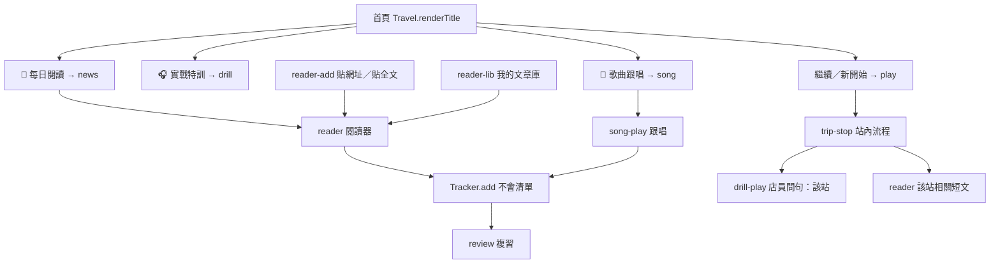
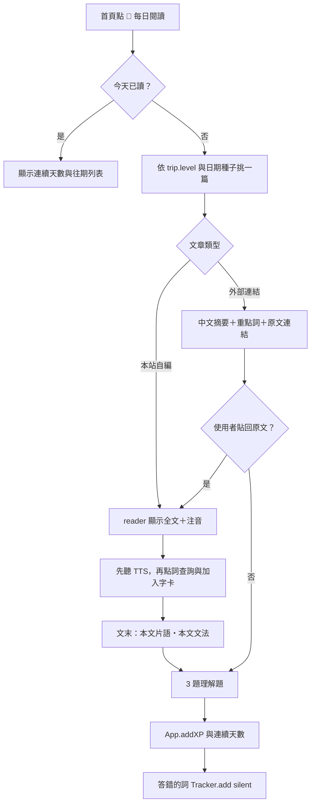
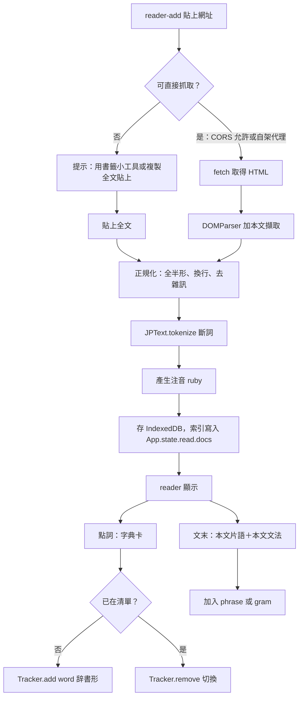
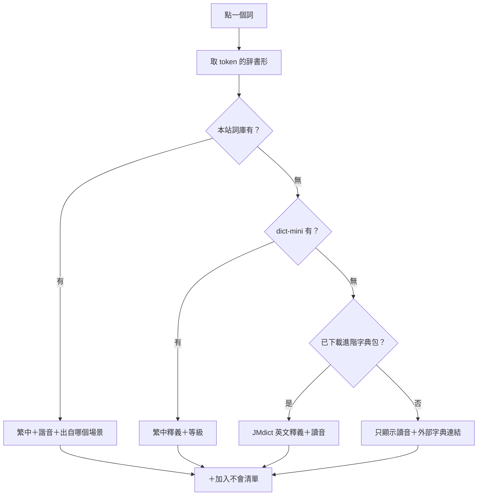
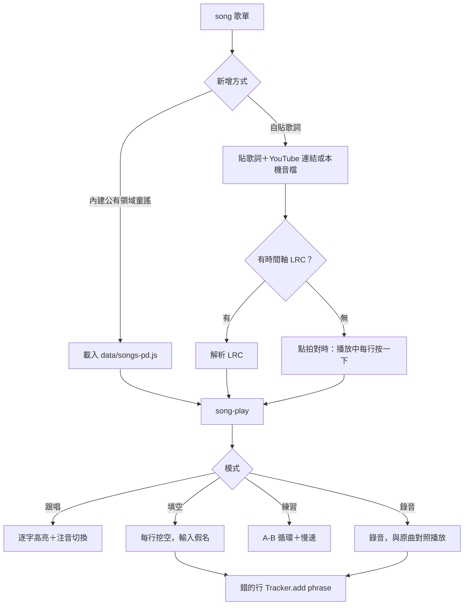
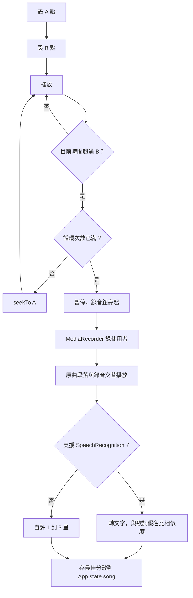
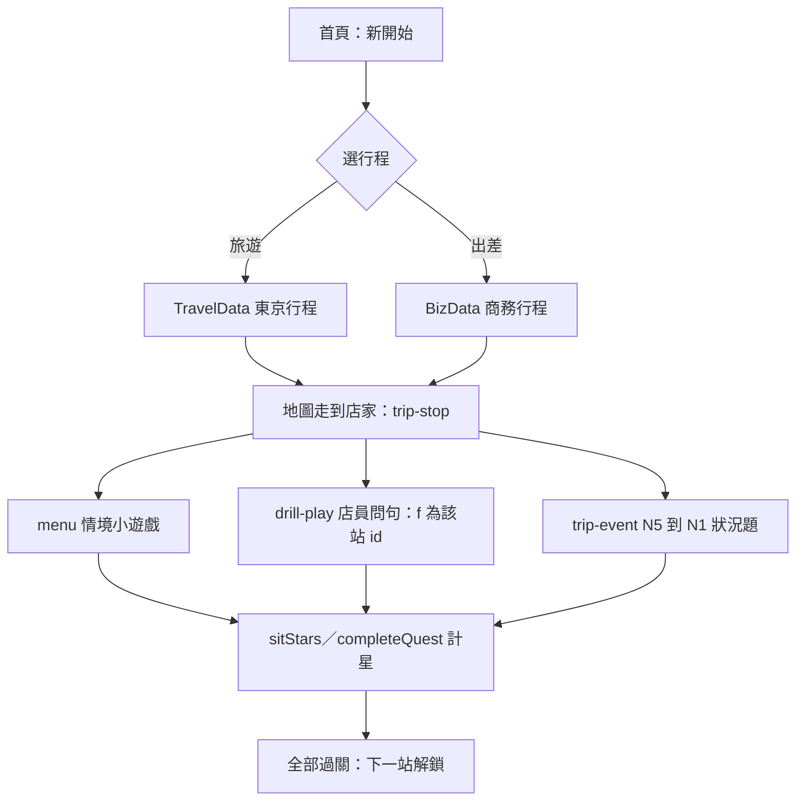
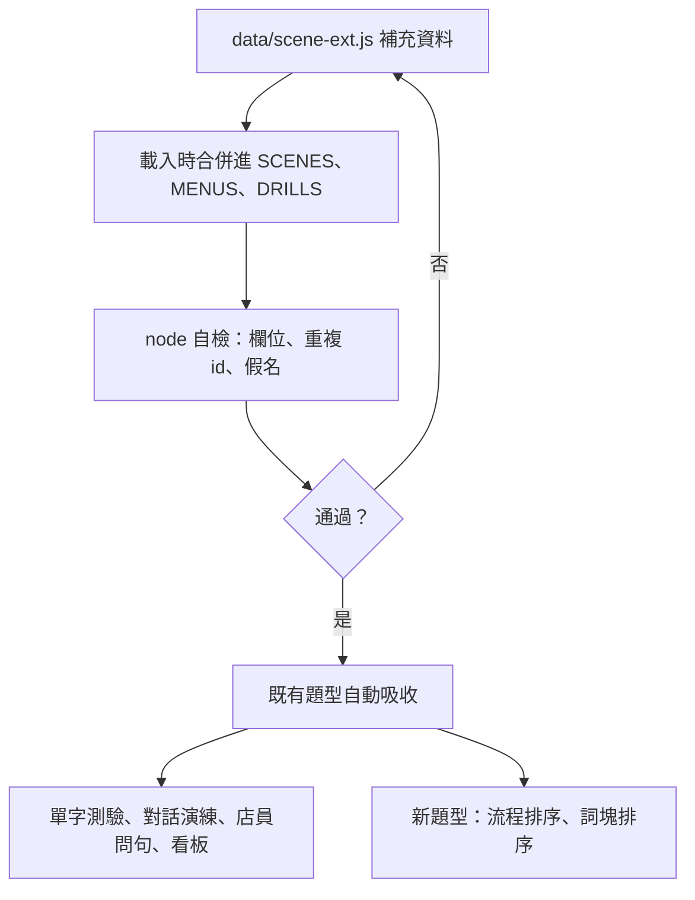

# 07 本站新功能設計：每日新聞・網址閱讀・歌曲跟唱・場景擴充與加深

> 基準：repo 工作目錄現況（commit 30bf17c ＋ 未提交的 `data/drills.js`、`js/drill.js`），2026-11-16。
> 本文所有「現有數量」皆以 node 載入 `kana-data.js`、`data/*.js` 實際統計；外部事實附來源，查不到者標「（待查證）」。
> 本文只做設計，不改任何程式。

---

## 0. 設計前提（必須遵守的現況約束）

### 0.1 架構約束

| 約束 | 來源 | 對新功能的影響 |
|---|---|---|
| 純前端、無建置工具、**無外部 CDN** | `CONTRACT.md` 開頭 | 斷詞器、字典、Readability 類函式庫都要 **vendor 進 repo**（例如 `lib/`），不能 `<script src="https://cdn…">`。YouTube IFrame API 是唯一無法 vendor 的外部腳本，只能在「歌曲」頁**延遲載入**，並視為例外寫進 CONTRACT。 |
| 可離線 PWA，`sw.js` 網路優先、失敗用快取，`FILES` 清單＋`VERSION` | `sw.js`（目前 `jpq-v17`） | 新檔案要加進 `FILES` 並升版；大型字典不放 `FILES`（安裝會變慢），改「使用者按下載才快取」到獨立 cache（如 `jpq-dict-v1`）。 |
| 存檔 `App.state` → `localStorage`＋雲端 `data/users/<id>/save`（整包 JSON 字串） | `js/core.js` `save()`／`cloudPush()` | **文章全文、歌詞、斷詞結果不得放進 `App.state`**（會讓每次 `save()` 都上傳大字串，且 localStorage 約 5MB 上限）。改存 **IndexedDB**，`App.state` 只放索引與星數。 |
| 路由只存在記憶體，`App.go(name, params)`；網址不再寫 `#/name?k=v` | `js/core.js` `go()` 註解 | CONTRACT 的「hash 為 #/name?k=v」已過時；params 可直接傳物件／陣列。分享網址進站（PWA Share Target）需另外在 `App.start()` 讀 `location.search`。 |
| 答錯一律 `Tracker.add(item, true)`；每個詞句旁要有 `.track-btn` | `CONTRACT.md` Tracker 規則 | 新功能所有可點的日文都要能加入不會清單。 |
| `review.js` 以 `source` 欄位分組篩選 | `js/review.js` 第 135、250 行 | `source` 要用**固定分類字串**（如 `📖 閱讀`），不要用文章標題，否則篩選列會爆量；標題放 `hint`。 |

### 0.2 現有路由（實際 `App.register` 盤點）

| 路由 | 檔案 | 用途 |
|---|---|---|
| `home` | index.html inline | `Travel.renderTitle`：繼續／新開始／🎧實戰特訓／⚙️設定 |
| `play`、`trip-stop`、`trip-event` | js/travel.js | 東京地圖、站內流程、N5–N1 狀況題 |
| `map`、`quest` | js/quest.js | 冒險地圖、關卡 |
| `practice`、`practice-map`、`stage`、`cards`、`menu` | js/practice.js | 原版練習、場景關卡、字卡、情境小遊戲 |
| `town`、`scene`、`drill`（被覆蓋） | js/town.js | 場景、自由練習 |
| `drill`、`drill-play` | js/drill.js | 實戰特訓（店員問句／看板／數字） |
| `review` | js/review.js | 不會清單 |

> ✅ 已修正（2026-11-16）：`js/drill.js` 的路由原本也叫 `drill`，與 `js/town.js` 衝突；已改名為 `boot`／`boot-play`，town 的 `drill` 恢復正常。新功能命名請避開 `drill`、`boot`。

### 0.3 新路由命名（全部避開既有名稱）

| 新路由 | 檔案 | params |
|---|---|---|
| `news` | js/reader.js | 無 |
| `reader` | js/reader.js | `{doc:'doc:<雜湊>'}` 或 `{news:'<新聞id>'}` |
| `reader-add` | js/reader.js | `{url?}` |
| `reader-lib` | js/reader.js | 無（我的文章庫） |
| `song` | js/song.js | 無（歌單） |
| `song-edit` | js/song.js | `{id?}` |
| `song-play` | js/song.js | `{id, m:'sing'\|'cloze'\|'loop'\|'rec'}` |
| （沿用）`play`、`trip-stop`、`menu`、`drill-play` | 既有 | 場景擴充與加深全部走既有引擎，只加資料 |

### 0.4 Tracker id 規則（對齊 CONTRACT，新增一個前綴）

| 前綴 | 現況 | 新功能用法 |
|---|---|---|
| `kana:<平假名>` | 既有 | 不變 |
| `word:<jp>` | 既有（`App.wordItem`） | 閱讀／新聞點詞：**jp 一律用辞書形**（降りました → `word:降りる`），才能和場景單字合併、不重複 |
| `phrase:<jp>` | 既有 | 本文片語、例句、歌詞行 |
| `num:`、`cnt:` | drill.js 已在用，CONTRACT 未列 | 建議補進 CONTRACT |
| `gram:<句型>` | **新增** | 本文文法，例：`gram:〜てしまう` |

注意：`word:` 以 jp 為鍵，同形異義會撞（例：`チャージ` 在 station 是「IC 加值」，居酒屋語境是「服務費」）。本文補詞清單已避開；若未來必須收同形異義，用 `word:<jp>|<kana>` 並在 CONTRACT 註明。

### 0.5 共用核心：`js/jp-text.js`（閱讀、新聞、歌曲三者共用）

```js
window.JPText = {
  ready: Promise,                          // 字典載入完成
  tokenize(text) -> [Token],               // 斷詞
  ruby(tokens, mode) -> html,              // mode: 'none' | 'kanji'（只標漢字） | 'all'
  lookup(base) -> Entry | null,            // 點詞查詢
  romaji(kana) -> string,                  // 用 KANA／DAKU／YOON 表轉羅馬字
  levelOf(base) -> 'N5'|'N4'|'N3'|'N2'|'N1'|'x'|null,  // 先查 CARDS.levelOf，再查 dict-mini
  findGrammar(text) -> [GrammarHit],       // 對 GRAMMAR 規則
  findPhrases(text) -> [PhraseHit]         // 對 COLLOC＋CARDS.decks.idiom＋SCENES.phrases
};
// Token
{ s: '降りました', b: '降りる', r: 'おりました', rb: 'おりる', p: '動詞', lv: 'N4', i: 128 /* 在原文的位置 */ }
// Entry
{ jp: '降りる', kana: 'おりる', zh: '下（車）', lv: 'N4', from: 'scene:station' | 'dict-mini' | 'jmdict', en?: 'to get off' }
```

斷詞引擎兩段式：

| 階段 | 做法 | 大小 | 優點 | 缺點 |
|---|---|---|---|---|
| A（預設，離線） | 最長匹配＋簡易活用還原（ます形／た形／て形／ない形 → 辞書形），詞庫＝本站 SCENES／CARDS／DRILLS／MENUS 全部日文＋新增 `data/dict-mini.js`（N5–N3 約 3,000–4,000 詞，**自編繁中釋義**） | 估 300–500KB（待實測） | 繁中、離線、手機快 | 未收錄的漢字詞讀音會缺 |
| B（選用「進階字典包」） | kuromoji.js（Apache-2.0）＋其 `dict/*.dat.gz`，在 Web Worker 執行 | npm 套件解壓後 41.3MB，字典檔總量（待查證，需實測 gz 後大小） | 斷詞與讀音準確 | 檔案大、首次載入慢、手機記憶體壓力（待實測） |

釋義來源：JMdict（EDRDG，CC BY-SA 4.0，需署名、衍生物同授權）主要是英文釋義，沒有可直接用的繁中（待查證多語版是否含中文）；因此**繁中釋義以自編 `dict-mini` 為主**，JMdict 只當英文後備，且若打包進站要在設定頁加署名與授權聲明。

---

## 總覽：新功能入口



---

## 1. 每日新聞（📰 每日閱讀）

### 1.1 可公開來源評估

| 來源 | 現況 | 可否抓全文進本站 | 建議用法 |
|---|---|---|---|
| NHK NEWS WEB EASY（`https://www3.nhk.or.jp/news/easy/`） | 2012 年 4 月開始，以人工改寫成簡單日文、附讀音與朗讀（[名古屋國際中心資料](https://www.nic-nagoya.or.jp/japanese/publication/assets_c/08f0739203c3411a9111c03995c6fe25cbe7061a.pdf)）。NHK 於 2025-10-01 改為「NHK ONE」，網站需登入、多數服務需收視契約（[ITmedia 2025-07-29](https://www.itmedia.co.jp/pcuser/articles/2507/29/news108.html)、[ITmedia 2025-10-08](https://www.itmedia.co.jp/mobile/amp/2510/08/news116.html)）。EASY 目前是否持續更新、是否需登入：（待查證，本次無法連上 nhk.or.jp） | **不可**：NHK 內容受著作權保護，使用條款與轉載規定（待查證，需人工讀 nhk.or.jp 規約頁）；瀏覽器端跨網域抓取亦無 CORS 標頭（待查證） | 只放「連結＋本站自寫中文摘要＋重點詞」，使用者自行點開原文 |
| NPO 多言語多讀「にほんご多読ブックス」免費讀物 | 網頁版讀物免費提供 PDF，可下載或列印（[tadoku.org](https://tadoku.org/japanese/?p=3851)）；朗讀音檔著作權屬該 NPO（[tadoku.org 音檔頁](https://tadoku.org/japanese/?p=1707)） | 授權是否允許轉載進 App：（待查證） | 只放連結＋分級標籤 |
| **本站自編短文**（新聞體、虛構或通識） | 自己寫，無版權問題 | **可**，打包進 `data/news.js`，完全離線 | **每日一篇的主力來源** |
| 使用者自貼 | 使用者自己複製的文字，只存在使用者本機 IndexedDB、不上雲端 | 可（私人學習用途） | 外部文章的「全文閱讀」一律走這條 |

**結論**：每日一篇以「本站自編」為主，外部新聞只做「連結＋摘要」，想讀原文全文就由使用者自貼。這樣不散布他人全文，也不依賴第三方 API。

### 1.2 難度標示方式

每篇文章（本站自編或使用者自貼）都自動算一次：

| 指標 | 算法 | 顯示 |
|---|---|---|
| 詞彙等級分布 | `JPText.levelOf` 統計 N5／N4／N3／N2／N1／級外 比例 | 一條彩色長條（N5 綠 → N1 紅、級外灰） |
| 綜合等級 | 取「涵蓋 90% 詞彙所需的最低等級」 | 標籤 `N4` |
| 漢字比例 | 漢字字數 ÷ 總字數 | `漢字 28%` |
| 平均句長 | 字數 ÷ 句號數 | `每句 24 字` |
| 個人已知率 | 詞在 `Tracker` 已 mastered、或屬於已過關場景（`App.state.sitStars`／`cleared`）的比例 | `你已認得 76%` |

內文中每個詞依等級加底線色（可在設定關閉）；使用者目前程度取 `App.state.trip.level`（K0／N5…N1），高於程度兩級以上的詞預設顯示注音。

### 1.3 每日一篇流程



日期種子挑文：`pool = NEWS.filter(n => 等級 ≤ 使用者程度+1)`，`idx = hash('2026-11-16') % pool.length`；同一天每次打開都是同一篇。

### 1.4 畫面組成

```
┌ news ───────────────────────────────┐
│ 📰 今日一篇  🔥連續 5 天             │
│ ┌ 卡片 ────────────────────────────┐ │
│ │ [N4] 漢字28% 每句24字 你已認得76% │ │
│ │ 標題（含注音）                    │ │
│ │ ▓▓▓▓▓▒▒▒░ 詞彙等級條              │ │
│ │ [▶ 開始閱讀]                      │ │
│ └──────────────────────────────────┘ │
│ 外部推薦（連結＋中文摘要）× 3        │
│ 往期：11/15 ★★☆ 11/14 ★★★ …         │
│ [🔗 貼網址／貼全文] [📚 我的文章庫]  │
└─────────────────────────────────────┘
```

reader 畫面見 2.4。

### 1.5 資料結構

```js
// data/news.js（本站自編，打包離線）
window.NEWS = [
  { id: 'n0001', lv: 'N5', tags: ['天氣'],
    title: '東京で初雪', titleKana: 'とうきょうではつゆき',
    body: ['きのう、東京で雪が降りました。', '去年より十日早いです。', '電車は少し遅れました。'],  // 一句一元素（範例為虛構示範）
    zh: ['昨天東京下雪了。', '比去年早十天。', '電車稍微誤點。'],
    vocab: [{ jp: '初雪', kana: 'はつゆき', zh: '初雪' }, { jp: '遅れる', kana: 'おくれる', zh: '誤點、遲到' }],
    q: [{ ask: '電車怎麼了？', a: ['稍微誤點', '停駛', '準時'], why: '「遅れました」＝誤點了' }],
    links: [{ scene: 'station' }] },   // 與場景關聯，用於 trip-stop 推薦
  // 外部連結型：不含原文
  { id: 'x0001', lv: 'N4', ext: { name: 'NEWS WEB EASY', url: 'https://www3.nhk.or.jp/news/easy/' },
    title: '（本站自寫中文標題）', summaryZh: '本站自寫的中文摘要，不轉載原文。', vocab: [/* 重點詞 */], q: [] }
];

// App.state（小、可上雲端）
App.state.read = {
  opt: { ruby: 'kanji', zh: false, lvColor: true, size: 1 },
  news: { last: '2026-11-16', days: 5, done: { n0001: 3 } }   // 星數
};
App.save();
```

完成時：`App.addXP(15, '每日閱讀')`；理解題全對 3 星、錯 1 題 2 星；答錯題目對應的 `vocab` 以 `App.wordItem(v, '📰 新聞', 'word')` 加入 Tracker（silent）並在 `App.showResult({wrong})` 列出。

### 1.6 新增檔案、整合點、工時

| 項目 | 內容 |
|---|---|
| 新檔 | `data/news.js`（先 30 篇：N5×10、N4×10、N3×10，每篇 3–6 句）、`js/reader.js`（與第 2 章共用）、`js/jp-text.js`、`data/dict-mini.js` |
| 改檔（主編） | `index.html` 加 script；`js/travel.js` `renderTitle` 加「📰 每日閱讀」按鈕（照 `tt-drill` 的寫法）；`sw.js` FILES＋升版 |
| 與 travel 整合 | `NEWS[].links.scene` 與站 id 對應；`hubSteps()` 尾端可加一步「📖 讀一篇」（`App.go('reader', {news})`），讀完計入站內星數 |
| 與 drill 整合 | 新聞詞彙若屬看板詞（`DRILLS.SIGNS`），文中標🪧並可一鍵 `App.go('drill-play', {m:'sign', f:分類})` |
| 工時 | 閱讀器共用核心另計（見 2.6）；每日新聞頁 6h；自編 30 篇內容 15h（每篇約 30 分）；難度計算 3h；合計 **約 24h** |

---

## 2. 自訂網址閱讀（🔗 貼網址 → 讀懂它）

### 2.1 使用者流程



### 2.2 點詞查詢流程



### 2.3 本文片語與本文文法（文章下方自動列出）

| 區塊 | 偵測來源 | 每筆顯示 | 加入字卡 |
|---|---|---|---|
| 本文片語 | ① 新增 `data/colloc.js`（搭配詞／慣用說法，先 300 筆）② `CARDS.decks.idiom`（現有 17 筆）③ 所有 `SCENES[].phrases`（現有 93 句） | 片語、讀音、中文、**本文出現的那句**（高亮）、另一個例句、🔊 | `Tracker.add({id:'phrase:気をつける', …, source:'🧩 片語'})` |
| 本文文法 | 新增 `data/grammar.js`（N5–N3 句型，先 80 條），以正規式或 token 序列比對 | 句型、等級、說明（繁中）、本文句、例句 2 個、🔊 | `Tracker.add({id:'gram:〜てしまう', …, source:'📐 文法'})` |

排序：依等級（低到高）再依出現次數；同一條只列一次，並標「本文出現 3 次」，點擊在內文逐一跳到該位置。

```js
// data/grammar.js
window.GRAMMAR = [
  { id: 'gram:〜てしまう', p: '〜てしまう／〜ちゃう', lv: 'N4', zh: '（不小心）做了；做完了（帶遺憾）',
    re: /[てで]しま(う|った|います|いました)|[ちじ]ゃ(う|った)/,
    note: '動詞て形＋しまう。口語縮成〜ちゃう／〜じゃう。',
    ex: [['財布を忘れてしまいました。', 'さいふをわすれてしまいました', '我把錢包忘了。'],
         ['電車に乗り遅れちゃった。', 'でんしゃにのりおくれちゃった', '沒趕上電車。']] },
  { id: 'gram:〜てください', p: '〜てください', lv: 'N5', zh: '請（做）…', re: /[てで]ください/,
    note: '動詞て形＋ください：禮貌請求。', ex: [['ここに名前を書いてください。', 'ここになまえをかいてください', '請在這裡寫名字。']] }
];
// 加入字卡
Tracker.add({ id: g.id, jp: g.p, kana: g.p.replace(/〜/g, ''), zh: g.zh, hint: '例：' + g.ex[0][0], source: '📐 文法' });

// data/colloc.js
window.COLLOC = [
  { jp: '気をつける', kana: 'きをつける', zh: '小心、注意', lv: 'N4', m: ['気をつけ', '気を付け'], ex: ['足元に気をつけてください。', 'あしもとにきをつけてください', '請小心腳下。'] }
];
```

### 2.4 畫面組成（reader）

```
┌ reader ─────────────────────────────┐
│ ← 標題                    [Aa][注音▾]│  注音：無／只漢字／全部；字級
│ [N4] 漢字28% 你已認得76%  [🔊全文]   │
│ ─────────────────────────────────── │
│ 内文（ruby；詞依等級底線色；         │
│ 已在清單的詞加 📌 角標）            │
│ 每句尾 🔊 單句朗讀、[中] 顯示譯文     │
│ ─────────────────────────────────── │
│ 🧩 本文片語（n）  每列 [＋ 加入不會清單]│
│ 📐 本文文法（n）  每列 [＋ 加入不會清單]│
│ 📌 本文我加入的詞（n） [→ 去複習]     │
└─────────────────────────────────────┘
點詞 → 底部抽屜：大字＋讀音＋羅馬字＋繁中＋等級＋本文例句＋🔊＋[＋ 加入不會清單]
```

`reader-add`：上方網址輸入框＋「抓取」；下方大文字框「或直接貼全文」＋標題欄；底部說明「全文只存在這台裝置，不會上傳」。

### 2.5 技術限制與對策

| 限制 | 說明 | 對策 |
|---|---|---|
| 純前端 CORS | 瀏覽器 `fetch` 他站 HTML，對方沒給 `Access-Control-Allow-Origin` 就讀不到內容（[MDN：CORS](https://developer.mozilla.org/en-US/docs/Web/HTTP/CORS)）；絕大多數新聞站不給 | ①**主流程＝貼全文**；②桌機提供「書籤小工具」：在文章頁執行，抽取本文後複製到剪貼簿，再回本站貼上；③進階：使用者**自架**轉送（如 Cloudflare Worker，約 20 行、白名單網域、不記錄），在設定填網址；**不建議**用公開 CORS 代理（隱私與穩定性風險） |
| Claude 網站沙盒 | `core.js` 有 `claude.use('db')` 雲端存檔，表示本站也會在 Claude 網站內執行；該環境的 CSP 是否允許對外 `fetch`：（待查證） | 沙盒內自動隱藏「抓取」按鈕，只留貼全文 |
| 本文擷取 | 需要 Readability 類演算法 | Mozilla Readability.js 為 Apache-2.0（[mozilla/readability 鏡像](https://chromium.googlesource.com/external/github.com/mozilla/readability/+show/refs/heads/main/README.md)），可 vendor 進 `lib/`；或自寫簡化版：取 `<article>`／最多 `<p>` 字數的區塊 |
| 離線字典 | 見 0.5：預設 dict-mini（繁中、小），進階包 kuromoji.js（Apache-2.0，npm 解壓 41.3MB，[npm](https://npmjs.com/package/kuromoji)；瀏覽器只需 `build/kuromoji.js` 與 `dict/*.dat.gz`，[GitHub](https://github.com/takuyaa/kuromoji.js)） | 進階包放獨立 cache，設定頁顯示大小與「刪除字典包」 |
| JMdict 檔案大小 | jmdict-simplified 最新版釋出說明列出 JMdict 約 115MB（未壓縮 JSON，[releases](https://github.com/scriptin/jmdict-simplified/releases/latest)）；common-only 版較小但確切大小（待查證） | 只取 common 詞＋必要欄位，預處理成 `{jp:[kana,en]}` 分片（按首字切檔），按需載入；授權 CC BY-SA 4.0 需署名（[EDRDG 授權](https://www.edrdg.org/edrdg/license.html)） |
| 手機效能 | 3,000 字文章：方案 A 最長匹配預估 < 50ms（待實測）；kuromoji 首次載入字典需數秒、記憶體壓力大（待實測） | 斷詞放 Web Worker；結果（tokens）一起存進 IndexedDB，第二次開啟不重算；長文分段 render（每 20 句一批） |
| 儲存 | 文章全文不可進 `App.state` | IndexedDB `jpq` 資料庫、`docs` store；`App.state.read.docs` 只放最近 50 筆索引 |
| 著作權 | 使用者貼的文章屬他人著作 | 只存本機、不上雲端、不提供分享；備份檔（`PracticeAPI.backup`）預設不含全文 |

### 2.6 資料結構與 API

```js
// IndexedDB 'jpq' → store 'docs'（不進 App.state、不上雲端）
{ id: 'doc:9f3a1c', title: '…', url: 'https://…' | null, src: 'url' | 'paste' | 'news',
  text: '全文', tokens: [Token], lv: 'N4', stat: { kanji: 0.28, len: 24, known: 0.76 }, at: 1731745000000 }

// App.state（索引）
App.state.read.docs = [{ id: 'doc:9f3a1c', title: '…', lv: 'N4', at: 1731745000000, n: 812 }];

// 點詞加入（對齊 CONTRACT：App.wordItem → id = 'word:<jp>'）
const item = App.wordItem({ jp: t.b, kana: t.rb, romaji: JPText.romaji(t.rb), zh: e.zh, hint: `出自《${doc.title}》：${sentence}` }, '📖 閱讀', 'word');
Tracker.has(item.id) ? Tracker.remove(item.id) : Tracker.add(item);

// js/reader.js
App.register('news',       { title: '每日閱讀', icon: '📰', nav: false, render: renderNews });
App.register('reader',     { title: '閱讀',     icon: '📖', nav: false, render: renderReader });
App.register('reader-add', { title: '加入文章', icon: '🔗', nav: false, render: renderAdd });
App.register('reader-lib', { title: '文章庫',   icon: '📚', nav: false, render: renderLib });
window.ReaderAPI = { open(docId), addText(title, text, src), todayNews(), docsFor(sceneId) };
```

讀完一篇（捲到底並開過至少 1 個詞卡）：`App.addXP(10, '閱讀')`，同一篇只給一次（記在 `App.state.read.done[docId]`）。

### 2.7 整合點、新增檔案、工時

| 項目 | 內容 |
|---|---|
| 新檔 | `js/jp-text.js`、`js/reader.js`、`data/dict-mini.js`、`data/grammar.js`、`data/colloc.js`、`lib/readability.js`（選用）、`lib/kuromoji/`（選用，不進 FILES） |
| 與 review 整合 | `source` 固定為 `📖 閱讀`／`🧩 片語`／`📐 文法`，review 篩選列自動出現；`gram:` 項目在 review 的「日→中」題型可直接用 |
| 與 drill 整合 | 文中出現的店員句（比對 `DRILLS.CLERK[].v`）標 🗣️，點了可直接開 `drill-play {m:'clerk', f:場景}`；數字（価格・時刻）標 🔢 可跳數字快打 |
| 與 travel 整合 | `ReaderAPI.docsFor(stop.id)` 回傳和該站相關的自編短文，`hubSteps` 加一步 |
| 工時 | jp-text 方案 A（最長匹配＋活用還原＋ruby）12h；dict-mini 3,000 詞繁中編輯 20h（可分批）；reader 畫面＋詞卡抽屜 10h；reader-add＋IndexedDB 6h；grammar 80 條 12h＋偵測 4h；colloc 300 條 8h；Readability 整合 3h；kuromoji 進階包 10h（選做）。合計 **約 75h（不含選做 65h）** |

---

## 3. 日文歌曲跟唱（🎵）

### 3.1 版權方案

| 項目 | 做法 | 依據 |
|---|---|---|
| 歌詞 | 本站**不收錄**有版權歌詞；使用者自貼，只存本機 IndexedDB、不上雲端、不提供匯出分享 | 歌詞為著作物 |
| 內建示範曲 | 只收**公有領域**童謠／唱歌：日本 2018-12-30 起延長為死後 70 年，但 1967 年以前去世者的著作已消滅、不回溯（[文化庁 TPP 整備法問答](https://www.bunka.go.jp/seisaku/chosakuken/hokaisei/kantaiheiyo_chosakuken/1411890.html)、[NDL E2119](https://current.ndl.go.jp/e2119)）。候選：「ふるさと」「春が来た」「紅葉」「朧月夜」（作詞 高野辰之 1947 歿、作曲 岡野貞一 1941 歿）、「赤とんぼ」（三木露風 1964 歿、山田耕筰 1965 歿）、「七つの子」（野口雨情 1945 歿、本居長世 1945 歿）、「さくらさくら」（日本古謠）。各曲作者生卒（待逐首查證） | 文化庁 |
| 音源 | ①YouTube 官方嵌入（不下載、不剝離音軌）②使用者選本機音檔（`<input type=file>`，只在記憶體或 IndexedDB）③內建曲只用 TTS 朗讀歌詞（不唱） | YouTube API 條款 |
| YouTube 規範 | 播放器可視區至少 200×200px；必須帶 HTTP Referer 識別；不得修改、遮蓋或阻擋播放器標準功能、不得背景播放（[Required Minimum Functionality](https://developers.google.com/youtube/terms/required-minimum-functionality)、[Developer Policies](https://developers.google.com/youtube/terms/developer-policies-guide)）。擁有者禁止嵌入時 `onError` 回傳 101／150；缺 Referer 回 153（[IFrame API](https://developers.google.com/youtube/iframe_api_reference)） | → 歌詞面板放在播放器**下方**，不疊在影片上；收到 101／150 顯示「此影片不允許嵌入，改用本機音檔或開新分頁」；以 `file://` 雙擊開啟時沒有 Referer，提示改用 `手機開啟.bat`／`python -m http.server` |

### 3.2 使用者流程



### 3.3 A-B 循環與錄音比對流程



### 3.4 功能規格

| 功能 | 實作 |
|---|---|
| 逐字高亮 | 行級時間 `t`／`e` 來自 LRC 或點拍；行內每個字的時間以**拍數（mora）比例內插**（拗音算 1 拍、促音／長音各 1 拍），標「估計」；YouTube 用 `getCurrentTime()` 以 `requestAnimationFrame` 輪詢（約 100ms 一次即可），本機音檔用 `timeupdate`＋rAF |
| 注音切換 | 沿用 `JPText.ruby`：無／只漢字／全部；另一顆切換羅馬字（`JPText.romaji`）與中文（使用者可自填每行中文） |
| 填空聽寫 | 每行依難度挖 1–3 個詞（優先挖使用者程度內、`levelOf` 有值的詞；不挖助詞），播放到該行自動暫停，輸入假名（正規化：片→平、長音符號），錯的詞 `Tracker.add(App.wordItem(…,'🎵 歌曲','word'), true)` |
| A-B 循環 | 點兩下行號設 A／B（或長按拖選多行），`seekTo(A, true)`；循環次數 1／3／∞ |
| 慢速 | YouTube：`getAvailablePlaybackRates()` 取可用值（常見 0.25–2），`setPlaybackRate()` 不保證成功，以 `onPlaybackRateChange` 為準（[IFrame API](https://developers.google.com/youtube/iframe_api_reference)）；本機音檔：`audio.playbackRate`＋`preservesPitch = true` |
| 跟唱錄音 | `getUserMedia`＋`MediaRecorder`（需安全來源：https 或 localhost；`file://` 不行）；建議「一問一答」模式：放完一行 → 暫停 → 錄 → 再放下一行，避免錄到原曲 |
| 錄音比對 | ①A/B 交替播放（主要）；②音量包絡線疊圖（自算 RMS，看節奏有沒有對上）；③選用語音辨識評分：`SpeechRecognition` 非 Baseline、Chrome 為伺服器端辨識不能離線（[MDN](https://developer.mozilla.org/en-US/docs/Web/API/SpeechRecognition)）；caniuse 標示 Chrome／Safari 部分支援、Firefox 預設停用、Edge 標為不支援（[caniuse](https://caniuse.com/speech-recognition)，Edge 實測待查證）→ 只當加分項，畫面註明「語音會傳到瀏覽器廠商伺服器」 |
| TTS | `App.speak` 可唸歌詞（說話語調，非唱），供不會讀的行先聽讀音 |

### 3.5 畫面組成（song-play）

```
┌ song-play ──────────────────────────┐
│ ← 曲名 / 歌手            [注音▾][羅][中]│
│ ┌ YouTube 播放器 ≥ 200×200（不覆蓋）┐ │
│ └──────────────────────────────────┘ │
│ 模式：[跟唱][填空][A-B][錄音]         │
│ 速度：0.5 0.75 1.0   循環：1 3 ∞      │
│ ─────────────────────────────────── │
│  12  ふるさと の 歌詞行（已唱部分變色）│ ← 目前行置中、自動捲動
│  13  下一行                           │
│ 每行右側：🔊TTS  🅰🅱  📌加入           │
│ ─────────────────────────────────── │
│ 錄音列：● 錄  ▶ 我的  ▶ 原曲  ★★☆    │
└─────────────────────────────────────┘
```

`song-edit`：貼歌詞（一行一句）、YouTube 網址或選音檔、LRC 貼上欄、「開始點拍對時」按鈕（播放時每到新的一行按一次空白鍵／大按鈕）。

### 3.6 資料結構

```js
// data/songs-pd.js（內建、公有領域）
window.SONGS_PD = [
  { id: 'song:furusato', title: 'ふるさと', lyricBy: '高野辰之（1876–1947）', musicBy: '岡野貞一（1878–1941）', pd: true,
    lines: [{ jp: '（歌詞第一行）', kana: '…', zh: '…' }] }   // 無時間軸 → 用 TTS 或使用者自配音源
];

// IndexedDB 'jpq' → store 'songs'（使用者自貼，不上雲端）
{ id: 'song:1731745000000', title: '', artist: '',
  src: { yt: 'VIDEO_ID' } /* 或 */ || { file: 'audio:1731745000000' },
  lines: [{ t: 12.30, e: 15.80, jp: '…', kana: '…', zh: '' }],
  ab: { a: 12.3, b: 31.0, loop: 3 }, rate: 0.75, at: 1731745000000 }

// App.state（只放小資料）
App.state.song = { opt: { ruby: 'kanji', romaji: false, zh: true }, best: { 'song:furusato': { cloze: 3, rec: 2 } } };
App.save();

// 歌詞行加入不會清單（phrase:<jp>）
Tracker.add(App.wordItem({ jp: line.jp, kana: line.kana, zh: line.zh || '（歌詞）', hint: '出自〈' + song.title + '〉' }, '🎵 歌曲', 'phrase'));

// js/song.js
App.register('song',      { title: '歌曲跟唱', icon: '🎵', nav: false, render: renderList });
App.register('song-edit', { title: '新增歌曲', icon: '✏️', nav: false, render: renderEdit });
App.register('song-play', { title: '跟唱',     icon: '🎤', nav: false, render: renderPlay });
```

YouTube API 腳本在 `song-play` 第一次進入時才插入 `<script src="https://www.youtube.com/iframe_api">`，並設 `window.onYouTubeIframeAPIReady`；`sw.js` 的 fetch handler 應略過 `youtube.com`／`ytimg.com`／`googlevideo.com`（現在是所有 GET 都 `caches.put`，會把外站回應塞進快取）。

### 3.7 整合點、新增檔案、工時

| 項目 | 內容 |
|---|---|
| 新檔 | `js/song.js`、`data/songs-pd.js`（先 6 首）、共用 `js/jp-text.js` |
| 改檔 | `index.html`、`js/travel.js` `renderTitle` 加「🎵 歌曲跟唱」、`sw.js`（FILES、略過 YouTube 網域）、`CONTRACT.md`（YouTube 例外） |
| 與 drill 整合 | 填空聽寫沿用 drill 的語速設定 `App.state.drillOpt.rate` 作為預設慢速；結果畫面沿用 `App.showResult` |
| 與 travel 整合 | 無直接關係；可在「⚙️ 設定」顯示每日跟唱連續天數 |
| 工時 | 歌單＋編輯＋IndexedDB 6h；LRC 解析＋點拍對時 5h；播放器抽象層（YouTube／本機音檔同介面）6h；逐字高亮＋注音 6h；填空 6h；A-B＋慢速 4h；錄音＋包絡線 8h；語音辨識評分 4h（選做）；公有領域 6 首整理 4h。合計 **約 49h** |

---

## 4. 旅遊／商用場景模組擴充

### 4.1 新增場景清單

**旅遊包（`data/scenes-3.js`）**

| id | 名稱 | 子場景 | 代表單字（節錄） | 代表句（節錄） |
|---|---|---|---|---|
| `onsen` | 溫泉・旅館 | 入館脫鞋、浴衣、大浴場規則、晚餐時間、貸切風呂 | 浴衣（ゆかた）、かけ湯（かけゆ）、貸切（かしきり）、男湯（おとこゆ）、女湯（おんなゆ）、刺青（いれずみ）、仲居（なかい） | 夕食は何時からですか。／タトゥーがあっても入れますか。／貸切風呂の予約はできますか。 |
| `taxi` | 計程車 | 叫車、說目的地、經由、付款、拿收據 | 迎車（げいしゃ）、行き先（いきさき）、トランク、領収書、高速道路（こうそくどうろ） | この住所までお願いします。／高速を使ってください。／ここで止めてください。 |
| `sushi` | 迴轉壽司 | 平板點餐、取盤、茶與醬油、計算盤數 | 皿（さら）、さび抜き（さびぬき）、粉茶（こなちゃ）、ガリ、注文パネル（ちゅうもんぱねる） | さび抜きでお願いします。／お茶はどうやって入れますか。／お会計はこのボタンですか。 |
| `depa` | 百貨公司・デパ地下 | 樓層導覽、試吃、保冷劑、伴手禮包裝、免稅櫃台 | 保冷剤（ほれいざい）、日持ち（ひもち）、手提げ袋（てさげぶくろ）、試食（ししょく）、お土産（おみやげ） | 何日くらい日持ちしますか。／保冷剤を入れてもらえますか。／小分けの袋をください。 |
| `super` | 超市 | 找商品、半價貼紙、自助結帳、自備袋 | 半額（はんがく）、見切り品（みきりひん）、セルフレジ、マイバッグ、レジ袋 | セルフレジの使い方を教えてください。／これは半額ですか。 |
| `ticket` | 景點・美術館門票 | 售票、年齡票種、語音導覽、寄物櫃、再入場 | 大人（おとな）、学生（がくせい）、音声ガイド（おんせいがいど）、コインロッカー、再入場（さいにゅうじょう） | 大人二枚お願いします。／再入場できますか。／音声ガイドはありますか。 |
| `post` | 郵局・宅配 | 寄明信片、寄行李到機場、EMS、取件 | 切手（きって）、はがき、航空便（こうくうびん）、船便（ふなびん）、着払い（ちゃくばらい） | 台湾までいくらですか。／空港まで荷物を送りたいです。 |

**商用包（`data/scenes-biz.js`，`pack:'biz'`）**

| id | 名稱 | 子場景 | 代表單字 | 代表句（標示敬語類型） |
|---|---|---|---|---|
| `b-aisatsu` | 自我介紹・寒暄 | 初次見面、所屬公司、道別 | 弊社（へいしゃ）、御社（おんしゃ）、担当（たんとう）、出張（しゅっちょう） | 台湾の○○社の王と申します。（謙譲）／いつもお世話になっております。（定型） |
| `b-meishi` | 名片交換 | 遞名片順序、收名片、放名片 | 名刺（めいし）、名刺入れ（めいしいれ）、肩書き（かたがき） | 頂戴いたします。（謙譲）／申し遅れました。（定型） |
| `b-uketsuke` | 訪問・受付 | 報上姓名與約、等候、被帶位 | 受付（うけつけ）、アポイント、応接室（おうせつしつ）、お約束（おやくそく） | 14時に営業部の田中様とお約束をいただいております。（謙譲） |
| `b-denwa` | 電話應對 | 接聽、轉接、留言、聽不清 | 折り返し（おりかえし）、伝言（でんごん）、席を外す（せきをはずす）、内線（ないせん） | 恐れ入りますが、もう一度お名前をお願いできますか。／折り返しお電話いただけますか。 |
| `b-kaigi` | 會議 | 開場、提問、確認、結論 | 資料（しりょう）、議題（ぎだい）、検討（けんとう）、納期（のうき）、見積もり（みつもり） | 確認させていただきます。／持ち帰って検討いたします。 |
| `b-settai` | 會食・接待 | 乾杯、倒酒、推辭、道謝 | 接待（せったい）、お酌（おしゃく）、ご馳走（ごちそう）、手土産（てみやげ） | 本日はお招きいただき、ありがとうございます。／ごちそうさまでした。 |
| `b-tenji` | 展覽會 | 攤位介紹、索取型錄、交換聯絡方式 | ブース、カタログ、サンプル、価格表（かかくひょう） | カタログをいただけますか。／後日メールでご連絡します。 |

### 4.2 使用者流程



### 4.3 畫面組成

- 「新開始」彈窗多一排：`[🗾 東京旅遊] [💼 東京出差]`，下面沿用難度按鈕 `levelBtns`。
- 地圖沿用 travel.js 的 5×8 tile 版型，出差包有自己的 `layout` 與站點（羽田 → 飯店 → 客戶受付 → 會議室 → 居酒屋接待 → 展覽會 → 郵局寄樣品）。
- 商用場景的句子卡多一個「敬語類型」小標籤（丁寧／尊敬／謙譲／定型），並在選項 feedback 說明為何此場合不能用另一類。

### 4.4 資料結構

```js
// data/scenes-3.js（旅遊包，CONTRACT SCENES 格式＋pack）
SCENES.push({
  id: 'onsen', pack: 'travel', name: '溫泉・旅館', icon: '♨️', color: '#b5651d', unlockLevel: 5,
  desc: '入館、換浴衣、泡大浴場的規矩', tips: ['進浴池前先「かけ湯」沖身體', '毛巾不要放進浴池裡'],
  vocab: [{ jp: '浴衣', kana: 'ゆかた', romaji: 'yukata', zh: '浴衣', hint: '諧音：（待編）', emoji: '👘' }],
  phrases: [{ jp: '貸切風呂の予約はできますか。', kana: 'かしきりぶろのよやくはできますか', romaji: 'kashikiri buro no yoyaku wa dekimasu ka', zh: '可以預約包場浴池嗎？', hint: '諧音：（待編）', use: '在櫃台' }],
  dialogues: [/* CONTRACT 格式，每步 3 選項 */]
});
MENUS.onsen = [/* 情境：type 'qa' | 'request' | 'ask' … 沿用 menus.js 格式 */];
DRILLS.SCENE_NAMES.onsen = '♨️ 溫泉旅館';
DRILLS.CLERK.push({ s: 'onsen', zh: '晚餐要幾點', v: [['ご夕食は何時になさいますか。', 'ごゆうしょくはなんじになさいますか'], ['お夕食のお時間はいかがいたしましょうか。', 'おゆうしょくのおじかんはいかがいたしましょうか'], ['夕食は六時と七時、どちらがよろしいですか。', 'ゆうしょくはろくじとしちじ、どちらがよろしいですか']], a: ['七時でお願いします。', '七點，麻煩你'] });

// data/scenes-biz.js（商用包）
SCENES.push({ id: 'b-meishi', pack: 'biz', name: '名片交換', icon: '📇', color: '#355c7d', unlockLevel: 3, desc: '…', tips: ['名片用雙手遞、字朝向對方', '收下的名片在會議中放桌上'],
  vocab: [/* … */], phrases: [{ jp: '頂戴いたします。', kana: 'ちょうだいいたします', romaji: 'choudai itashimasu', zh: '（收名片時）我收下了', hint: '諧音：（待編）', use: '收名片', reg: '謙譲' }], dialogues: [] });
window.BizData = { levels: TravelData.levels, layout: [/* 40 格 */], stops: [
  { id: 'b-uketsuke', day: 'Day 1', area: '品川', story: '早上十點拜訪客戶，在一樓受付報到。', tile: 1, icon: '🏢', name: '受付', jp: '受付', npc: '受付係',
    events: { N5: [['…', '…', '…', ['正解', '錯1', '錯2'], '講解', 'よみ']], N4: [], N3: [], N2: [], N1: [] } }
] };

// App.state.trip 加 pack（舊存檔沒有 → 視為 'travel'）
App.state.trip = { level: 'N4', pack: 'biz', /* 其餘沿用 */ };
```

### 4.5 整合點、新增檔案、工時

| 項目 | 內容 |
|---|---|
| 新檔 | `data/scenes-3.js`（旅遊包 7 場景）、`data/scenes-biz.js`（商用包 7 場景＋`BizData`） |
| 改檔 | `js/travel.js`：`const { levels, stops } = TravelData` 改成 `data()` 依 `App.state.trip.pack` 取 `TravelData` 或 `BizData`，`layout` 同理；`newGame()` 加行程選擇；`index.html`、`sw.js` |
| 與 drill 整合 | 新場景只要 `DRILLS.SCENE_NAMES` 加名稱、`CLERK.push({s:id,…})`，特訓首頁篩選列自動出現；看板加分類 `on`（溫泉：男湯・女湯・貸切・脱衣所）、`bz`（辦公：受付・会議室・関係者以外立入禁止・来客用） |
| 與 practice 整合 | `PracticeAPI.stageNodes(id)` 依 `MENUS[id]` 自動產生情境節點，`hubSteps` 自動吸收 |
| 工時 | 每個場景內容（vocab 15、phrases 8、dialogues 3、menus 3、CLERK 4、travel events 10）約 8h × 14 = 112h；travel.js 改為多行程 10h；商用敬語標籤與畫面 4h；看板新分類 3h。合計 **約 129h**（建議先做旅遊包前 3 個：onsen、sushi、taxi ≈ 24h） |

---

## 5. 現有場景加深

### 5.1 實際盤點（node 統計）

統計範圍：`SCENES`（scenes-1／2）、`MENUS`、`TravelData.stops`、`DRILLS.CLERK`。共盤點 **14 個場景 id**（13 個 SCENES 場景＋只存在於特訓的 `rest` 餐廳）。

| 場景 id | 名稱 | Lv | 單字 | 句型 | 對話段（步） | 情境小遊戲（類型:品項） | 情境品項 | 旅程狀況題 N5/N4/N3/N2/N1 | 店員問句 問題/說法 |
|---|---|---|---|---|---|---|---|---|---|
| konbini | 便利商店 | 1 | 14 | 7 | 2（7） | 收銀台熱食[order:8]、飲料冷藏櫃[order:7]、結帳時回答店員[qa:7題] | 15 | 2/2/2/2/2 | 8/36 |
| ramen | 拉麵店 | 2 | 15 | 7 | 2（7） | 券売機[kenbaiki:8]、告訴師傅喜好[okonomi]、用餐中・離開[qa:3題] | 8 | 2/2/2/2/2 | 7/27 |
| cafe | 咖啡廳 | 3 | 15 | 7 | 2（7） | 點飲料[order:6]、客製化[pref:7]、甜點櫃[order:6] | 19 | 無站點 | 5/20 |
| drugstore | 藥妝店 | 4 | 14 | 7 | 3（10） | 藥品貨架[order:7]、美妝專櫃[order:6]、問商品在哪[ask:6] | 19 | 2/2/2/2/2 | 5/17 |
| izakaya | 居酒屋・餐廳 | 5 | 15 | 8 | 3（10） | 入店帶位[qa:6題]、平板點菜[order:26]、續攤串燒[order:14]、ラストオーダー結帳[qa:5題] | 40 | 2/2/2/2/2 | 10/38 |
| clothes | 服飾店 | 6 | 15 | 7 | 2（7） | 挑衣服[order:7]、問尺寸顏色[pref:7]、店內找地方[ask:6] | 20 | 無站點 | **0/0** |
| directions | 問路 | 2 | 13 | 7 | 2（6） | 街上問路[ask:7]、找景點[ask:6]、搭計程車[pref:6] | 19 | 無站點 | **0/0** |
| station | 車站・電車 | 3 | 15 | 7 | 2（6） | 買車票[ticket:7]、問月台[ask:6]、新幹線窗口[ticket:5] | 18 | 2/2/2/2/2 | 5/15 |
| hotel | 飯店入住 | 4 | 14 | 7 | 2（7） | 要備品[request:7]、問設施時間[ask:5]、客房服務[order:6] | 18 | 2/2/2/2/2 | 5/16 |
| shrine | 神社・觀光 | 5 | 14 | 7 | 2（6） | 授與所[order:5]、挑御守[order:5]、境內問路[ask:6] | 16 | 2/2/2/2/2 | **0/0** |
| airport | 機場 | 6 | 15 | 8 | 2（7） | 報到選座位[pref:4]、機場商店[order:7]、機上服務[request:6] | 17 | 2/2/2/2/2 | **0/0** |
| emergency | 緊急求助・藥局 | 7 | 15 | 8 | 3（10） | 藥局買藥[order:6]、說明哪裡痛[pref:6]、緊急找地方[ask:6] | 18 | 無站點 | **0/0** |
| yakiniku | 燒肉店 | 4 | 13 | 6 | 2（6） | 入店選方案[qa:3題]、QR 點肉[order:19]、選醬汁[pref:4]、烤肉中[qa:4題]、追加點肉[order:12]、櫃台結帳[qa:3題] | 35 | 2/2/2/2/2 | 4/12 |
| rest | 餐廳（僅特訓） | — | 0 | 0 | 0 | 無 | 0 | 無站點 | 4/13 |
| **合計** | | | **187** | **93** | **29（96）** | **43 個情境** | **262** | **90 題** | **53/194** |

其他現有資料：看板 `DRILLS.SIGNS` 114 個（車站 29、設施 29、店家 27、餐飲 17、街道飯店 12）、量詞 16 個、量詞題材 25 個、分級字卡 形容詞 41／片語 17／諺語 19。跨場景同詞（同義、不衝突）：トイレ、薬、免税、パスポート、予約。

**缺口摘要**：①店員問句 5 個場景為 0（clothes、directions、shrine、airport、emergency）；②旅程站點缺 4 個（cafe、clothes、directions、emergency 沒有 `TravelData.stops`）；③`rest` 只有店員問句、沒有場景本體；④每場景單字 13–15 個，距離「夠用」約 30–40 個仍差一半。

### 5.2 加深的資料流程



補充資料**不直接改** `scenes-1.js`／`scenes-2.js`（CONTRACT 分工：各自有負責人），改放新檔 `data/scene-ext.js`，在 `data/drills.js` 之後載入，自行合併：

```js
// data/scene-ext.js
window.SCENE_EXT = {
  konbini: {
    subs: [{ id: 'atm', name: 'ATM 提款', icon: '🏧' }, { id: 'copy', name: '影印列印', icon: '🖨️' }],
    vocab: [{ jp: '手数料', kana: 'てすうりょう', romaji: 'tesuuryou', zh: '手續費', hint: '諧音：（待編）', emoji: '💴', sub: 'atm' }],
    phrases: [{ jp: 'ATMは使えますか。', kana: 'えーてぃーえむはつかえますか', romaji: 'eetiiemu wa tsukaemasu ka', zh: '可以用 ATM 嗎？', hint: '諧音：（待編）', use: '找提款機', sub: 'atm' }],
    dialogues: [/* CONTRACT 格式 */],
    clerk: [{ zh: '內用還是外帶', v: [['店内でお召し上がりですか。', 'てんないでおめしあがりですか'], ['イートインのご利用ですか。', 'いーといんのごりようですか'], ['こちらでお召し上がりですか。', 'こちらでおめしあがりですか']], a: ['持ち帰りです。', '外帶'] }],
    signs: [['イートイン', 'いーといん', '內用區', 'w', '你想坐下來吃', 'sh']],
    order: [['レジに並ぶ', '排隊結帳'], ['温めを頼む', '請店員加熱'], ['支払う', '付款'], ['レシートを受け取る', '拿收據']]  // 流程排序題
  }
};
(function merge() {
  Object.entries(window.SCENE_EXT).forEach(([id, x]) => {
    const s = SCENES.find(s => s.id === id);
    if (s) { s.vocab.push(...(x.vocab || []).filter(v => !s.vocab.some(o => o.jp === v.jp)));
             s.phrases.push(...(x.phrases || [])); s.dialogues.push(...(x.dialogues || [])); s.subs = x.subs; s.order = x.order; }
    (x.clerk || []).forEach(c => DRILLS.CLERK.push(Object.assign({ s: id }, c)));
    (x.signs || []).forEach(g => DRILLS.SIGNS.push(g));
  });
})();
```

注意：CONTRACT 規定 vocab 12–15 個、phrases 6–8 句；加深後會超過，需同步修改 CONTRACT（建議改為「基本 12–15＋擴充不限」，quest／town 題目抽樣不受影響，因為都是 `sample`）。所有新詞的「諧音」須由內容編輯補齊，以下清單先列 jp／讀音／中文。

### 5.3 各場景補充清單（具體詞句）

以下「已有」欄只列判斷依據；已存在於任一場景 vocab 的詞不重複列（例：`遅延` 已在 airport、`領収書` 已在 hotel）。

#### 5.3.1 konbini 便利商店（現有 14 詞／7 句／2 段對話／店員問句 8）

需補子場景：ATM 提款、影印列印（マルチコピー機）、宅配寄件、內用區（イートイン，稅率不同）。

| 補單字 | 讀音 | 中文 |
|---|---|---|
| 手数料 | てすうりょう | 手續費 |
| 引き出す | ひきだす | 提領（錢） |
| 暗証番号 | あんしょうばんごう | 密碼（提款） |
| コピー機 | こぴーき | 影印機 |
| 白黒 | しろくろ | 黑白 |
| カラー | からー | 彩色 |
| 宅配便 | たくはいびん | 宅配 |
| 送り状 | おくりじょう | 託運單 |
| イートイン | いーといん | 內用區 |
| 電子レンジ | でんしれんじ | 微波爐 |
| 揚げ物 | あげもの | 炸物 |
| 期間限定 | きかんげんてい | 期間限定 |
| 賞味期限 | しょうみきげん | 賞味期限 |
| 交通系IC | こうつうけいあいしー | 交通 IC 卡（Suica 等） |

| 補句型 | 讀音 | 中文 |
|---|---|---|
| ATMは使えますか。 | えーてぃーえむはつかえますか | 可以用 ATM 嗎？ |
| コピー機の使い方を教えてください。 | こぴーきのつかいかたをおしえてください | 請教我影印機怎麼用。 |
| イートインで食べます。 | いーといんでたべます | 我在內用區吃。 |
| 温かいものと冷たいものは分けてください。 | あたたかいものとつめたいものはわけてください | 熱的和冷的請分開裝。 |
| 交通系ICで払います。 | こうつうけいあいしーではらいます | 我用交通 IC 卡付。 |
| これを送りたいです。 | これをおくりたいです | 我想寄這個。 |

補店員問句（新意圖）：「店内でお召し上がりですか／イートインのご利用ですか／こちらでお召し上がりですか」（內用嗎）；「袋はお分けしますか／袋分けますか／別の袋にお入れしますか」（袋子要分開嗎）。

#### 5.3.2 ramen 拉麵店（15／7／2 段／7）

需補子場景：店外排隊與先買券、券売機不收大鈔與換錢、卓上調味料與免費配料、沾麵的スープ割り。

| 補單字 | 讀音 | 中文 |
|---|---|---|
| 行列 | ぎょうれつ | 排隊人龍 |
| 並ぶ | ならぶ | 排隊 |
| 千円札 | せんえんさつ | 千元鈔 |
| 両替 | りょうがえ | 換零錢 |
| 味玉 | あじたま | 溏心滷蛋 |
| のり | のり | 海苔 |
| ネギ | ねぎ | 蔥 |
| メンマ | めんま | 筍乾 |
| 濃いめ | こいめ | 味道濃一點 |
| 薄め | うすめ | 味道淡一點 |
| 油少なめ | あぶらすくなめ | 少油 |
| つけ麺 | つけめん | 沾麵 |
| スープ割り | すーぷわり | （沾麵）加高湯稀釋 |
| 紙エプロン | かみえぷろん | 紙圍裙 |

| 補句型 | 讀音 | 中文 |
|---|---|---|
| ここに並んでいますか。 | ここにならんでいますか | 您是在這裡排隊嗎？ |
| 一万円札は使えますか。 | いちまんえんさつはつかえますか | 可以用一萬元鈔嗎？ |
| 両替できますか。 | りょうがえできますか | 可以換零錢嗎？ |
| 味は薄めでお願いします。 | あじはうすめでおねがいします | 味道請淡一點。 |
| 紙エプロンをください。 | かみえぷろんをください | 請給我紙圍裙。 |
| スープ割りをお願いします。 | すーぷわりをおねがいします | 請幫我加湯。 |

補店員問句：「食券お預かりします／食券拝見します／食券をお願いします」（請給我餐券）；「麺の硬さはどうしますか／麺の硬さはいかがなさいますか／硬さのお好みは」（麵要多硬）。

#### 5.3.3 cafe 咖啡廳（15／7／2 段／5；**無旅程站點**）

需補子場景：取餐方式（號碼牌、呼叫器、叫名字）、行動點餐取貨、找插座座位、餐具回收。

| 補單字 | 讀音 | 中文 |
|---|---|---|
| 受け取り | うけとり | 取餐 |
| 番号札 | ばんごうふだ | 號碼牌 |
| 呼び出しベル | よびだしべる | 取餐呼叫器 |
| 電源 | でんげん | 電源、插座 |
| 季節限定 | きせつげんてい | 季節限定 |
| 豆乳 | とうにゅう | 豆漿 |
| 無脂肪乳 | むしぼうにゅう | 脫脂牛奶 |
| ホイップ | ほいっぷ | 鮮奶油 |
| シロップ | しろっぷ | 糖漿 |
| 甘さ控えめ | あまさひかえめ | 少甜 |
| マグカップ | まぐかっぷ | 馬克杯 |
| 紙コップ | かみこっぷ | 紙杯 |
| トレー | とれー | 托盤 |
| 返却口 | へんきゃくぐち | 餐具回收處 |

| 補句型 | 讀音 | 中文 |
|---|---|---|
| 豆乳に変更できますか。 | とうにゅうにへんこうできますか | 可以換成豆漿嗎？ |
| ホイップ多めでお願いします。 | ほいっぷおおめでおねがいします | 鮮奶油請多一點。 |
| 電源のある席はありますか。 | でんげんのあるせきはありますか | 有插座的位子嗎？ |
| マグカップでお願いします。 | まぐかっぷでおねがいします | 請用馬克杯裝。 |
| モバイルオーダーで注文しました。 | もばいるおーだーでちゅうもんしました | 我用手機點過了。 |
| トレーはどこに返せばいいですか。 | とれーはどこにかえせばいいですか | 托盤要還到哪裡？ |

補店員問句：「番号でお呼びします／番号札をお持ちになってお待ちください／こちらのベルが鳴りましたら取りにお越しください」（叫號取餐）。補旅程站點：`TravelData.stops` 加 `cafe`（N5–N1 各 2 題）。

#### 5.3.4 drugstore 藥妝店（14／7／3 段／5）

需補子場景：第 1 類醫藥品需藥劑師說明、成分與副作用確認、免稅手續、優惠券與集點。註：日本免稅制度預定 2026-11-01 起改為「退稅制」（リファンド方式），店頭流程與店員說法會變（待查證）。

| 補單字 | 讀音 | 中文 |
|---|---|---|
| 薬剤師 | やくざいし | 藥劑師 |
| 第1類医薬品 | だいいちるいいやくひん | 第一類醫藥品 |
| 成分 | せいぶん | 成分 |
| 副作用 | ふくさよう | 副作用 |
| 眠くなる | ねむくなる | 會想睡 |
| 食後 | しょくご | 飯後 |
| 錠 | じょう | 錠、顆 |
| 子供用 | こどもよう | 兒童用 |
| 敏感肌 | びんかんはだ | 敏感肌 |
| 保湿 | ほしつ | 保濕 |
| 消耗品 | しょうもうひん | 消耗品 |
| 開封 | かいふう | 拆封 |
| 税込 | ぜいこみ | 含稅 |
| クーポン | くーぽん | 優惠券 |

| 補句型 | 讀音 | 中文 |
|---|---|---|
| 薬剤師さんはいますか。 | やくざいしさんはいますか | 藥劑師在嗎？ |
| これを飲むと眠くなりますか。 | これをのむとねむくなりますか | 吃這個會想睡嗎？ |
| 子供も飲めますか。 | こどもものめますか | 小孩也可以吃嗎？ |
| 敏感肌用はありますか。 | びんかんはだようはありますか | 有敏感肌用的嗎？ |
| このクーポンは使えますか。 | このくーぽんはつかえますか | 這張優惠券能用嗎？ |
| 免税はいくらからですか。 | めんぜいはいくらからですか | 買多少錢以上可以免稅？ |

補店員問句：「こちらは第1類医薬品ですので、薬剤師からご説明いたします／薬剤師が説明しますので少々お待ちください」；「免税のお手続きはされますか／免税ご希望ですか／パスポートはお持ちですか」。

#### 5.3.5 izakaya 居酒屋（15／8／3 段／10）

需補子場景：吸菸席指定、お通し與座位費、飲み放題時間制、忌口與過敏、加點與續杯。

| 補單字 | 讀音 | 中文 |
|---|---|---|
| 喫煙席 | きつえんせき | 吸菸席 |
| 席料 | せきりょう | 座位費 |
| ハイボール | はいぼーる | 威士忌蘇打 |
| サワー | さわー | 沙瓦 |
| ウーロン茶 | うーろんちゃ | 烏龍茶 |
| おかわり | おかわり | 再來一杯／續 |
| 取り皿 | とりざら | 小分盤 |
| おしぼり | おしぼり | 濕毛巾 |
| 盛り合わせ | もりあわせ | 拼盤 |
| 単品 | たんぴん | 單點 |
| 時間制 | じかんせい | 限時制 |
| 苦手 | にがて | 不敢吃、不擅長 |
| 抜き | ぬき | 去掉（ネギ抜き＝不要蔥） |
| 串 | くし | 串 |

| 補句型 | 讀音 | 中文 |
|---|---|---|
| 取り皿をください。 | とりざらをください | 請給我小盤子。 |
| おしぼりをもらえますか。 | おしぼりをもらえますか | 可以給我濕毛巾嗎？ |
| ハイボールをおかわりお願いします。 | はいぼーるをおかわりおねがいします | 威士忌蘇打再一杯。 |
| ネギ抜きでお願いします。 | ねぎぬきでおねがいします | 請不要加蔥。 |
| 飲み放題は何分ですか。 | のみほうだいはなんぷんですか | 喝到飽是幾分鐘？ |
| エビのアレルギーがあります。 | えびのあれるぎーがあります | 我對蝦子過敏。 |

補店員問句：「お煙草はお吸いになりますか／喫煙席と禁煙席、どちらになさいますか／おタバコは吸われますか」；「苦手な食材はございますか／アレルギーはございますか」。

#### 5.3.6 clothes 服飾店（15／7／2 段／**店員問句 0**；**無旅程站點**）

需補子場景：尺碼換算（號數）、修改褲長、試穿件數限制、退換貨、送禮包裝。

| 補單字 | 讀音 | 中文 |
|---|---|---|
| 号 | ごう | （女裝）號，如 9号 |
| 丈 | たけ | 長度（衣長、褲長） |
| 裾上げ | すそあげ | 修改褲長 |
| 袖 | そで | 袖子 |
| きつい | きつい | 緊 |
| ゆるい | ゆるい | 鬆 |
| 素材 | そざい | 材質 |
| 綿 | めん | 棉 |
| 返品 | へんぴん | 退貨 |
| 交換 | こうかん | 換貨 |
| 在庫 | ざいこ | 庫存 |
| 包装 | ほうそう | 包裝 |
| プレゼント用 | ぷれぜんとよう | 送禮用 |
| 洗濯機 | せんたくき | 洗衣機 |

| 補句型 | 讀音 | 中文 |
|---|---|---|
| ちょっときついです。 | ちょっときついです | 有點緊。 |
| 丈を短くしてもらえますか。 | たけをみじかくしてもらえますか | 可以幫我改短嗎？ |
| 裾上げはどのくらいかかりますか。 | すそあげはどのくらいかかりますか | 改褲長要多久？ |
| 在庫はありますか。 | ざいこはありますか | 有庫存嗎？ |
| プレゼント用に包んでもらえますか。 | ぷれぜんとようにつつんでもらえますか | 可以幫我包成禮物嗎？ |
| 洗濯機で洗えますか。 | せんたくきであらえますか | 可以用洗衣機洗嗎？ |
| 交換できますか。 | こうかんできますか | 可以換貨嗎？ |

補店員問句（全新 4 組）：
1. 要試穿嗎：「ご試着されますか／よろしければご試着もできます／試着室ご案内しましょうか」。
2. 拿幾件：「何点お持ちですか／お持ちの点数を確認します／試着は三点までです」。
3. 尺寸如何：「サイズはいかがでしたか／サイズ感どうでしたか／大きさは大丈夫でしたか」。
4. 自用或送禮：「ご自宅用ですか／プレゼント用ですか／お包みしましょうか」。
補旅程站點：`clothes`（N5–N1 各 2 題）。

#### 5.3.7 directions 問路（13／7／2 段／**店員問句 0**；**無旅程站點**）

需補子場景：拿手機地圖問路、聽地標描述、迷路求助、問最近的出口。

| 補單字 | 讀音 | 中文 |
|---|---|---|
| 交差点 | こうさてん | 十字路口 |
| 突き当たり | つきあたり | 盡頭 |
| 曲がる | まがる | 轉彎 |
| 渡る | わたる | 過（馬路、橋） |
| 向かい | むかい | 對面 |
| 隣 | となり | 隔壁 |
| 手前 | てまえ | 前面（靠自己這側） |
| 先 | さき | 前方、再過去 |
| 一つ目 | ひとつめ | 第一個 |
| 二つ目 | ふたつめ | 第二個 |
| 横断歩道 | おうだんほどう | 斑馬線 |
| 歩道橋 | ほどうきょう | 天橋 |
| 目印 | めじるし | 地標、記號 |
| 迷う | まよう | 迷路 |

| 補句型 | 讀音 | 中文 |
|---|---|---|
| この地図のここに行きたいです。 | このちずのここにいきたいです | 我想去地圖上這裡。 |
| ここはどこですか。 | ここはどこですか | 這裡是哪裡？ |
| 道に迷いました。 | みちにまよいました | 我迷路了。 |
| 何か目印はありますか。 | なにかめじるしはありますか | 有什麼明顯的地標嗎？ |
| 紙に書いてもらえますか。 | かみにかいてもらえますか | 可以寫在紙上嗎？ |
| 一番近い出口は何番ですか。 | いちばんちかいでぐちはなんばんですか | 最近的出口是幾號？ |

補「路人回答」聽解（放 CLERK，s:'directions'）：
1. 第二個紅綠燈右轉：「二つ目の信号を右に曲がってください／信号を二つ過ぎたら右です／二つ目の信号を右です」。
2. 盡頭左轉：「突き当たりを左です／まっすぐ行って突き当たりを左に曲がってください／つきあたったら左です」。
3. 過馬路就到：「渡ってすぐです／横断歩道を渡ったら目の前です／道の向かい側です」。
4. 再往前一點：「もう少し先です／この先にあります／二、三分行ったところです」。
補旅程站點：`directions`（N5–N1 各 2 題）。

#### 5.3.8 station 車站・電車（15／7／2 段／5）

需補子場景：精算機補票、IC 餘額不足、誤點與停駛廣播、失物、改指定席與沒趕上車。

| 補單字 | 讀音 | 中文 |
|---|---|---|
| 精算機 | せいさんき | 補票機 |
| 乗り越し | のりこし | 坐過站（需補票） |
| 残高 | ざんだか | 餘額 |
| 運転見合わせ | うんてんみあわせ | 暫停行駛 |
| 振替輸送 | ふりかえゆそう | 替代運輸 |
| 忘れ物 | わすれもの | 遺失物 |
| 女性専用車両 | じょせいせんようしゃりょう | 女性專用車廂 |
| 始発 | しはつ | 首班車 |
| 方面 | ほうめん | 往…方向 |
| 行き | ゆき | 開往… |
| 急行 | きゅうこう | 急行 |
| 特急 | とっきゅう | 特急 |
| 払い戻し | はらいもどし | 退票 |
| 乗り遅れる | のりおくれる | 沒趕上車 |

| 補句型 | 讀音 | 中文 |
|---|---|---|
| 乗り越してしまいました。 | のりこしてしまいました | 我坐過站了。 |
| 残高が足りません。 | ざんだかがたりません | 餘額不足。 |
| 電車に忘れ物をしました。 | でんしゃにわすれものをしました | 我把東西忘在電車上了。 |
| 指定席を変更できますか。 | していせきをへんこうできますか | 可以改指定席嗎？ |
| 新幹線に乗り遅れました。 | しんかんせんにのりおくれました | 我沒趕上新幹線。 |
| この電車は新宿行きですか。 | このでんしゃはしんじゅくゆきですか | 這班車開往新宿嗎？ |

補廣播聽解（CLERK）：「次は渋谷、渋谷です／まもなく渋谷です」；「ドアが閉まります、ご注意ください／駆け込み乗車はおやめください」；「人身事故の影響で運転を見合わせております／ただいま遅れが出ております」。

#### 5.3.9 hotel 飯店入住（14／7／2 段／5）

需補子場景：住宿稅與預付、大浴場與備品、房間故障、續住與換房、叫計程車與行李寄送。

| 補單字 | 讀音 | 中文 |
|---|---|---|
| 宿泊税 | しゅくはくぜい | 住宿稅 |
| 前払い | まえばらい | 預付 |
| 大浴場 | だいよくじょう | 大浴池 |
| アメニティ | あめにてぃ | 備品 |
| 歯ブラシ | はぶらし | 牙刷 |
| 冷蔵庫 | れいぞうこ | 冰箱 |
| エアコン | えあこん | 冷氣 |
| お湯 | おゆ | 熱水 |
| 壊れる | こわれる | 壞掉 |
| 延泊 | えんぱく | 續住 |
| 部屋番号 | へやばんごう | 房號 |
| 金庫 | きんこ | 保險箱 |
| 貴重品 | きちょうひん | 貴重物品 |
| モーニングコール | もーにんぐこーる | 晨喚服務 |

| 補句型 | 讀音 | 中文 |
|---|---|---|
| お湯が出ません。 | おゆがでません | 沒有熱水。 |
| エアコンが動きません。 | えあこんがうごきません | 冷氣不會動。 |
| もう一泊できますか。 | もういっぱくできますか | 可以再住一晚嗎？ |
| 部屋を変えてもらえますか。 | へやをかえてもらえますか | 可以幫我換房間嗎？ |
| 大浴場は何階ですか。 | だいよくじょうはなんがいですか | 大浴池在幾樓？ |
| 歯ブラシをもらえますか。 | はぶらしをもらえますか | 可以給我牙刷嗎？ |
| タクシーを呼んでもらえますか。 | たくしーをよんでもらえますか | 可以幫我叫計程車嗎？ |

補店員問句：「お部屋は八階の八〇五号室でございます／お部屋は八〇五号室です」（房號，與數字快打的樓層題聯動）；「朝食は二階のレストランで、七時から十時まででございます／朝食会場は二階です」。

#### 5.3.10 shrine 神社・觀光（14／7／2 段／**店員問句 0**）

需補子場景：手水與參拜順序（流程排序題）、御朱印（書き置き／直書き、初穂料）、寺院脫鞋與拍照限制。

| 補單字 | 讀音 | 中文 |
|---|---|---|
| 手水舎 | ちょうずや | 手水舍（洗手處） |
| 柄杓 | ひしゃく | 水杓 |
| 拝殿 | はいでん | 拜殿 |
| 二礼二拍手一礼 | にれいにはくしゅいちれい | 二拜二拍手一拜 |
| 初穂料 | はつほりょう | （神社）奉納金 |
| 書き置き | かきおき | 預先寫好的御朱印 |
| 直書き | じかがき | 當場在御朱印帳上寫 |
| 御朱印帳 | ごしゅいんちょう | 御朱印帳 |
| 拝観料 | はいかんりょう | 參觀費（寺院） |
| 撮影禁止 | さつえいきんし | 禁止攝影 |
| 土足厳禁 | どそくげんきん | 禁止穿鞋進入 |
| 脱ぐ | ぬぐ | 脫 |
| 凶 | きょう | 凶（籤） |
| 結ぶ | むすぶ | 綁 |

| 補句型 | 讀音 | 中文 |
|---|---|---|
| 御朱印帳を持っていません。 | ごしゅいんちょうをもっていません | 我沒有御朱印帳。 |
| 書き置きでも大丈夫です。 | かきおきでもだいじょうぶです | 預先寫好的也可以。 |
| 靴を脱ぎますか。 | くつをぬぎますか | 要脫鞋嗎？ |
| 拝観料はいくらですか。 | はいかんりょうはいくらですか | 參觀費多少？ |
| おみくじはどこに結びますか。 | おみくじはどこにむすびますか | 籤要綁在哪裡？ |
| 御朱印は何時までですか。 | ごしゅいんはなんじまでですか | 御朱印受理到幾點？ |

補店員問句（全新）：「御朱印は書き置きのみとなっております／本日は書き置きでのお渡しです」；「初穂料は五百円です／五百円お納めください」；「こちらから先は撮影禁止です／撮影はご遠慮ください」；「靴はこちらでお脱ぎください／土足でのお上がりはご遠慮ください」。
補流程排序題：鳥居で一礼 → 手水 → お賽銭 → 鈴を鳴らす → 二礼二拍手一礼。

#### 5.3.11 airport 機場（15／8／2 段／**店員問句 0**）

需補子場景：行李件數與重量、液體與行動電源、轉機、行李沒出來、入境審查與海關。

| 補單字 | 讀音 | 中文 |
|---|---|---|
| 重量 | じゅうりょう | 重量 |
| 超過料金 | ちょうかりょうきん | 超重費 |
| 液体 | えきたい | 液體 |
| モバイルバッテリー | もばいるばってりー | 行動電源 |
| 保安検査 | ほあんけんさ | 安檢 |
| 乗り継ぎ | のりつぎ | 轉機 |
| 手荷物受取所 | てにもつうけとりじょ | 行李提領處 |
| 税関 | ぜいかん | 海關 |
| 申告 | しんこく | 申報 |
| 入国審査 | にゅうこくしんさ | 入境審查 |
| 滞在 | たいざい | 停留 |
| 目的 | もくてき | 目的 |
| 帰りの便 | かえりのびん | 回程班機 |
| 定刻 | ていこく | 準時（按表定時間） |

| 補句型 | 讀音 | 中文 |
|---|---|---|
| 荷物が出てきません。 | にもつがでてきません | 我的行李沒出來。 |
| 乗り継ぎです。 | のりつぎです | 我要轉機。 |
| モバイルバッテリーは手荷物に入れています。 | もばいるばってりーはてにもつにいれています | 行動電源放在手提行李裡。 |
| 申告するものはありません。 | しんこくするものはありません | 沒有要申報的東西。 |
| ホテルに泊まります。 | ほてるにとまります | 我住飯店。 |
| 帰りの便は二十日です。 | かえりのびんははつかです | 回程是二十號。 |

補店員問句（全新）：「お預けになるお荷物はいくつですか／お預けのお荷物は何個ですか／スーツケースはおいくつですか」；「中にバッテリーやライターは入っていませんか／リチウム電池は入っていますか」；「入国の目的は何ですか／ご旅行ですか、お仕事ですか」；「何日間滞在されますか／いつまで日本にいますか」。

#### 5.3.12 emergency 緊急求助・藥局（15／8／3 段／**店員問句 0**；**無旅程站點**）

需補子場景：打 119／110 說地址與狀況、醫院掛號與問診單、症狀擬態語、失竊報案與駐日代表處。

| 補單字 | 讀音 | 中文 |
|---|---|---|
| 問診票 | もんしんひょう | 問診單 |
| 受付 | うけつけ | 掛號處 |
| 保険証 | ほけんしょう | 健保卡 |
| 海外旅行保険 | かいがいりょこうほけん | 海外旅遊保險 |
| 診断書 | しんだんしょ | 診斷證明 |
| 吐き気 | はきけ | 想吐 |
| 下痢 | げり | 拉肚子 |
| 咳 | せき | 咳嗽 |
| 喉 | のど | 喉嚨 |
| 怪我 | けが | 受傷 |
| 骨折 | こっせつ | 骨折 |
| ずきずき | ずきずき | 抽痛 |
| ひりひり | ひりひり | 刺痛、灼痛 |
| 盗難届 | とうなんとどけ | 失竊報案單 |

| 補句型 | 讀音 | 中文 |
|---|---|---|
| 喉が痛いです。 | のどがいたいです | 喉嚨痛。 |
| 吐き気がします。 | はきけがします | 想吐。 |
| 昨日からです。 | きのうからです | 從昨天開始。 |
| 海外旅行保険に入っています。 | かいがいりょこうほけんにはいっています | 我有保海外旅遊險。 |
| 診断書をください。 | しんだんしょをください | 請給我診斷證明。 |
| 財布を盗まれました。 | さいふをぬすまれました | 我的錢包被偷了。 |
| 盗難届を出したいです。 | とうなんとどけをだしたいです | 我想報失竊。 |

補「對方問句」聽解（CLERK）：「火事ですか、救急ですか」（119 接通第一句）；「どうしましたか／どうされましたか／どこが痛いですか」；「いつからですか／いつから痛みますか」；「保険証はお持ちですか／保険には入っていますか」。補旅程站點：`emergency`（N5–N1 各 2 題）。

#### 5.3.13 yakiniku 燒肉店（13／6／2 段／4）

需補子場景：選吃到飽方案與時間制、火力調整、熟度判斷、剩食加價規則。

| 補單字 | 讀音 | 中文 |
|---|---|---|
| コース | こーす | 方案、套餐 |
| 制限時間 | せいげんじかん | 限制時間 |
| 焼き加減 | やきかげん | 烤的熟度 |
| 生焼け | なまやけ | 沒烤熟 |
| 火力 | かりょく | 火力 |
| 強火 | つよび | 大火 |
| 弱火 | よわび | 小火 |
| 上カルビ | じょうかるび | 上等五花 |
| 冷麺 | れいめん | 冷麵 |
| ビビンバ | びびんば | 拌飯 |
| エプロン | えぷろん | 圍裙 |
| 食べ残し | たべのこし | 吃剩 |
| 追加料金 | ついかりょうきん | 額外費用 |

| 補句型 | 讀音 | 中文 |
|---|---|---|
| 火が強すぎます。 | ひがつよすぎます | 火太大了。 |
| 火を弱くしてもらえますか。 | ひをよわくしてもらえますか | 可以幫我把火關小嗎？ |
| 食べ放題のコースでお願いします。 | たべほうだいのこーすでおねがいします | 我們要吃到飽方案。 |
| 何分制ですか。 | なんぷんせいですか | 限時幾分鐘？ |
| エプロンをください。 | えぷろんをください | 請給我圍裙。 |
| これはもう焼けていますか。 | これはもうやけていますか | 這個烤好了嗎？ |

補店員問句：「コースはお決まりですか／どのコースになさいますか」；「お食べ残しは別途料金をいただいております／残されますと追加料金がかかります」。

#### 5.3.14 rest 餐廳（家庭餐廳・定食屋；目前僅店員問句 4）

建議升格為完整場景 `rest`（SCENES＋MENUS＋旅程站點）。子場景：入店與人數、呼叫鈕點餐、飲料吧、拿單據到櫃台結帳。

| 補單字 | 讀音 | 中文 |
|---|---|---|
| ドリンクバー | どりんくばー | 飲料吧 |
| 呼び出しボタン | よびだしぼたん | 服務鈴 |
| 伝票 | でんぴょう | 點餐單、帳單 |
| 日替わり | ひがわり | 每日替換 |
| 定食 | ていしょく | 定食、套餐 |
| ご飯 | ごはん | 白飯 |
| 味噌汁 | みそしる | 味噌湯 |
| お子様ランチ | おこさまらんち | 兒童餐 |
| セルフサービス | せるふさーびす | 自助 |
| ランチ | らんち | 午餐 |
| セット | せっと | 套餐 |
| お水 | おみず | 水 |

| 補句型 | 讀音 | 中文 |
|---|---|---|
| ドリンクバーを一つ付けてください。 | どりんくばーをひとつつけてください | 請加一份飲料吧。 |
| 日替わり定食をください。 | ひがわりていしょくをください | 請給我今日定食。 |
| ご飯大盛りにできますか。 | ごはんおおもりにできますか | 飯可以加大嗎？ |
| 取り皿を二つください。 | とりざらをふたつください | 請給我兩個小盤子。 |
| お水はセルフですか。 | おみずはせるふですか | 水是自助的嗎？ |
| お会計はレジですか。 | おかいけいはれじですか | 是到櫃台結帳嗎？ |

### 5.4 補充總量與新題型

| 項目 | 現有 | 補充後 | 增加 |
|---|---|---|---|
| 單字 | 187 | 187＋（13×14 ＋ rest 12）≈ 381 | ≈ +194 |
| 句型 | 93 | 93＋（13×6–7 ＋ rest 6）≈ 186 | ≈ +93 |
| 店員問句（問題） | 53 | 53＋約 40 | 5 個 0 的場景補齊 |
| 旅程站點 | 9 | 13（＋cafe、clothes、directions、emergency）＋rest＝14 | +5 站 × 10 題 |
| 新題型 | — | 流程排序（`order` 欄位）、詞塊排序（由 phrases 自動切塊：すみません｜これを｜二つ｜ください） | 建議放 drill.js 新增 `MODES.order`、`MODES.build` |

### 5.5 整合點、新增檔案、工時

| 項目 | 內容 |
|---|---|
| 新檔 | `data/scene-ext.js`（14 場景補充） |
| 改檔 | `index.html`（在 drills.js 後載入）、`sw.js`、`CONTRACT.md`（數量規則、`subs`／`order` 欄位、`num:`／`cnt:` 前綴）、`data/travel.js`（+5 站，或另開 `data/travel-ext.js` 再 push）、`js/travel.js` `layout`（站點 tile 不夠時要擴地圖） |
| 與 drill 整合 | `clerk`、`signs` 直接 push 進 `DRILLS`；`order` 供新題型 |
| 與 travel 整合 | 新站點自動經 `hubSteps` 帶出 `MENUS` 情境；建議 `hubSteps` 再加一步 `drill-play {m:'clerk', f:stop.id}`（有該場景 CLERK 時） |
| 工時 | 內容編輯（每場景 14 詞＋6 句＋諧音＋2 段對話＋店員句）約 4h × 14 = 56h；5 個新旅程站點（各 10 題）2h × 5 = 10h；合併程式與 node 自檢腳本 4h；流程排序＋詞塊排序題型 10h；地圖擴充 4h。合計 **約 84h** |

---

## 6. 開發優先順序與工時總表

| 優先 | 項目 | 理由 | 工時 |
|---|---|---|---|
| P0 | 修 `drill` 路由衝突、CONTRACT 更新（路由、id 前綴、數量規則） | 現有功能被覆蓋；後續新增都依賴契約 | 3h |
| P0 | 5. 現有場景加深：店員問句 0 的 5 場景＋旅程缺站 | 只改資料、效益最大，直接補「聽解」缺口 | 先做 30h（CLERK＋站點），其餘 54h 分批 |
| P1 | `js/jp-text.js`＋`dict-mini`（方案 A） | 閱讀、新聞、歌曲共用底座 | 32h |
| P1 | 1. 每日閱讀（本站自編 30 篇＋外部連結摘要） | 每日回訪理由；無版權風險 | 24h |
| P1 | 2. 貼全文閱讀＋點詞加入＋本文片語／文法 | 把任意日文變成教材 | 43h |
| P2 | 3. 歌曲跟唱（自貼歌詞＋YouTube／本機音檔、注音、A-B、慢速、填空） | 動機型功能；技術成熟 | 37h |
| P2 | 3. 錄音比對＋語音辨識評分 | 瀏覽器支援不一 | 12h |
| P2 | 4. 旅遊包前 3 場景（onsen、sushi、taxi） | 補旅遊常見但缺的場景 | 24h |
| P3 | 2. 網址抓取（自架轉送／書籤小工具）、Readability | 受 CORS 限制，非主流程 | 9h |
| P3 | 4. 商用包＋travel.js 多行程 | 目標族群不同，工程較大 | 70h |
| P3 | 0.5 方案 B：kuromoji 進階字典包 | 大檔案、手機效能待測 | 10h |
| P3 | 4. 旅遊包其餘 4 場景 | | 32h |

合計約 **350h**；P0＋P1 約 132h。

建議里程碑：
1. 第 1 週：P0（路由＋契約＋5 場景店員句＋旅程缺站）。
2. 第 2–3 週：jp-text＋貼全文閱讀＋每日閱讀（先 10 篇）。
3. 第 4 週：歌曲跟唱核心。
4. 之後：場景加深其餘內容、旅遊包、商用包。

---

## 7. 待查證清單

| 項目 | 現況 |
|---|---|
| NHK NEWS WEB EASY 在 NHK ONE 上線後是否持續更新、是否需登入 | 無法連上 nhk.or.jp，待人工確認 |
| NHK 網站使用條款的轉載／連結規定 | 待人工讀 NHK 規約頁 |
| 多言語多讀網頁版讀物是否允許轉載進 App | 待查 tadoku.org 授權說明 |
| kuromoji.js `dict/*.dat.gz` 實際總大小、手機載入時間與記憶體 | 待實測 |
| jmdict-simplified common-only 版檔案大小 | 待查 releases 資產列表 |
| JMdict 是否含中文釋義 | 待查證 |
| Claude 網站沙盒是否允許對外 fetch | 待實測 |
| Edge 的 SpeechRecognition 實際支援 | caniuse 標示不支援，待實測 |
| 日本免稅改為退稅制（2026-11-01 起）的店頭流程 | 待查證 |
| 內建童謠逐首作者生卒 | 待逐首查證 |

## 8. 參考來源

- [Nagoya International Center：NEWS WEB EASY 介紹資料](https://www.nic-nagoya.or.jp/japanese/publication/assets_c/08f0739203c3411a9111c03995c6fe25cbe7061a.pdf)
- [ITmedia：NHK ONE 10 月 1 日上線（2025-07-29）](https://www.itmedia.co.jp/pcuser/articles/2507/29/news108.html)
- [ITmedia：NHK 新聞網站除緊急外改需付費（2025-10-08）](https://www.itmedia.co.jp/mobile/amp/2510/08/news116.html)
- [NPO 多言語多讀：Our Graded Readers](https://tadoku.org/japanese/?p=3851)、[朗讀音檔下載](https://tadoku.org/japanese/?p=1707)
- [kuromoji（npm）](https://npmjs.com/package/kuromoji)、[takuyaa/kuromoji.js（GitHub）](https://github.com/takuyaa/kuromoji.js)
- [EDRDG 授權](https://www.edrdg.org/edrdg/license.html)、[JMdict（Wikipedia）](https://en.wikipedia.org/wiki/JMdict)、[scriptin/jmdict-simplified](https://github.com/scriptin/jmdict-simplified)、[jmdict-simplified releases](https://github.com/scriptin/jmdict-simplified/releases/latest)
- [Mozilla Readability README（鏡像）](https://chromium.googlesource.com/external/github.com/mozilla/readability/+show/refs/heads/main/README.md)
- [MDN：CORS](https://developer.mozilla.org/en-US/docs/Web/HTTP/CORS)
- [YouTube IFrame Player API](https://developers.google.com/youtube/iframe_api_reference)、[Required Minimum Functionality](https://developers.google.com/youtube/terms/required-minimum-functionality)、[Developer Policies Guide](https://developers.google.com/youtube/terms/developer-policies-guide)
- [MDN：SpeechRecognition](https://developer.mozilla.org/en-US/docs/Web/API/SpeechRecognition)、[caniuse：Speech Recognition](https://caniuse.com/speech-recognition)
- [文化庁：TPP 整備法（著作權保護期間延長）問答](https://www.bunka.go.jp/seisaku/chosakuken/hokaisei/kantaiheiyo_chosakuken/1411890.html)、[NDL カレントアウェアネス E2119](https://current.ndl.go.jp/e2119)
