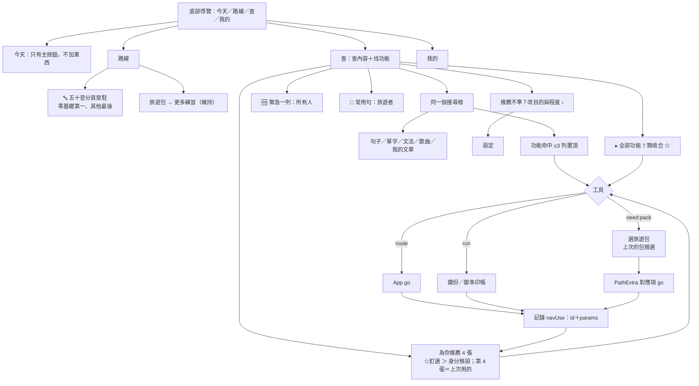

# 10 修正後架構（已實作，jpq-v45）

## 流程圖

### 修正後的架構表
| 檔案 | 改動 |
|---|---|
| js/nav.js（新，跟 lookup 一起延遲載入） | `NAV.TOOLS`（7 類，約 30 項，不含舊模組）、`NAV.forMe()`、`NAV.search(q)`、`NAV.go(item)`（route／run／need:pack）、`NAV.note(id,params)`、`NAV.pin(id)` |
| js/lookup.js `home()` | 🆘（全員）→ 常用句（旅遊）→ 推薦 4 → 修正連結 → 全部功能收合；刪「其他工具」「實驗」；`results(q)` 最上面加功能命中 |
| css/lookup.css | `.lk-rec`、`.lk-all`、☆；≥44px、字 ≥13px、只用 tokens |
| js/path.js `tabs()` | 五十音一律在 main（零基礎 unshift、其他 push）；不再放進 rest |
| css/path.css | `.pa-tabs` 橫向捲動 |
| js/home.js | 刪 `.cl-entry`、`#st-cl` |
| js/core.js | **不改頂列**；只在 render() 掛 navUse 記錄（或由 NAV.go 自己記） |
| index.html | lookup 的 js 清單加 `js/nav.js`；`classic` 維持轉址 |
| challenge／town／drill／practice／travel.js | navParent 改 path（P2） |
| sw.js | jpq-v45 |

實作差異：biz-read 需要文章 id，「商務閱讀」改為 run（開商務頁並捲到文章區）；「閱讀」合併我的文章（read sec:art）；查頁搜尋字改存歷史紀錄；「上次用的」已在推薦內時原位改成帶參數的上次卡。
