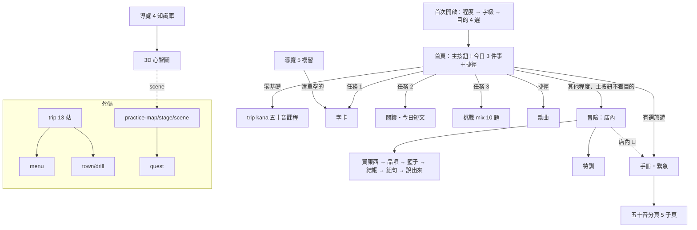

# 評審 v8：總指揮架構分析（產品×架構×遊戲設計）

- 評估對象：e718ab9（sw.js v37），2026-11-18。
- 方法：
  - 讀過 CONTRACT、index.html、評審 v3／v4／v6／v7 彙整與 v7 修正 H／R／T、世界資料格式、市售 APP 分析、驗收報告 v2，以及 git log（38 個提交）。
  - 讀過 js/ 共 23 支（13,505 行，1.02MB），用 node 統計 data/ 的內容量。
- 實測環境：本機 `python -m http.server 8797`，無頭 Chrome，畫面 375×812。每輪都清空存檔並略過 Service Worker。
  - 驅動腳本：`D:\reviewtmp\v8-cmd\d.mjs`
  - 截圖：`D:\reviewtmp\v8-cmd\*.png`
- 實測範圍：4 種目的 × 不同程度，共 5 條主路徑。另把 20 個路由逐一跑過。整個過程 console 0 錯誤。

---

## 1. 一句話診斷與分數

**一句話：這不是一個 App，而是 4 個平行開發的小 App（冒險、閱讀歌曲、知識庫挑戰、舊旅程字卡）共用一條底部導覽。它們沒有共同的「學習單位」和「進度」，「學日文的目的」也沒有真的決定使用者走哪條路。所以每次修補只會讓某一塊變好，整體的「簡單」和「想再來」上不去。**

| 面向 | 分數 | 理由（摘要） |
|---|---|---|
| 簡單明瞭 | **5.5** | 首頁只有 8 個主要按鈕，算好；但一進到功能頁就變成儀表板：店內第一屏約 30 個可點、手冊 126 個、歌曲頁 288 個、知識庫 36 個、心智圖 54 個 |
| 想玩下去 | **6** | 店內擬真、熱門歌曲＋MV 有吸引力；但沒有「今天學完什麼、明天回來做什麼」的主線。XP、御朱印、星星、連勝各自計算 |
| 真的學到 | **5** | 沒有「學過→複習」的閉環：SRS 只收答錯或手動加入的字；挑戰、字卡、知識庫、冒險的「學會」互不相通；新聞與歌詞的斷詞、文法偵測仍會教錯 |
| 架構健康度 | **3** | 32 個路由，約 1/3 是沒有入口的舊路由；首次載入同步抓 1.36MB、36 個請求；SW 預先快取 84 檔、5.85MB；至少 6 種詞彙格式、10 個以上的進度儲存 |
| 可維護性 | **3** | 只靠全域變數，沒有模組系統、型別或建置；git 歷史從沒刪過任何檔案；每輪修正都在加「橋接」程式（例如挑戰→知識庫同步、字卡→不會清單同步） |

---

## 2. 功能版圖

### 2.1 路由與模組總表（32 個 `App.register`）

標記說明：**核心**＝某個目的的主循環；**支線**＝有用，但不是主循環；**重複**＝與其他功能教一樣的東西、進度卻分開記；**死碼**＝現行介面沒有入口，或只靠舊路由才進得去。

| 路由 | 模組（大小） | 入口 | 標記 | 學什麼 | 進度存在哪 |
|---|---|---|---|---|---|
| `home` | home.js 23K | 導覽 1 | 核心殼 | — | `daily.tasks` |
| `settings` | home.js | ⚙️ | 支線 | — | `profile`、`ui` |
| `play` | world.js 93K＋world-quest 45K＋world-art 66K＋phrase 41K | 導覽 2、首頁主按鈕 | **核心（旅遊）** | 店內組句、品項詞、看板 | `world.{stamps,dex,zones,goals,cards,…}`、`cleared['w:…']` |
| `event` | world-quest.js | 店內 | 支線 | 狀況題（**讀取舊的 TravelData**，world-quest.js:433） | `cleared` |
| `read`、`read-article` | reader.js 43K＋jp-text 74K＋link-import 23K | 導覽 3、今日任務 | **核心（新聞）** | 新聞、自編短文、點詞查詢 | `read.done`；使用者字典寫在 localStorage `jpq.read.udict`，不在存檔內 |
| `songs`、`song` | songs.js 58K | 首頁捷徑、閱讀分頁 | **核心（歌曲）** | 歌詞逐句、填空 | `songLast`、`cleared`；偏好寫在 localStorage `jpq.song.pref` |
| `kb`、`kb-page`、`mind` | kb.js 48K | 導覽 4 | 支線（參考書） | 8,034 詞、727 文法 | localStorage `jpq.mind.v1`，**不在 App.state 內，備份帶不走** |
| `mind3d` | mind3d 66K＋mind-game 25K＋vendor 1.4MB | 知識庫內 | **重複／實驗** | 同上，另有 202 個任務 | `jpq.mind.v1` |
| `challenge`、`challenge-play` | challenge.js 41K | 首頁捷徑、今日任務 | **核心（日檢）** | JLPT 題型 | `chal.m`（**用陣列索引當 id**，challenge.js:3）＋同步到 `jpq.mind.v1` |
| `review` | review.js 34K | 導覽 5 | 核心（但只複習錯題） | 不會清單 | `tracked`（1→3→7 天） |
| `cards` | practice.js 90K 的一部分 | 首頁捷徑、今日任務 1 | **重複** | 五十音、N5–N1 詞、場景詞、句卡、形容詞、諺語 | `cardDiff`、`cardDay`，另外橋接到 Tracker（practice.js:455-462） |
| `phrasebook` | phrasebook 33K＋kana-lesson 35K | 旅遊快查、首頁捷徑、店內 📖 | 核心工具（旅遊）＋**重複**（五十音分頁） | 必備句、緊急、五十音講義與小考 | `lastDone.kana` |
| `boot`、`boot-play` | drill.js 35K＋drills 41K | 冒險地圖頁 | 支線／**重複** | 店員問句聽解、看板、量詞 | `drill` |
| `trip`（kana:1） | travel.js 29K | 零基礎主按鈕、五十音課程 | **重複**（五十音第 3 個入口） | 五十音課程 | `kanaL`、`kanaDay` |
| `trip`（非五十音）、`trip-stop`、`trip-event`、`trip-next` | travel.js＋travel*.js 200K | 沒有入口 | **死碼** | 舊東京 13 站 | `trip.runs` |
| `menu` | practice.js＋menus.js 64K | 只有 trip-stop 進得去 | **死碼** | 舊情境小遊戲 | `sit` |
| `practice-map`、`stage`、`practice`、`scene` | practice.js | 只有舊路由互相連 | **死碼** | 舊練習地圖（**畫面上仍有一本「御朱印帳 0/16」**，冒險的是 0/49） | `sceneDone` |
| `town`、`drill` | town.js 39K | 只有舊路由 | **死碼** | 舊單字測驗／對話 | `sceneDone` |
| `map`、`quest` | quest.js 27K | 轉址／沒有入口 | **死碼** | 舊關卡 | `cleared` |
| 根目錄 `日文講義.html`、`50音訓練表.html` | 40K | SW 有快取，沒有入口 | 死碼（內容已併入 kana-lesson） | — | — |

**數量**：
- 32 個路由裡，有現行入口的約 19 個，死碼約 13 個。
- 死碼和只靠舊路由才用得到的資料，**都在首頁同步載入**（index.html:35-56）：quest、town、practice、travel、menus、travel-ext、travel-stops、scenes ×3、loan（只有閱讀用）。合計約 **800KB**。

### 2.2 重疊的對照（同樣的東西，在幾個地方學、記幾份進度）

| 學習內容 | 出現的地方 | 進度是否打通 |
|---|---|---|
| 五十音 | ① 零基礎主按鈕 `trip{kana}`（travel.js）② 今日任務「翻 10 張五十音字卡」（practice.js）③ 今日任務「五十音小練習」（kana-lesson 小考）④ 手冊的五十音分頁（表、濁音、拗音、講義、練習，共 5 子頁）⑤ 字卡的平、片、濁 3 副牌 ⑥ 根目錄 2 個舊 HTML | ❌ 分別記在 `kanaL`、`cardDiff`、`lastDone.kana`、`kanaDay`，只有加入不會清單的 id 一致 |
| 單字 | 冒險的品項與看板、場景單字（SCENES 442 詞）、字卡 N5–N1、挑戰、知識庫、心智圖、閱讀點詞、歌詞點詞、特訓量詞 | ❌ 場景詞只有 185／442 也在 MIND 詞庫裡；知識庫 id 是 `w:N5:12`（索引），挑戰是 `w`＋索引，Tracker 與字卡用 `word:<jp>`，冒險句卡用 jp 當 key |
| 句子 | 冒險組句、句卡 🃏（`world.cards`）、手冊、SCENES 會話句 299 句、特訓店員問句 194 種說法、舊 trip 狀況題 | ❌ 句卡、手冊、Tracker 是三份不同的清單 |
| 文法 | 知識庫（727 條）、挑戰的文法題、閱讀的「本文文法」、心智圖任務、冒險的禮貌層級切換 | 🟡 v7 補了挑戰→知識庫的單向同步；閱讀和冒險沒有接上 |
| 複習 | 「複習」分頁（只收不會清單）、字卡自評、挑戰重玩、心智圖任務 | ❌ 只有 Tracker 有排程（1→3→7 天，core.js:550-556）；**學過、答對的東西永遠不會排進複習** |
| 獎勵 | XP、Lv（頂列）、程度（zero–n1）、JLPT 等級（挑戰）、星星、御朱印（冒險 49 間＋舊 16）、頭像、連勝、每日 3 件事、店內「今天想做的事」 | 🟡 XP 有統一；其他各記各的。光「等級」就有 Lv、程度、N 級三套 |

### 2.3 使用者實際會走的路徑（實測）



**實測數據（清空存檔、375px）**：

| 目的×程度 | 首頁主按鈕去哪 | 首頁到「學到第一個東西」 | 主循環實測 |
|---|---|---|---|
| 旅遊×零基礎 | 五十音課程 | 4 次定位＋1 次 ＝ **5 次點擊**看到「あ」 | 五十音一組 5 字（好）；但同一天首頁還有另外 2 個五十音任務，各走不同模組 |
| 旅遊×N5 | 冒險・上野便利商店 | 5 次看到店員句與一句「馬上說」；**13 次**才組出並說出第一句（買東西→お茶→放進籃子→去結帳→繼續→これを→お願いします→說出來） | 店內第一屏約 30 個可點；一個子目標約 10 次點擊；蓋印要累計完成 2 件事 |
| 日檢×N3 | **冒險・新宿燒肉店**（目的被忽略） | 任務 3「N3 挑戰一輪」：5 次就出題 | 日檢的主循環（挑戰）不在底部導覽；知識庫在導覽上，但只能查 |
| 工作×N2 | **冒險・東山日式旅館** | 沒有商務內容（data 中 0 篇商務短文，0 個商務場景） | 目的選項寫「敬語、Email、開會」，實際做不到 |
| 歌曲動漫新聞×N4 | **冒險・原宿咖啡廳** | 捷徑「歌曲」5 次；第一首熱門歌 6 次，但顯示「這部影片不允許嵌入播放」（夜に駆ける） | 歌曲頁 288 個可點；斷詞仍出現「溶｜と｜けて」 |

- **入口數**：首頁可點 8 個＋頂列與導覽 8 個＝16 個（CONTRACT 定的是 ≤10）。四種目的的使用者看到的首頁，只差主按鈕的目的地和一顆「旅遊快查」。
- **目的的實際作用**：全站只有 `home.js:74`（`travel`）讀 `profile.goals`。`exam`、`work`、`fun` **完全沒有效果**。另外 core.js:22 在沒選時預設成 `['travel']`。
- **首次載入**：同步 36 個請求、**1.36MB**（未壓縮），其中約 1.2MB 首頁用不到。9 支 CSS 全部預先載入。SW 安裝時再抓 84 檔、**5.85MB**（v3 評審 #21「只快取外殼約 300KB」至今未做）。
- **console**：20 個路由與 5 條路徑都是 0 錯誤（這是優點）。

---

## 3. 根本問題（7 個）

### RP1. 沒有「學習單位＋單一進度」：App 在記錄活動，不是在累積學會的東西
**證據**
- 詞彙至少有 6 種格式：SCENES 物件 `{jp,kana,romaji,zh,hint,emoji}`、MIND 陣列 `[jp,kana,zh,pos,grp,wh,sc,core]`、世界品項、`dict-news` 的「表層｜讀音｜…」字串、DRILLS、舊 travel 的位置陣列（CONTRACT.md:118 還在相容）。
- 進度存成 ≥12 份：
  - App.state 內：`tracked`、`cardDiff`、`chal.m`、`world.*`、`read.done`、`drill`、`kanaL`、`lastDone`、`sit`、`sceneDone`、`trip.runs`。
  - App.state 外（localStorage）：`jpq.mind.v1`、`jpq.read.udict`。
- **備份只序列化 App.state**（core.js:601-603），所以知識庫的掌握狀態、使用者字典都不會跟著備份。
- id 不一致：知識庫用 `w:N5:12`，挑戰用 `w`＋陣列索引（challenge.js:3）。只要重建詞庫，索引一位移，進度就錯置。
- SRS 只排「不會清單」（core.js:533-562）；挑戰、字卡、冒險答對的東西不會進入複習。
- 評審連續三輪都在這裡：
  - v6 #21：字卡自評與不會清單兩套。
  - v7 #10：挑戰沒有回寫知識庫，N4 文法答對 8 題後，知識庫仍是 0／804。
  - v7 02 號評審：任務 1 被複習吃掉。

**為什麼逐項修補解決不了**：每打通兩個模組就要寫一條橋（practice.js:455 字卡→Tracker、challenge.js:58 挑戰→知識庫），N 個模組需要 N² 條橋。而且「學會」的定義在每個模組都不一樣：自評簡單、連對 3 次、答對 1 題就 learned。只要沒有單一的 Item＋Progress，「真的學到」就無法量化，首頁也排不出「今天該學什麼」。

### RP2. 「目的」只是問卷，沒有決定資訊架構
**證據**
- `profile.goals` 只在 home.js:74 用到。
- 實測 N3 日檢、N2 工作、N4 歌曲三種人，主按鈕都送去冒險的店（燒肉店、日式旅館、咖啡廳）。
- 今日 3 件事的組合寫死成 `[rev|cards, read, kq|chal]`（home.js:33），不看目的。
- 底部導覽依「模組」分（冒險／閱讀／知識庫／複習），不是依「我要做什麼」分。
- 評審 05 旅客：「首頁仍是學習導向」「N5–N1 挑戰是噪音」。評審 06 N1：「同 2 篇短文一直重複」。

**為什麼逐項修補解決不了**：v7 的做法是「旅遊加一顆快查」，等於在同一個首頁上逐一加條件。目的每多一個，首頁就多一層 if，按鈕也跟著變多，簡單明瞭的分數反而下降。真正的解法是：**目的決定主循環，主循環決定首頁與導覽**，而不是在首頁上加按鈕。

### RP3. 功能版圖只增不減：同一件事有 3–6 個入口，13 個死路由仍然載入
**證據**
- 五十音 6 處（2.2 節）；舊旅遊世界 2 套（trip 13 站、practice-map 16 印）與新冒險 49 店並存。
- CONTRACT.md:114 寫著舊模組「仍可用，非主要入口」。
- `git log --diff-filter=D` 是空的：**38 個提交、約 9.5 萬行新增，沒有刪過任何一個檔案**。
- 評審 01 長輩：「手冊五十音分頁仍有…7 顆」。v6 #22 和 v7 都在處理「五十音入口太多」。

**為什麼逐項修補解決不了**：每輪修補都是「藏一個入口」，模組本身還在，還在吃載入量、維護成本與測試面。只要評審點到它，它就會回來。只有刪除或合併，才會讓分數真的往上走。

### RP4. 每一頁都是儀表板：缺少「一次只做一件事」的活動框架
**證據**
- 可點元素：店內第一屏約 30、手冊 126、歌曲 288、心智圖 54、設定 41、知識庫 36。
- 店內同一屏同時有：看板、16 個區域、店員句、「馬上說一句」、3 個動作、今天想做的事、御朱印、挑戰、句卡、手冊。
- 評審 05：「每段開頭重複 いらっしゃいませ ➜ 繼續」。驗收 v2：「一站約 80 次點擊」。

**為什麼逐項修補解決不了**：這是互動模型的問題，不是版面問題。市售 APP（03-介面種類）的共同做法是「課程或關卡 → 全螢幕單一活動（卡片、選擇、拼字塊…）→ 結算」。本站每個模組各自發明互動，所以無法共用「一題一屏、結算、回首頁」的節奏。調字級、收合面板只是在搬家具。

### RP5. 系統邊界劃錯：在前端即時解析任意網路內容，正確率要靠排除表追
**證據**
- jp-text.js 74K 加 dict-news 106K，在瀏覽器裡斷詞並偵測文法。
- 新聞透過第三方代理 `r.jina.ai` 抓取，歌詞透過 LRCLIB，影片用 YouTube 嵌入（link-import.js）。
- v6 #2、#3 和 v7 P0-3、P0-4 都是斷詞／文法誤判或時間軸錯誤；修正 T 新增 60 個詞與一張排除表。
- 實測熱門歌第 2 首就無法嵌入播放，斷詞仍有「溶｜と｜けて」。

**為什麼逐項修補解決不了**：開放領域的日文斷詞是 MeCab 等級的問題，用手寫字典加規則只會無限追錯。對「真的學到」來說，**教錯比沒教更傷**。正確的邊界是：精選內容在建置時就斷好詞、人工校對過才上線；任意網址匯入降級成「實驗工具」，並明白標示「自動分析可能有誤」。

### RP6. 程式架構是全域腳本堆，同步全載，靠人工契約維持
**證據**
- index.html:35-62 同步載入 23 支腳本；全部模組靠 `window.*` 互相呼叫。
- CONTRACT.md:4 規定「不得直接改 localStorage」，但 jp-text.js:413/766、songs.js:67-72、kb.js:17 都直接寫。
- SW 的 FILES 清單手動維護（84 項、5.85MB），每次改版都要手動把 VERSION 加 1。
- 資料是可執行的 JS（`SCENES.push`、`WORLD.pack`），沒有結構描述（schema），只有世界資料有 check-world。
- v3 的 A／B／C／D 分組各自擁有檔案（00-改版計畫 §4），結果產出 4 套 UI 語彙：class 前綴 `hm- wd- kb- mm- pb- rv- dr- ch- kn- trip- …` 共 15 種以上。

**為什麼逐項修補解決不了**：載入量、快取、狀態一致性都是「全域」性質。在全域腳本堆裡，任何一個修正都可能牽動其他模組（例如 v34 的 `today()` 漏呼叫，讓所有獎勵失效）。沒有模組邊界和單一 store，可維護性停在 3 分。

### RP7. 評審與修正的迴圈本身在製造區域最佳化
**證據**
- 分數：v3 5.8／4.8 → v6 5.0／5.5 → v7 5.7／6.2，每輪只進步 +0.4～0.7。
- 同一題反覆出現：
  - 羅馬字：v3 #8、v6 #8、v7 #2。
  - 今日任務：v3 #1、v6 #20、v7 #5。
  - 五十音入口：v6 #22、v7。
  - 進度不連動：v6 #21、v7 #10。
- 大項一直寫「另案」（v6「未做」、v7 #11、#12）：商務內容 0、N1 讀解、JLPT 準備度。
- 4 天 38 個提交，單一提交最多改 1.6 萬行（6ac2326）。

**為什麼逐項修補解決不了**：修正清單由 6 位評審的 bug 合併而成，天生偏向「看得到的小錯」。結構性的缺口（RP1、RP2、RP4）不會被寫成一條可修的 bug，所以永遠排不進 P0。

---

## 4. 目標架構

### 4.1 資訊架構

**底部導覽改成 4 鈕，依「做什麼」分，不依模組分**：

| 鈕 | 名稱 | 內容 |
|---|---|---|
| 1 | **今天** | 唯一的主按鈕「開始今天（約 8 分鐘）」＝**今日課**佇列（見下），加連勝與今日進度。可點元素 ≤5 |
| 2 | **路線** | 依目的切換主循環（下表）。多目的的人用頂部分頁切換，預設是第一個目的 |
| 3 | **查** | 依目的切換工具：旅遊＝快查手冊（緊急置頂）；日檢、工作＝字典與文法（原知識庫的查詢部分）；歌曲新聞＝我的文章與歌曲庫。全部共用一個搜尋框 |
| 4 | **我的** | 複習統計（單一 SRS）、已學會清單、御朱印與成就、設定 |

**今日課（Today queue）**：由單一 SRS 算出，每天固定、可完成、會打勾。
1. 到期複習 ≤15 張：所有來源都進同一個佇列。
2. 新學 5–8 個：取自目的路線的下一個單元。
3. 1 個「應用」：旅遊＝1 個店內子目標；日檢＝5 題 JLPT 題型；歌曲＝1 段歌詞跟唱；新聞＝1 篇分級短文。

結算畫面只有一個：學會 N 個、明天到期 M 個，再加連勝。

### 4.2 每種目的的主循環

| 目的 | 路線單位 | 主循環（≤10 分鐘，≤15 次點擊） | 用到的活動 |
|---|---|---|---|
| 旅遊 | **場景包**：便利商店、拉麵、車站、飯店、緊急…，對應冒險的店型 | 學 6–8 句（卡片＋語音）→ 店內演練 1 個子目標（冒險引擎，只顯示當前目標相關的區域）→ 收進快查收藏 → SRS | 卡片、拼字塊、聽選、店內模擬 |
| 日檢 | **等級單元**：N5→N1，每單元 20 詞＋3 文法，取自 MIND 並重排 | 學 → JLPT 題型 5–10 題 → 單元測驗 → 每週模擬考 | 卡片、選擇、重組、讀解 |
| 工作 | 未有內容前**不提供選項**（或標「即將推出」，並導到日檢 N3／N2 的敬語單元） | — | — |
| 歌曲新聞 | **分級精選庫**：每篇或每首都事先斷詞、校對，標 N 級 | 讀或唱 1 段 → 點詞「收進 SRS」→ 3 題理解 | 閱讀器、歌詞播放器、卡片 |

零基礎不分目的，先走「五十音路線」（單一模組，取代現在的 6 處）。學完自動切到目的路線。

### 4.3 統一學習資料模型

```js
// 內容（建置產出，唯讀）：content/items/*.json
Item = { id: 'v:食べる', type: 'kana'|'vocab'|'phrase'|'grammar', jp, kana, zh, lv: 'N5', romaji /*建置時算*/,
         tags: { scene:['eat'], goal:['travel','exam'] }, ex: [{jp, zh}], audio? }
// id 規則：以內容為鍵（kana:あ、v:<辭書形>、p:<句子正規化>、g:<句型>），不用陣列索引
Unit = { id: 'travel/konbini', goal, lv, items: [itemId…], practice: {activity, params} }

// 進度（唯一一份，在 App.state.learn，跟著備份與雲端）
Progress[itemId] = { s: 'new'|'learning'|'review'|'mastered', due, stab, diff, reps, lapses, last, src }
Learn.record(itemId, grade /*0-3*/, ctx)   // 所有活動只呼叫這一個
Learn.queue(goal) -> { due:[…], fresh:[…], apply }   // 今日課
```

- 「不會清單」改成一個檢視：`lapses>0` 或使用者加星號的項目，不再有獨立的儲存。
- 知識庫的「已掌握」就是 `s>=review`；挑戰的「已掌握」就是 grade。兩者自然同步，**所有橋接程式都刪掉**。
- 舊存檔遷移：`tracked`、`cardDiff`、`chal.m`、`jpq.mind.v1`、`world.cards` → `learn`，只做一次。

### 4.4 模組邊界

```
core/   router、store（App.state＋migrate＋備份）、learn（SRS＋Item 索引）、ui（modal/toast/result）、tts
shell/  today、path、lookup、me
activities/  flashcard、choice、wordbank、listen、reader、lyrics、shop-sim（冒險引擎降級為一種活動）
content/  依目的、等級分塊的 JSON，延遲載入
```

每個活動只實作 `start(el, {items, params}) → Promise<{results:[{id,grade}]}>`，由 shell 負責結算與 `Learn.record`。這樣「一題一屏、結算、回今天」的節奏會全站一致。

**刪除或合併清單**：

| 動作 | 對象 |
|---|---|
| 刪除 | quest.js、town.js；practice.js 的 practice-map、stage、scene、menu；travel.js 的 13 站（trip-stop／event／next）；data/menus.js、travel-ext.js、travel-stops.js（狀況題先遷進世界資料）；根目錄 2 個舊 HTML |
| 合併 | 五十音：travel kana＋kana-lesson＋字卡假名副牌 → 單一「五十音路線」 |
| 合併 | drill.js 特訓 → 旅遊路線的 listen 活動 |
| 合併 | challenge.js → 日檢路線的 choice 活動＋模擬考 |
| 合併 | 字卡 → flashcard 活動（不再是獨立頁） |
| 降級 | mind3d、mind-game、vendor 1.4MB → 從主程式移除，另存成實驗頁或直接刪除 |
| 降級 | link-import（任意網址、YouTube 匯入）→「查」裡的實驗工具 |

### 4.5 內容管線

```
content-src/（CSV／YAML，人寫）→ tools/build.mjs（schema 驗證、羅馬字與讀音生成、
  精選文章與歌詞離線斷詞＋人工校對檔、分級、交叉去重：場景詞⇄MIND 詞庫）→ content/*.json（分塊、加雜湊）
→ tools/test-*.mjs（羅馬字、斷詞、文法回歸）＋ CI 預算（首次載入 ≤300KB）
```

- 執行時不做開放領域 NLP，jp-text 只用於「實驗匯入」。
- SW 的快取清單由建置自動產生：預快取只放外殼，內容用過才快取。

---

## 5. 重構路線圖（每階段都能上線、能驗證）

### 階段 1：止血、統一進度、目的驅動首頁（約 5–7 個工作天）
**要做**
1. 新增 `js/learn.js`（Item 索引轉接層＋單一 Progress＋FSRS-lite 排程＋遷移）。先**不改內容格式**，用轉接器把 SCENES、MIND、world、kana 轉成 Item。
2. Tracker、cardDiff、challenge setMastery、kb ST、world.cards 全部改呼叫 `Learn.record`；`jpq.mind.v1` 搬進 App.state。刪除 practice.js:455-462 與 challenge.js:58-80 的橋接。
3. home.js 改成「今天」頁：主按鈕＝今日課（依 `goals[0]`），不再有捷徑列。目的選項拿掉「工作」，或改標「即將推出」。
4. index.html 只同步載入 core、learn、home 和 tokens／app.css。其他全部改用 `App.lazy`。
5. **從入口與載入清單移除**死碼路由（13 個；檔案可以先留在 git 歷史）。
6. 改寫 sw.js：只預快取外殼，其餘用執行期快取。

**要改的檔案**：core.js、新 learn.js、home.js、review.js、practice.js、challenge.js、kb.js、world.js、index.html、sw.js、CONTRACT.md。

**驗收指標**
- 首次載入 ≤350KB、≤15 個請求（現在 1.36MB／36 個）；SW 預快取 ≤400KB（現在 5.85MB）。
- 首頁可點元素（含導覽）≤10（現在 16）。
- 4 種目的的主按鈕各自進到對應的主循環（現在 4 種都去冒險）。
- 字卡、挑戰、知識庫、複習對同一個字顯示同一個狀態；備份檔包含全部進度。
- 舊存檔遷移後，XP 與星星不變。
- 6 位評審重測：簡單明瞭 ≥6.8。

### 階段 2：路線＋活動框架＋刪除重複（約 2–3 週）
**要做**
1. 建 `activities/`（flashcard、choice、wordbank、listen、shop-sim）與統一結算。
2. 建「路線」頁：旅遊場景包（由 49 間店依店型歸成約 14 包）、日檢 N5–N3 單元、五十音路線。
3. 冒險引擎降級為 shop-sim 活動：只給目前單元的子目標，第一屏 ≤12 個可點。
4. 合併或刪除：五十音 6 處→1 處；drill→listen；challenge→日檢路線；字卡頁→flashcard；mind3d 移出主程式；刪除 quest、town、menus、travel 13 站與相關資料。
5. 底部導覽改成 今天／路線／查／我的。

**要改的檔案**：新 js/activities/*、js/path.js、js/lookup.js、js/me.js；world*.js 拆分；刪除 quest.js、town.js、travel.js（大部分）、practice.js（大部分）、drill.js、challenge.js（併入）、mind3d.js、mind-game.js。

**驗收指標**
- 每種目的：首頁到學到第一個新東西 ≤2 次點擊（不含定位），一個單元 ≤15 次點擊、≤10 分鐘。
- 路由數 ≤12（現在 32）；任一頁可點元素 ≤25（歌曲的歌詞列除外，改用虛擬清單或分段）。
- JS 總量 ≤600KB（現在 1.02MB＋vendor 1.4MB）。
- 評審重測：簡單明瞭 ≥7.5、想玩下去 ≥6.8。

### 階段 3：內容管線與沉浸內容（約 3–4 週）
**要做**
1. 建 `content-src/`＋`tools/build.mjs`（schema、去重、羅馬字、分塊、SW 清單自動產生）。
2. 分級精選閱讀：N5–N1 各 ≥10 篇，事先斷詞並人工校對。
3. 精選歌曲 20 首：固定 LRC 版本與可嵌入的影片來源。
4. 日檢 N2／N1 單元與題庫，讀解題幹改用日文。
5. 任意網址匯入降級成標示清楚的實驗工具。
6. 工作內容只在備齊 ≥6 個場景包時才開放這個目的。

**要改的檔案**：tools/*、content-src/*、content/*；reader.js、songs.js 改讀預先處理過的內容；jp-text.js 只留給實驗匯入。

**驗收指標**
- 精選內容斷詞與文法回歸錯誤率 ≤1%（以 249 句以上的語料測）。
- 評審重測：**簡單明瞭 ≥8、想玩下去 ≥7、真的學到 ≥7**。
- 7 日留存的代理指標：連續 3 天完成今日課的比例（以本機統計或評審模擬）。

---

## 6. 不該做的事（停損清單）

1. **不要再在首頁加按鈕或條件分支**（例如快查、繼續唱、各目的捷徑）。首頁只能有今日課。
2. **不要再寫模組之間的同步橋**（例如 X 的成績回寫 Y）。一律改走 `Learn.record`。
3. **不要再擴充手寫斷詞字典和文法排除表**來追新聞、歌詞的誤判。精選內容改成離線校對；任意匯入接受「可能有誤」。
4. **不要再新增世界地區、店家或 3D 心智圖功能**。現有 49 間店已經超過學習路線能消化的量。
5. **不要在單一目的的主循環能閉環之前，承諾新的目的**（工作、遊學）。
6. **不要「藏入口但留模組」**。不用的就刪掉，git 歷史就是備份。
7. **不要用 6 位評審的 bug 合併清單當主要排程**。每輪先檢查本文第 5 節的指標，bug 修正只佔每輪的 30% 以內。
8. **不要一次大改版**（像 6ac2326 一次 1.6 萬行）。照上面 3 個階段走，每階段都要能上線、能量測、能回退。
9. **不要再增加獎勵種類**（印、星、頭像、等級）。先把現有的 Lv、程度、N 級三套「等級」收斂成兩個：程度（N 級）＋連勝與 XP。
